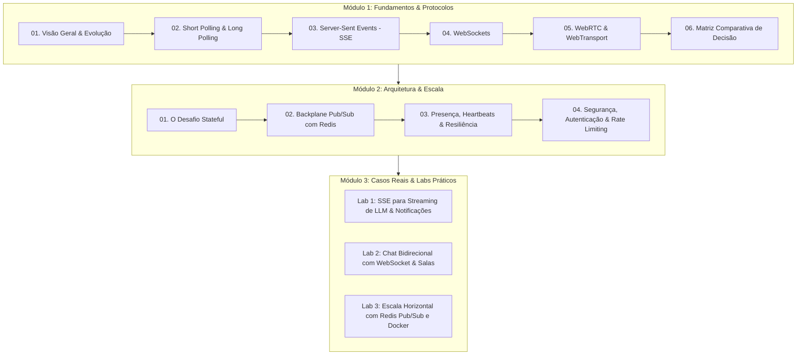

# 🚀 Estudo Aprofundado: Comunicação em Tempo Real na Web

Guia de estudos e repositório prático sobre técnicas, arquiteturas e protocolos de comunicação em tempo real (*real-time web*).

---

## 🗺️ Mapa da Trilha de Aprendizado

---

## 📚 Índice da Documentação

### Módulo 1: Fundamentos & Protocolos
- [01. Visão Geral e Evolução da Web em Tempo Real](file:///mnt/c0b6217c-c2f3-4c1f-8ba2-c8d177f718a9/development/professional/estudo-comunicao-em-tempo-real/docs/01-fundamentos/01-visao-geral-e-evolucao.md)
- [02. Short Polling vs. Long Polling](file:///mnt/c0b6217c-c2f3-4c1f-8ba2-c8d177f718a9/development/professional/estudo-comunicao-em-tempo-real/docs/01-fundamentos/02-short-polling-vs-long-polling.md)
- [03. Server-Sent Events (SSE)](file:///mnt/c0b6217c-c2f3-4c1f-8ba2-c8d177f718a9/development/professional/estudo-comunicao-em-tempo-real/docs/01-fundamentos/03-server-sent-events-sse.md)
- [04. WebSockets: Anatomia, Handshake e Framing](file:///mnt/c0b6217c-c2f3-4c1f-8ba2-c8d177f718a9/development/professional/estudo-comunicao-em-tempo-real/docs/01-fundamentos/04-websockets.md)
- [05. WebRTC e WebTransport](file:///mnt/c0b6217c-c2f3-4c1f-8ba2-c8d177f718a9/development/professional/estudo-comunicao-em-tempo-real/docs/01-fundamentos/05-webrtc-e-webtransport.md)
- [06. Matriz Comparativa: Qual tecnologia escolher?](file:///mnt/c0b6217c-c2f3-4c1f-8ba2-c8d177f718a9/development/professional/estudo-comunicao-em-tempo-real/docs/01-fundamentos/06-tabela-comparativa-e-quando-usar.md)

### Módulo 2: Arquitetura & Escala
- [01. O Desafio Stateful em Ambientes Distribuídos](file:///mnt/c0b6217c-c2f3-4c1f-8ba2-c8d177f718a9/development/professional/estudo-comunicao-em-tempo-real/docs/02-arquitetura-e-escala/01-o-desafio-stateful.md)
- [02. Backplane Pub/Sub com Redis](file:///mnt/c0b6217c-c2f3-4c1f-8ba2-c8d177f718a9/development/professional/estudo-comunicao-em-tempo-real/docs/02-arquitetura-e-escala/02-pubsub-com-redis.md)
- [03. Presença, Heartbeats & Resiliência de Conexão](file:///mnt/c0b6217c-c2f3-4c1f-8ba2-c8d177f718a9/development/professional/estudo-comunicao-em-tempo-real/docs/02-arquitetura-e-escala/03-gerenciamento-de-presenca-e-heartbeat.md)
- [04. Segurança, Autenticação e Rate Limiting](file:///mnt/c0b6217c-c2f3-4c1f-8ba2-c8d177f718a9/development/professional/estudo-comunicao-em-tempo-real/docs/02-arquitetura-e-escala/04-seguranca-autenticacao-e-rate-limiting.md)

### Módulo 3: Casos Reais & Laboratórios
- [01. Edição Colaborativa em Tempo Real: OT, CRDT, Persistência e Histórico](file:///mnt/c0b6217c-c2f3-4c1f-8ba2-c8d177f718a9/development/professional/estudo-comunicao-em-tempo-real/docs/03-casos-reais-e-padroes/01-edicao-colaborativa-ot-crdt.md)
- [02. Cursores Remotos e Atribuição de Autoria em Tempo Real](file:///mnt/c0b6217c-c2f3-4c1f-8ba2-c8d177f718a9/development/professional/estudo-comunicao-em-tempo-real/docs/03-casos-reais-e-padroes/02-cursores-e-presenca-colaborativa.md)
- [03. Estudo de Caso de Produção: Arquitetura do Overleaf (ShareLaTeX)](file:///mnt/c0b6217c-c2f3-4c1f-8ba2-c8d177f718a9/development/professional/estudo-comunicao-em-tempo-real/docs/03-casos-reais-e-padroes/03-estudo-de-caso-overleaf.md)
- [Lab 01: Server-Sent Events (SSE)](file:///mnt/c0b6217c-c2f3-4c1f-8ba2-c8d177f718a9/development/professional/estudo-comunicao-em-tempo-real/labs/01-sse-streaming/README.md)
- [Lab 02: WebSocket Chat com Salas e Presença](file:///mnt/c0b6217c-c2f3-4c1f-8ba2-c8d177f718a9/development/professional/estudo-comunicao-em-tempo-real/labs/02-websocket-chat/README.md)
- [Lab 03: Escala Horizontal Multi-Nó com Redis e Docker](file:///mnt/c0b6217c-c2f3-4c1f-8ba2-c8d177f718a9/development/professional/estudo-comunicao-em-tempo-real/labs/03-scale-redis-pubsub/README.md)
- [Lab 04: Editor Colaborativo em LaTeX estilo Overleaf (CodeMirror 6 + TeX Live + Fastify + PostgreSQL + Redis)](file:///mnt/c0b6217c-c2f3-4c1f-8ba2-c8d177f718a9/development/professional/estudo-comunicao-em-tempo-real/labs/04-collaborative-editor/README.md)

### Módulo 4: Kubernetes, Kind & GitOps com Argo
- [Guia Operacional: Subindo a Arquitetura no Kubernetes & Argo CD (k8s/README.md)](file:///mnt/c0b6217c-c2f3-4c1f-8ba2-c8d177f718a9/development/professional/estudo-comunicao-em-tempo-real/k8s/README.md)
- [01. Arquitetura Kubernetes & Kind: Do Monólito à Nuvem Elástica](file:///mnt/c0b6217c-c2f3-4c1f-8ba2-c8d177f718a9/development/professional/estudo-comunicao-em-tempo-real/docs/04-kubernetes-e-gitops/01-arquitetura-k8s-e-kind.md)
- [02. GitOps com Argo CD & Pipelines com Argo Workflows](file:///mnt/c0b6217c-c2f3-4c1f-8ba2-c8d177f718a9/development/professional/estudo-comunicao-em-tempo-real/docs/04-kubernetes-e-gitops/02-argocd-gitops-e-workflows.md)
- [Manifestos Kubernetes (k8s/base)](file:///mnt/c0b6217c-c2f3-4c1f-8ba2-c8d177f718a9/development/professional/estudo-comunicao-em-tempo-real/k8s/base/kustomization.yaml)
- [Argo CD Application (k8s/argocd)](file:///mnt/c0b6217c-c2f3-4c1f-8ba2-c8d177f718a9/development/professional/estudo-comunicao-em-tempo-real/k8s/argocd/application.yaml)
- [Argo Workflows LaTeX Template (k8s/workflows)](file:///mnt/c0b6217c-c2f3-4c1f-8ba2-c8d177f718a9/development/professional/estudo-comunicao-em-tempo-real/k8s/workflows/latex-compile-workflow.yaml)
