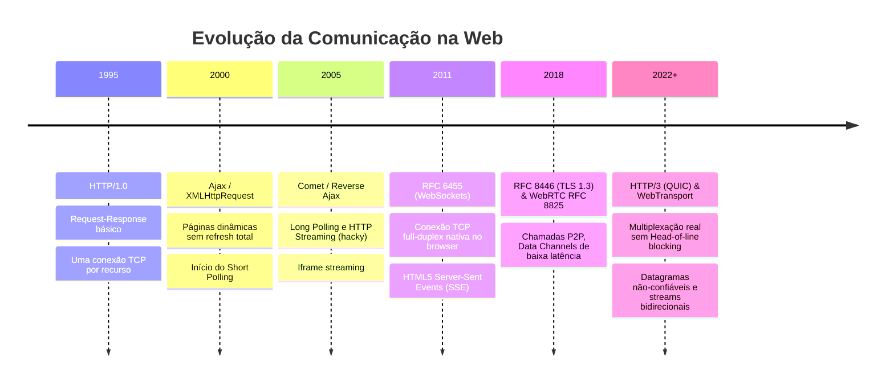

# 01. Visão Geral e Evolução da Web em Tempo Real

A web tradicional foi desenhada sobre o modelo **Request-Response (Requisição-Resposta)** do HTTP: o cliente pede algo, o servidor responde e a conexão é encerrada ou mantida ociosa em *keep-alive*. Esse modelo é inerentemente orientado a "pull" (o cliente sempre toma a iniciativa).

No entanto, aplicações modernas exigem comunicação orientada a **push** (o servidor notifica o cliente assim que um evento ocorre).

---

## ⏳ Linha do Tempo e Evolução

---

## 🔍 O Problema do HTTP Tradicional para Tempo Real

No HTTP/1.1 clássico:
1. **Iniciativa exclusiva do cliente**: O servidor não possui mecanismo nativo de enviar dados sem solicitação prévia.
2. **Overhead de Headers**: Toda requisição HTTP carrega centenas de bytes em cabeçalhos (`User-Agent`, `Cookies`, `Accept`, etc.). Para uma mensagem de 10 bytes (ex: "online"), enviar 800 bytes de headers consome muita banda e processamento.
3. **Latência de Handshake**: Conexões novas exigem Three-Way Handshake TCP (SYN, SYN-ACK, ACK) + Handshake TLS, gerando múltiplos *round-trips* (RTT).

---

## 🎯 As Categorias de Problemas em Tempo Real

Podemos classificar as necessidades em 3 grandes grupos:

### 1. Unidirecional (Servidor $\to$ Cliente)
- **Exemplos**: Notificações push no sistema, cotações de ações, placar de jogo, progresso de processamento, geração de texto token a token de IA (LLMs).
- **Candidato Ideal**: **Server-Sent Events (SSE)** ou Long Polling (quando SSE não for viável).

### 2. Bidirecional de Baixa Latência (Cliente $\leftrightarrow$ Servidor)
- **Exemplos**: Chat, ferramentas de desenho/edição simultânea (Figma, Google Docs), painel de controle operacional, jogos multiplayer leves.
- **Candidato Ideal**: **WebSockets**.

### 3. P2P ou Latência Ultrabaixa / Streaming Contínuo
- **Exemplos**: Videoconferência (Google Meet, Zoom Web), streaming de jogos via nuvem, canais de dados UDP peer-to-peer.
- **Candidato Ideal**: **WebRTC** ou **WebTransport**.

---

## 🧭 Próximos Passos

No próximo capítulo, analisaremos como o mercado resolvia isso antes do WebSocket e SSE com [02. Short Polling vs. Long Polling](file:///mnt/c0b6217c-c2f3-4c1f-8ba2-c8d177f718a9/development/professional/estudo-comunicao-em-tempo-real/docs/01-fundamentos/02-short-polling-vs-long-polling.md).
