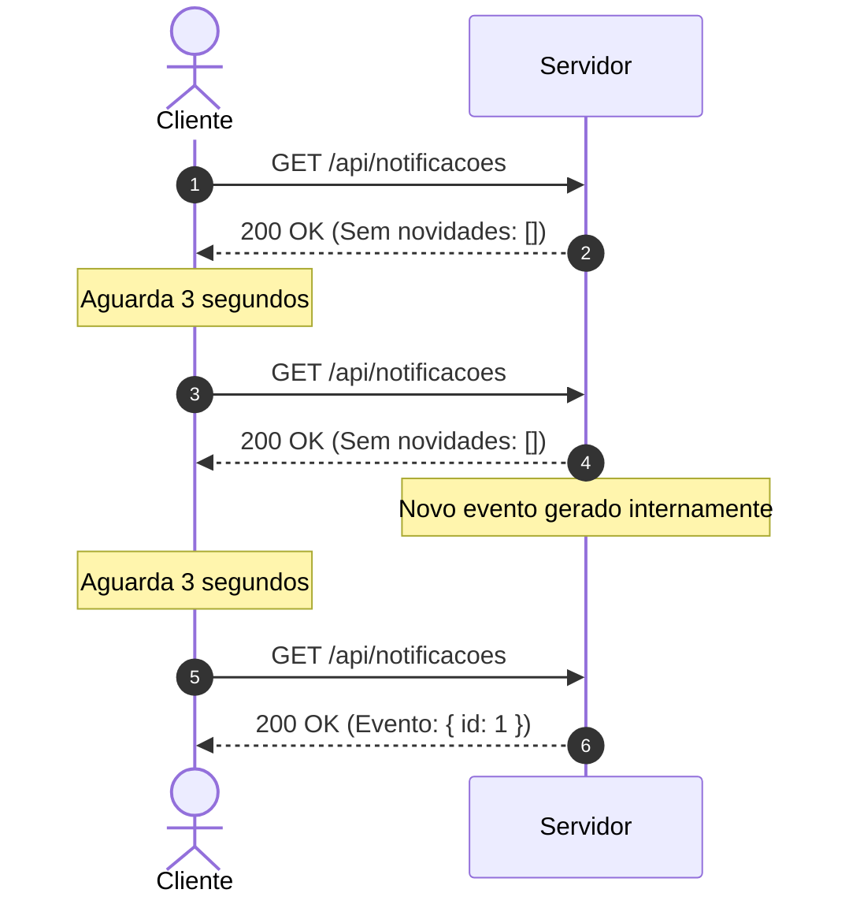
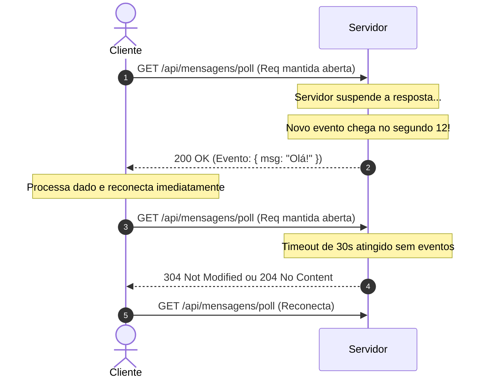

# 02. Short Polling vs. Long Polling

Antes da padronização de WebSockets e Server-Sent Events, os desenvolvedores utilizavam técnicas de **Polling** sobre HTTP para simular tempo real.

---

## 1. Short Polling (Polling Regular)

### Como Funciona
O cliente envia requisições HTTP regulares a um intervalo de tempo fixo (ex: a cada 2 ou 5 segundos) perguntando: *"Há novidades?"*. O servidor responde imediatamente com o dado (se houver) ou com um payload vazio.

### Vantagens
- **Simplicidade Absoluta**: Utiliza endpoints REST comuns.
- **Stateless**: Funciona perfeitamente atrás de qualquer Load Balancer padrão sem configuração especial.
- **Cache amigável**: Pode utilizar cabeçalhos `ETag` ou `If-Modified-Since`.

### Desvantagens
- **Desperdício de Recursos**: A imensa maioria das requisições retorna vazia.
- **Overhead**: Headers HTTP trafegam repetidamente.
- **Latência intrínseca**: Se o polling é a cada 5s e um evento ocorre no segundo 1, o cliente só saberá 4 segundos depois.

---

## 2. Long Polling (Comet)

### Como Funciona
O cliente faz a requisição HTTP. Em vez de responder de imediato, o servidor **segura a requisição aberta** (suspende a resposta) até que:
1. Um novo dado/evento esteja disponível, **OU**
2. Ocorra um *timeout* pré-estabelecido (ex: 30 segundos).

Assim que o cliente recebe a resposta (seja com dado ou por timeout), ele **imediatamente abre uma nova requisição**.

### Vantagens
- **Latência quase zero**: O servidor empurra o dado no momento exato em que ele ocorre.
- **Compatibilidade total**: Funciona em qualquer browser e com qualquer firewall ou proxy corporativo restritivo que bloqueie WebSockets.

### Desvantagens
- **Carga de conexões pendentes**: O servidor precisa manter milhares de requisições HTTP simultâneas abertas (exige servidores assíncronos não-bloqueantes como Node.js, Go ou Netty).
- **Sobrecarga de reabertura**: A cada mensagem entregue, uma nova conexão precisa ser negociada.
- **Problemas de ordem de mensagens**: Se conexões rápidas se cruzarem, pacotes podem chegar fora de ordem no cliente.

---

## 💡 Quando o Polling ainda é válido hoje?
- **Short Polling**: Verificação de status de processos em batch muito longos (ex: geração de um relatório PDF em background a cada 10s).
- **Long Polling**: Excelente estratégia de **fallback** transparente quando WebSockets são bloqueados por proxies corporativos (o que bibliotecas como o *Socket.io* fazem automaticamente).
