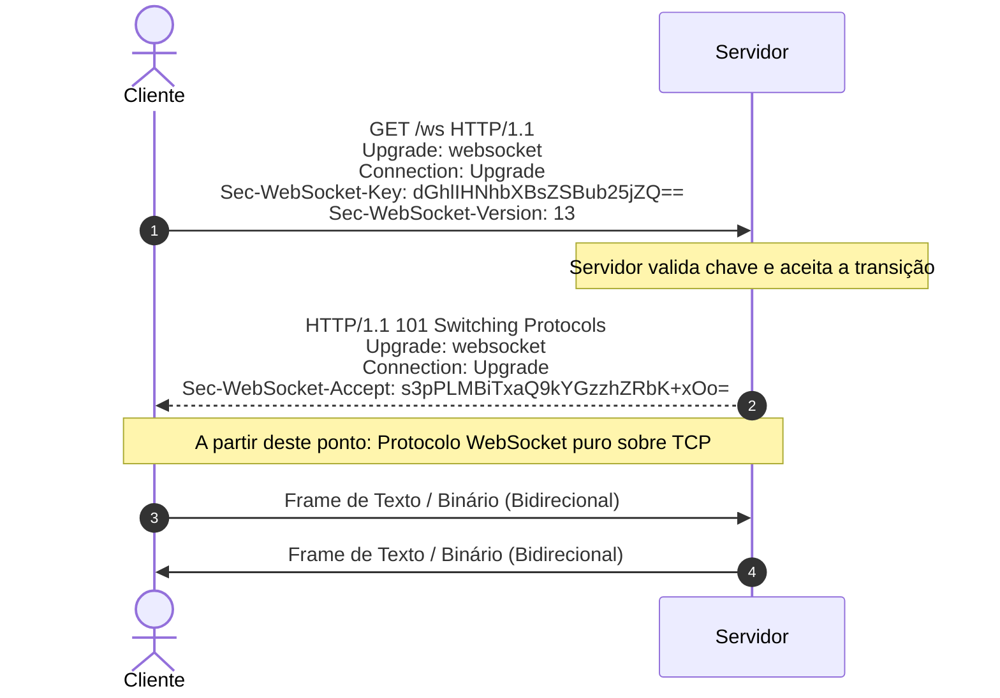

# 04. WebSockets: Anatomia, Handshake e Framing

O **WebSocket** (padronizado pela [RFC 6455](https://datatracker.ietf.org/doc/html/rfc6455)) é o padrão definitivo para comunicação **bidirecional e full-duplex** de baixa latência na web.

Diferente do HTTP tradicional, após a fase de handshake inicial, a conexão deixa de seguir o ciclo requisição-resposta e passa a ser um túnel TCP contínuo onde cliente e servidor podem enviar dados a qualquer momento, de forma independente.

---

## 🤝 O Handshake Inicial (HTTP Upgrade)

Toda conexão WebSocket começa como uma requisição HTTP comum, solicitando uma "mudança de protocolo" (*Protocol Upgrade*).



### O cálculo do `Sec-WebSocket-Accept`:
Para evitar que proxies antigos façam cache ou interpretem a requisição incorretamente:
1. O servidor pega o `Sec-WebSocket-Key` enviado pelo cliente.
2. Concatena com um GUID fixo padrão da RFC: `258EAFA5-E914-47DA-95CA-C5AB0DC85B11`.
3. Calcula o hash SHA-1 do resultado e codifica em Base64.
4. Retorna esse valor no header `Sec-WebSocket-Accept`.

---

## 📦 Anatomia de um Frame WebSocket

Diferente do HTTP, que envia cabeçalhos verbosos em texto plano, o WebSocket utiliza um formato de quadro (*frame*) binário extremamente compacto:

```text
 0                   1                   2                   3
 0 1 2 3 4 5 6 7 8 9 0 1 2 3 4 5 6 7 8 9 0 1 2 3 4 5 6 7 8 9 0 1
+-+-+-+-+-------+-+-------------+-------------------------------+
|F|R|R|R| opcode|M| Payload len |    Extended payload length    |
|I|S|S|S|  (4)  |A|     (7)     |             (16/64)           |
|N|V|V|V|       |S|             |   (if payload len==126/127)   |
| |1|2|3|       |K|             |                               |
+-+-+-+-+-------+-+-------------+ - - - - - - - - - - - - - - - +
|     Extended payload length continued, if payload len == 127  |
+ - - - - - - - - - - - - - - - +-------------------------------+
|                               |Masking-key, if MASK set to 1  |
+-------------------------------+-------------------------------+
| Masking-key (continued)       |          Payload Data         |
+-------------------------------- - - - - - - - - - - - - - - - +
:                     Payload Data continued ...                :
+---------------------------------------------------------------+
```

### Principais Campos:
- **FIN (1 bit)**: Indica se este é o último fragmento da mensagem.
- **Opcode (4 bits)**:
  - `0x1`: Frame de Texto (UTF-8).
  - `0x2`: Frame Binário.
  - `0x8`: Fechamento de Conexão (*Connection Close*).
  - `0x9`: Ping (Heartbeat).
  - `0xA`: Pong (Resposta ao Ping).
- **MASK (1 bit)**: Se `1`, os dados foram mascarados. **Obrigatório** do cliente para o servidor para prevenir ataques de *cache poisoning* em proxies intermediários.
- **Payload Length**: Tamanho do corpo (overhead de apenas **2 a 10 bytes** por mensagem, contra ~800 bytes do HTTP!).

---

## 💓 Ping / Pong e Detecção de Queda

Como uma conexão TCP ociosa pode ser silenciosamente encerrada por roteadores, NATs e firewalls sem notificação (conexão zumbi), o protocolo WebSocket possui frames nativos de controle:
- **Ping (`0x9`)**: Uma das partes envia um ping.
- **Pong (`0xA`)**: A outra parte deve responder imediatamente com um pong com os mesmos dados.
- Se o ping não for respondido dentro de uma janela de tempo, a conexão é considerada morta e encerrada.

---

## 💻 Consumindo WebSocket no Browser

```javascript
// Inicia conexão (ws:// ou wss:// para conexões seguras)
const socket = new WebSocket('wss://api.exemplo.com/ws');

// Conexão aberta
socket.onopen = (event) => {
  console.log('Conectado ao WebSocket!');
  socket.send(JSON.stringify({ type: 'join', room: 'geral' }));
};

// Recebendo mensagens
socket.onmessage = (event) => {
  const data = JSON.parse(event.data);
  console.log('Mensagem recebida:', data);
};

// Erro
socket.onerror = (error) => {
  console.error('Erro no WebSocket:', error);
};

// Fechamento da conexão
socket.onclose = (event) => {
  console.log(`Conexão fechada. Código: ${event.code}, Razão: ${event.reason}`);
  // Implementar aqui estratégia de reconexão (Backoff Exponencial)
};
```

---

## ⚖️ Trade-offs do WebSocket

| Vantagens | Desvantagens |
| :--- | :--- |
| Full-duplex com latência mínima (< 5ms) | Stateful: Dificulta balanceamento de carga e escala horizontal |
| Overhead mínimo por mensagem (apenas 2 a 10 bytes) | Não tem reconexão nativa (requer lógica manual) |
| Suporta texto e dados binários brutos | Bloqueado por alguns proxies corporativos antigos |
| Padrão universal com suporte total em navegadores | Não suporta multiplexação nativa (como HTTP/2) |
