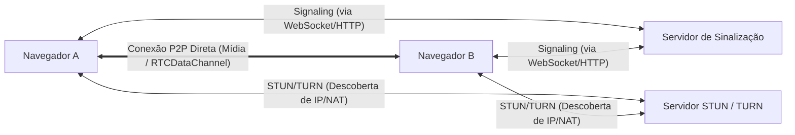
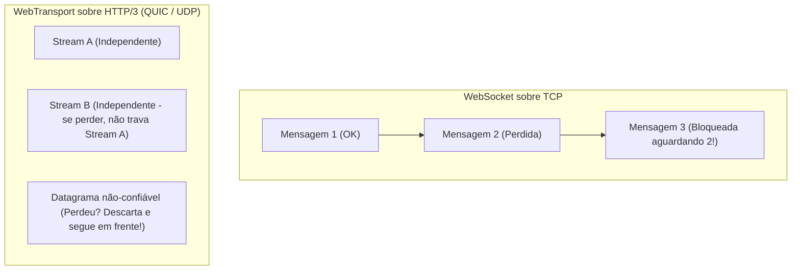

# 05. WebRTC e WebTransport: A Fronteira do Tempo Real

Para casos onde WebSockets e SSE não são suficientes — como comunicação de áudio/vídeo, jogos competitivos ou telemetria de alta frequência —, entram em cena **WebRTC** e a tecnologia mais moderna da web: **WebTransport**.

---

## 1. WebRTC (Web Real-Time Communication)

O **WebRTC** foi desenvolvido primordialmente para comunicação **P2P (Peer-to-Peer)** entre navegadores, sem que os fluxos de mídia precisem passar por um servidor central.

### Componentes Chave:
1. **Signaling (Sinalização)**: O WebRTC não define como os peers se descobrem. Você precisa de um servidor (geralmente WebSocket) para trocar mensagens SDP (*Session Description Protocol*) e candidatos ICE.
2. **STUN (Session Traversal Utilities for NAT)**: Descobre o IP público do navegador atrás de roteadores residenciais.
3. **TURN (Traversal Using Relays around NAT)**: Servidor de relay usado como fallback quando o firewall simétrico impede conexão P2P direta.
4. **RTCDataChannel**: Permite envio de dados arbitrários (texto/binário) com suporte a entrega não-confiável ou confiável sobre UDP (SCTP).

### Casos de Uso:
- Videoconferências e chamadas de voz (Google Meet, Discord Web).
- Compartilhamento de arquivos P2P diretamente de navegador para navegador.

---

## 2. WebTransport: O Sucessor Moderno do WebSocket sobre HTTP/3 (QUIC)

O WebSocket roda sobre **TCP**, o que traz uma limitação conhecida como **Head-of-Line Blocking**: se um único pacote for perdido na rede, todos os pacotes subsequentes ficam bloqueados na fila do sistema operacional até que o pacote perdido seja retransmitido.

O **WebTransport** resolve isso rodando sobre **HTTP/3 e QUIC (UDP)**.

### Recursos Exclusivos do WebTransport:
1. **Datagramas Não Confiáveis (*Unreliable Datagrams*)**:
   - Semelhante a enviar pacotes UDP puros diretamente do JavaScript.
   - Ideal para posições de jogadores em games, telemetria de sensores ou áudio onde dados atrasados perdem a utilidade.
2. **Streams Unidirecionais e Bidirecionais Confiáveis**:
   - Múltiplos canais lógicos multiplexados dentro da mesma conexão sem que a queda de um trave o outro.
3. **Setup ultrarrápido (0-RTT)**:
   - Handshake unificado de transporte e criptografia (TLS 1.3 embutido no QUIC).

---

## 📊 Comparativo Técnico Rápido

| Característica | WebSockets | WebRTC (DataChannel) | WebTransport |
| :--- | :--- | :--- | :--- |
| **Protocolo de Transporte** | TCP | UDP (SCTP / DTLS) | UDP (QUIC / HTTP/3) |
| **Arquitetura** | Cliente-Servidor | Geralmente P2P | Cliente-Servidor |
| **Head-of-Line Blocking** | Sim (no nível de transporte) | Não (configurável) | Não |
| **Tipos de Transmissão** | Apenas confiável e ordenada | Confiável ou Não confiável | Confiável (Streams) e Não confiável (Datagramas) |
| **Complexidade de Setup** | Baixa | Muito Alta (STUN/TURN/SDP) | Média/Alta (Requer suporte a HTTP/3) |
