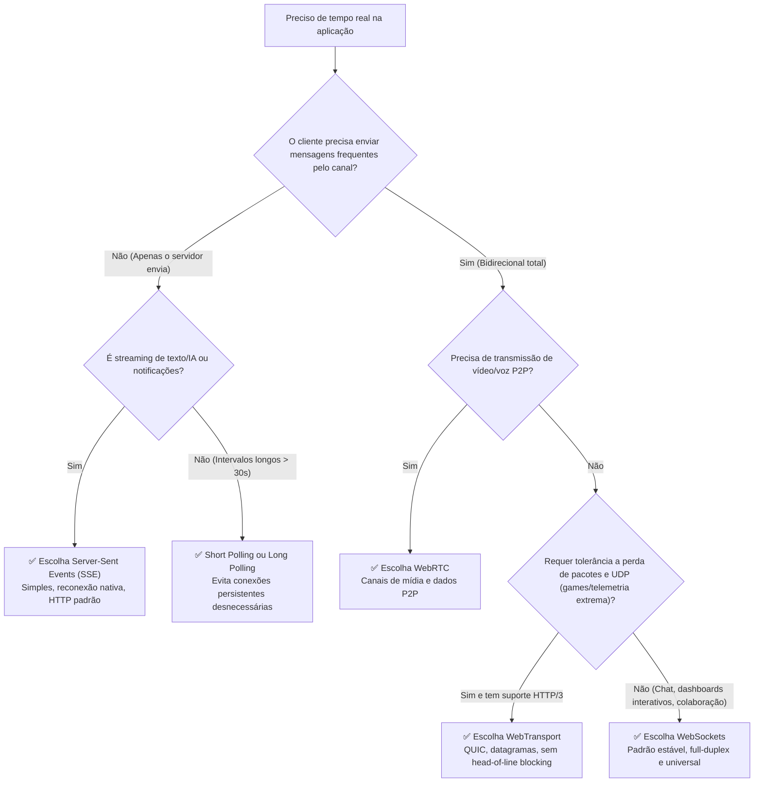

# 06. Matriz de Decisão: Qual Tecnologia Escolher?

Ao iniciar um projeto, a escolha incorreta do protocolo de tempo real gera custos desnecessários de infraestrutura, complexidade arquitetural ou problemas de desempenho.

---

## 🎯 Árvore de Decisão Rápida

---

## 📊 Matriz Comparativa Completa

| Critério | Short Polling | Long Polling | Server-Sent Events (SSE) | WebSockets (WS) | WebTransport | WebRTC |
| :--- | :--- | :--- | :--- | :--- | :--- | :--- |
| **Direcionalidade** | Pull (Client $\to$ Server) | Pull com delay | Push (Server $\to$ Client) | Full-Duplex (Bidirecional) | Full-Duplex (Bidirecional) | Peer-to-Peer (ou via SFU) |
| **Protocolo de Rede** | HTTP/1.1 ou HTTP/2 | HTTP/1.1 | HTTP/1.1 ou HTTP/2 (melhor) | TCP puro (após upgrade) | QUIC (UDP) / HTTP/3 | UDP (SRTP / SCTP) |
| **Overhead por mensagem** | Alto (headers completos) | Alto a cada mensagem | Mínimo (`data: ...\n\n`) | Ultrabaixo (2 a 10 bytes) | Mínimo | Ultrabaixo |
| **Reconexão Automática** | Não aplicável | Manual | **Nativa no browser** (`EventSource`) | Manual (deve implementar) | Manual | Manual / ICE restart |
| **Suporte a Binários** | Sim | Sim | Não (Apenas texto UTF-8) | **Sim (ArrayBuffer/Blob)** | **Sim** | **Sim** |
| **Compatibilidade de Proxies** | 100% | 99% | 98% (passa como HTTP) | ~90% (alguns proxies bloqueiam) | Requer suporte a UDP/HTTP3 | Requer STUN/TURN |
| **Facilidade de Escalar** | Muito fácil (Stateless) | Moderada | Boa (HTTP comum) | Desafiadora (Stateful) | Desafiadora (Stateful) | Muito Complexa |

---

## 🏆 Exemplos do Mundo Real

1. **ChatGPT / Claude / Gemini Web**:
   - Usam **SSE (Server-Sent Events)** para cuspir palavras/tokens à medida que são gerados pelo modelo. O prompt inicial vai via `POST` HTTP comum.
2. **Slack / Discord**:
   - Usam **WebSockets** para entrega instantânea de mensagens de texto, status de "digitando...", notificações de presença e reações.
3. **Google Meet / Zoom Web**:
   - Usam **WebRTC** para os streams de vídeo e áudio entre participantes.
4. **Figma / Notion / Miro**:
   - Usam **WebSockets** para sincronização colaborativa de cursores e modificações simultâneas de nós em tempo real (CRDTs / OT).
5. **Dashboard de entregas / Rastreamento simples**:
   - Frequentemente usam **Short Polling** a cada 10-15 segundos se a precisão de milissegundos não for mandatória, poupando custos de infraestrutura de conexões abertas.
