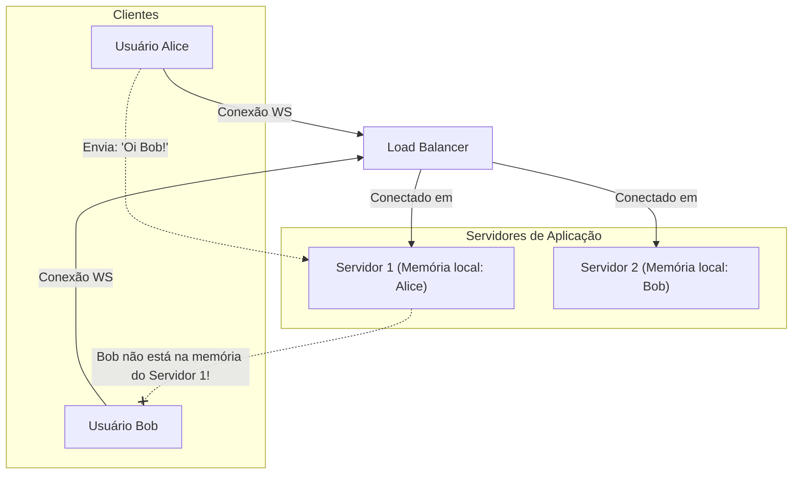
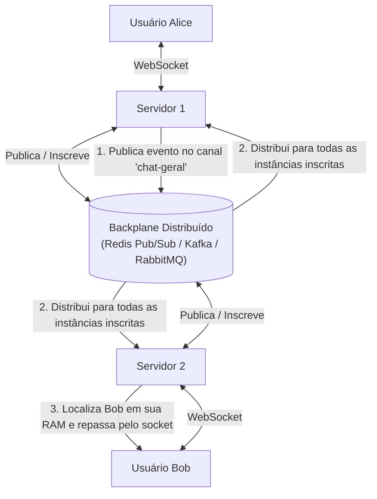

# 01. O Desafio Stateful em Ambientes Distribuídos

Em aplicações web REST clássicas, os servidores são **stateless** (sem estado). Cada requisição HTTP contém tudo o que é necessário para ser processada, permitindo que um Load Balancer (como Nginx, AWS ALB, Traefik) distribua as requisições aleatoriamente ou via Round-Robin entre 10 servidores sem nenhum problema.

Com **WebSockets e conexões persistentes**, esse modelo é quebrado: a conexão é **stateful**.

---

## 💥 O Problema da Sala Dividida

Imagine um cenário simples de chat com duas instâncias do servidor:

### O que acontece:
1. **Alice** se conecta e o Load Balancer a direciona para o **Servidor 1**. A referência do socket dela fica guardada em uma variável na memória RAM do Servidor 1 (ex: `connections.set(aliceId, socket)`).
2. **Bob** se conecta e o Load Balancer o direciona para o **Servidor 2**. O socket dele fica na memória RAM do Servidor 2.
3. Quando Alice envia uma mensagem destinada a Bob:
   - A mensagem chega no **Servidor 1**.
   - O Servidor 1 vasculha sua memória RAM: *"Existe algum socket aqui com ID de Bob?"* $\to$ **Não!**
   - Bob **nunca recebe a mensagem**!

---

## 🚫 Soluções Ruins / Incompletas

### 1. Sticky Sessions (Sessões Pegajosas)
- O Load Balancer tenta garantir que requisições de um mesmo usuário sempre caiam no mesmo servidor (via cookie ou IP).
- **Por que falha em tempo real?** Embora mantenha Alice sempre no Servidor 1, Bob continuará no Servidor 2. A comunicação entre usuários diferentes continua quebrada.

### 2. Guardar Sockets no Banco de Dados Relacional
- Conexões de rede (Sockets TCP) são descritores de arquivos (*file descriptors*) do sistema operacional daquela máquina específica.
- **Não é possível serializar um socket TCP em JSON** ou salvá-lo no Postgres/MySQL. Ele só existe na memória daquele processo.

---

## 🏆 A Solução Arquitetural: O Backplane de Mensagens

Para permitir escala horizontal elástica (auto-scaling de 2 a 100 servidores), desacoplamos o gerenciamento de conexões físicas da camada de distribuição de eventos usando um **Backplane de Mensagens** (Message Broker / PubSub).

No próximo documento, veremos detalhadamente como implementar essa arquitetura com **Redis Pub/Sub**.
