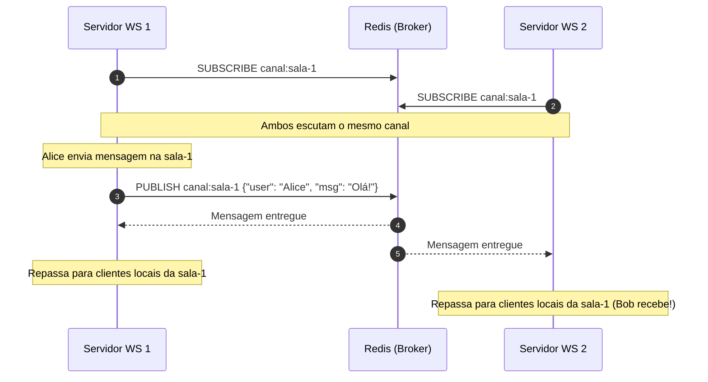

# 02. Backplane Pub/Sub com Redis

O **Redis** é a escolha mais popular da indústria como *backplane* de comunicação para servidores de WebSocket e SSE, devido à sua velocidade em memória (sub-milissegundo) e suporte nativo ao padrão Publish/Subscribe.

---

## 📻 Como Funciona o Padrão Publish/Subscribe

O padrão Pub/Sub desacopla quem produz o evento de quem o consome através de **canais (channels)**.



---

## ⚠️ A Regra das Duas Conexões Redis

Ao trabalhar com Redis Pub/Sub em Node.js, Go ou Python, é fundamental compreender uma limitação do protocolo Redis:

> Quando uma conexão Redis entra no modo de subscrição (`SUBSCRIBE`), ela fica **bloqueada** exclusivamente para receber mensagens desse canal. Você **não pode** executar outros comandos (como `GET`, `SET` ou `PUBLISH`) usando essa mesma instância de conexão.

Por isso, cada instância da sua aplicação precisa de no mínimo **duas conexões Redis**:
1. **Conexão de Subscrição (`subClient`)**: Fica em escuta passiva aguardando mensagens chegarem.
2. **Conexão Geral / Publicação (`pubClient`)**: Usada para disparar `PUBLISH` e comandos normais de chave-valor.

---

## ⚡ Redis Pub/Sub Tradicional vs. Redis Streams

É vital conhecer a diferença entre os dois modelos do Redis para tempo real:

| Característica | Redis Pub/Sub | Redis Streams |
| :--- | :--- | :--- |
| **Garantia de Entrega** | *At-most-once* (Fogo e esqueça). Se um nó estiver offline no momento, a mensagem é perdida. | *At-least-once*. As mensagens ficam gravadas num log com ID sequencial. |
| **Persistência** | Nenhuma. Mensagens só existem na memória enquanto trafegam. | Sim (no disco/AOF/RDB do Redis). |
| **Histórico / Replay** | Um novo cliente que entra não consegue ler mensagens passadas. | Clientes podem pedir mensagens a partir do ID `X` (*catch-up*). |
| **Custo de Memória** | Mínimo absoluto (praticamente zero overhead em repouso). | Proporcional ao tamanho do histórico retido. |
| **Melhor para:** | Notificações em tempo real efêmeras, status de presença, chat onde o histórico já é salvo no Postgres/Mongo. | Event sourcing, filas resilientes com confirmação (ACK), auditoria. |

---

## 💻 Estrutura do Padrão em Código (Exemplo Conceitual)

```typescript
import { createClient } from 'redis';

const pubClient = createClient({ url: 'redis://localhost:6379' });
const subClient = pubClient.duplicate();

await pubClient.connect();
await subClient.connect();

// 1. Escutando mensagens do Redis vindas de QUALQUER servidor
await subClient.subscribe('canal:chat', (messageStr) => {
  const event = JSON.parse(messageStr);
  
  // Encontra conexões locais deste nó específico que pertencem à sala
  for (const client of localClients.values()) {
    if (client.roomId === event.roomId) {
      client.socket.send(messageStr);
    }
  }
});

// 2. Quando um cliente local envia mensagem via WebSocket
function onClientMessage(roomId: string, message: any) {
  // Publica no Redis para que todos os nós (inclusive outros) recebam
  pubClient.publish('canal:chat', JSON.stringify({ roomId, ...message }));
}
```
