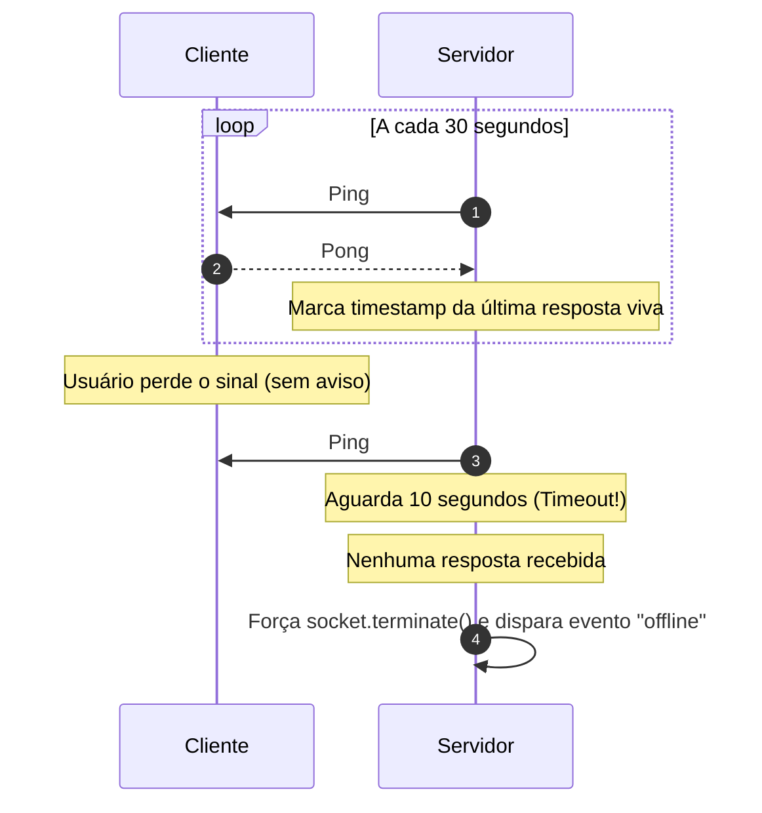

# 03. Presença, Heartbeats e Resiliência de Conexão

Manter o status de **"Quem está Online"** e saber com precisão quando alguém se desconectou é um dos maiores desafios em sistemas de tempo real.

---

## 👻 O Problema das Conexões Zumbis (*Half-Open Connections*)

Em redes móveis (3G/4G/5G ou Wi-Fi), é muito comum o usuário:
- Entrar em um túnel ou elevador.
- Ter a bateria do celular esgotada de repente.
- Ativar o modo avião.

Nessas situações, **nenhum pacote TCP `FIN` ou `RST` de encerramento é enviado**. 

> Se o servidor não tiver um mecanismo ativo de verificação, a conexão TCP continuará aberta no sistema operacional por até **2 horas** (padrão de keep-alive do kernel Linux), consumindo memória e indicando falsamente que o usuário está "online".

---

## 💓 A Estratégia de Heartbeat (Ping / Pong)

Para evitar conexões zumbis, estabelecemos um batimento cardíaco periódico:



---

## 🗄️ Gerenciamento de Presença Distribuída no Redis

Em um cluster com vários servidores, o status de presença não pode ficar na memória RAM de uma única máquina. 

### Padrão 1: Redis Chave com TTL (Heartbeat Lease)
Sempre que o servidor recebe um `Pong` ou mensagem do usuário `user:123`:
```bash
# Define presença com expiração automática de 45 segundos
SET presence:user:123 "online" EX 45
```
Se o usuário cair e os pings falharem, o Redis expira a chave automaticamente após 45 segundos, sem risco de presenças fantasmas eternas.

### Padrão 2: Redis Sorted Sets (ZSET) para Listagem de Usuários Online
Para saber quem está online em uma sala sem escanear milhares de chaves:
```bash
# Guarda o timestamp atual (epoch milissegundos) como pontuação (score)
ZADD room:sala-1:members 1730000000 "user:alice"
ZADD room:sala-1:members 1730000005 "user:bob"

# Remove automaticamente membros inativos há mais de 60 segundos
ZREMRANGEBYSCORE room:sala-1:members -inf (tempo_atual - 60000)

# Lista todos os usuários ativos no momento
ZRANGEBYSCORE room:sala-1:members (tempo_atual - 60000) +inf
```

---

## 🔄 Resiliência no Cliente: Backoff Exponencial com Jitter

Se o servidor cair ou reiniciar para deploy, milhares de navegadores tentarão reconectar exatamente no mesmo milissegundo. Isso causa o temido efeito **Thundering Herd** (efeito manada), derrubando o servidor assim que ele inicia.

### A Fórmula Correta:
$$\text{Delay} = \min(\text{MaxDelay}, \text{BaseDelay} \times 2^{\text{tentativas}}) + \text{JitterAleatório}$$

```javascript
let attempts = 0;

function connect() {
  const socket = new WebSocket('wss://api.exemplo.com/ws');

  socket.onclose = () => {
    attempts++;
    // Backoff exponencial com teto de 30s + ruído aleatório (jitter)
    const baseDelay = Math.min(30000, 1000 * Math.pow(2, attempts));
    const jitter = Math.random() * 1000;
    const retryDelay = baseDelay + jitter;

    console.log(`Reconectando em ${Math.round(retryDelay)}ms...`);
    setTimeout(connect, retryDelay);
  };

  socket.onopen = () => {
    attempts = 0; // Reseta contador após conexão bem sucedida
  };
}
```

---

## 🛡️ Janela de Tolerância a F5 (*Debounce de Presença*)
Quando um usuário recarrega a página (F5), o socket é fechado e reaberto 300ms depois. Para evitar disparar notificações irritantes de *"Bob saiu da sala"* seguidas de *"Bob entrou na sala"*, adicione um pequeno delay (ex: 3 a 5 segundos) antes de anunciar o evento de desconexão.
