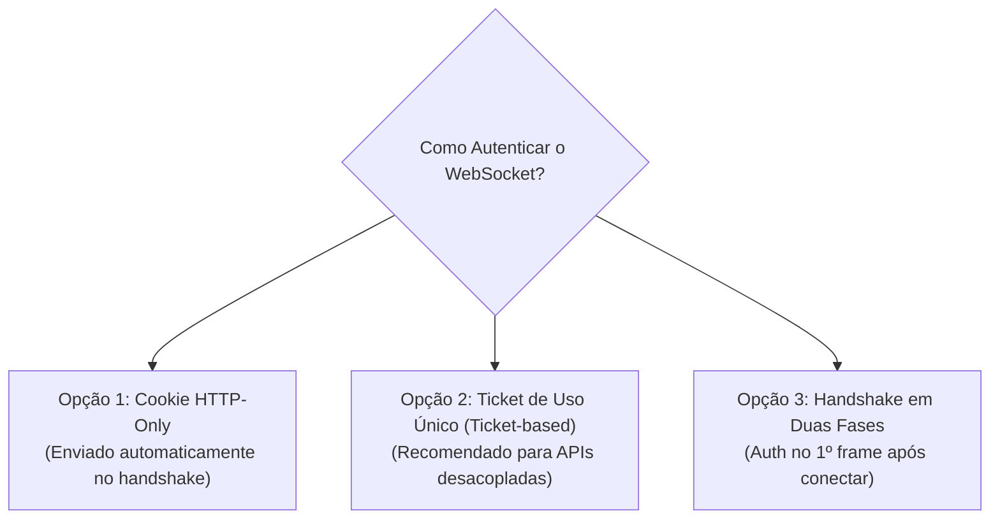

# 04. Segurança, Autenticação e Rate Limiting

A segurança em conexões persistentes exige cuidados que não existem em APIs REST tradicionais.

---

## 🔐 1. O Desafio da Autenticação no WebSocket

Na API padrão `new WebSocket(url)` do navegador, **não é possível passar cabeçalhos HTTP customizados** (como `Authorization: Bearer <token>`).

Isso deixa 3 abordagens principais para autenticação:



### Abordagem 1: Cookies HTTP-Only (Ideal para Monólitos / Mesmo Domínio)
Como o handshake é uma requisição HTTP normal, cookies gravados no domínio são enviados automaticamente no cabeçalho `Cookie`.
- **Cuidado**: Exige proteção rigorosa contra **CSWSH** (veja abaixo).

### Abordagem 2: Ticket Efêmero de Uso Único (O Padrão Ouro na Indústria)
1. O cliente faz um `POST /api/auth/ws-ticket` autenticado (via Bearer token normal).
2. O servidor gera um token aleatório com validade curta (ex: 30 segundos) e salva no Redis.
3. O cliente conecta no WebSocket passando o ticket via Query Parameter:
   ```javascript
   const socket = new WebSocket(`wss://api.meusite.com/ws?ticket=${ticket}`);
   ```
4. O servidor WebSocket lê o ticket, valida no Redis, consome (deleta para não ser reutilizado) e associa a conexão ao usuário.
- **Por que isso é seguro?** Mesmo se a URL com o ticket vazar em logs de proxy, o ticket já expirou e foi consumido.

### Abordagem 3: Autenticação no Primeiro Frame (Two-Phase Auth)
1. O socket se conecta sem autenticação.
2. O servidor inicia um cronômetro rígido de 5 segundos.
3. A primeira mensagem enviada pelo cliente **deve** ser:
   ```json
   { "type": "AUTH", "token": "jwt.aqui..." }
   ```
4. Se o token for válido, o servidor autoriza a conexão. Se demorar mais de 5s ou o token for inválido, o servidor fecha o socket imediatamente (`socket.terminate()`).

---

## 🚨 2. CSWSH: Cross-Site WebSocket Hijacking

O WebSocket **não segue a política de Same-Origin (SOP)** por padrão! Qualquer site malicioso pode abrir uma conexão WebSocket com a sua API se você depender apenas de Cookies de sessão.

### Como se Proteger:
Sempre valide o cabeçalho `Origin` durante o handshake HTTP:

```typescript
function handleUpgrade(req, socket, head) {
  const origin = req.headers.origin;
  const allowedOrigins = ['https://meusite.com', 'https://app.meusite.com'];

  if (!origin || !allowedOrigins.includes(origin)) {
    // Rejeita a conexão antes de fazer o upgrade!
    socket.write('HTTP/1.1 403 Forbidden\r\n\r\n');
    socket.destroy();
    return;
  }

  // Prossegue com o handshake do WebSocket
  wss.handleUpgrade(req, socket, head, (ws) => {
    wss.emit('connection', ws, req);
  });
}
```

---

## 🛑 3. Rate Limiting em Tempo Real

Em REST, o rate limit é baseado em chamadas HTTP por minuto. No WebSocket, um usuário mal-intencionado com um socket aberto pode disparar milhares de mensagens por segundo sem abrir novas requisições.

### Estratégia do Token Bucket por Socket:
- Cada conexão recebe um "balde" com capacidade para $N$ tokens (ex: 10 mensagens).
- A cada mensagem enviada, 1 token é consumido.
- A cada 1 segundo, 2 novos tokens são adicionados ao balde.
- Se o balde esvaziar, o servidor descarta a mensagem ou desconecta o cliente abusivo com o código `1008 (Policy Violation)`.

---

## 📏 4. Limite de Tamanho de Payload (*Max Payload Size*)

Nunca permita o recebimento de mensagens de tamanho ilimitado. Um ataque de DoS simples consiste em enviar um frame de 500 MB de texto para esgotar a memória do servidor.
- Defina no servidor o tamanho máximo por frame (ex: 64 KB ou 1 MB dependendo do caso).
- Bibliotecas como `ws` (Node.js) possuem o parâmetro `maxPayload: 64 * 1024`.
