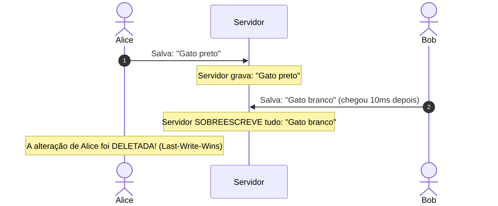
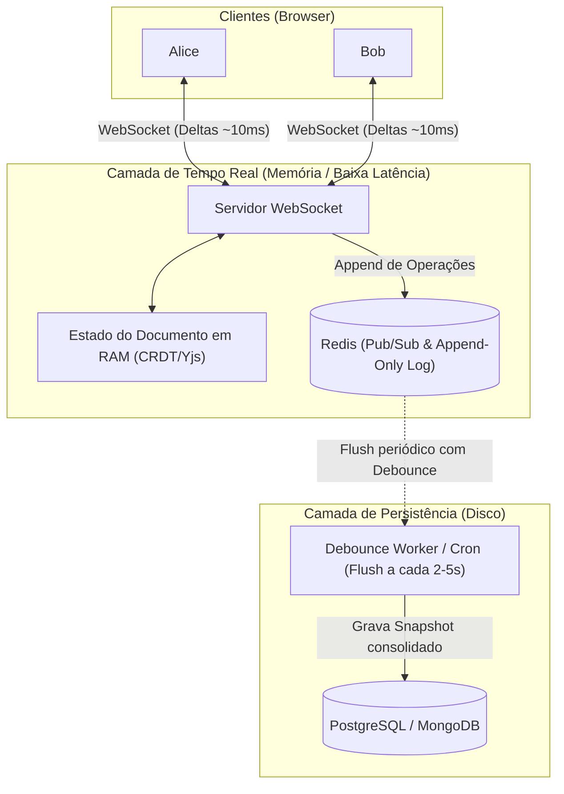

# 01. Edição Colaborativa em Tempo Real: OT, CRDT, Persistência e Histórico

A edição colaborativa em tempo real (como no **Google Docs, Notion, Figma e Miro**) é um dos problemas mais fascinantes da computação distribuída.

Quando duas pessoas digitam no mesmo documento ao mesmo tempo, a abordagem tradicional de *"enviar o arquivo todo"* falha catastroficamente.

---

## 💥 Por que NUNCA enviar o arquivo todo?

Imagine um texto inicial: `"Gato"`.
1. **Alice** (no segundo 0.1) quer mudar para `"Gato preto"`.
2. **Bob** (no segundo 0.1) quer mudar para `"Gato branco"`.



Se enviássemos o arquivo todo:
- **Perda de dados por sobrescrita** (*Race Conditions / Last-Write-Wins*).
- **Desperdício colossal de banda**: se o documento tem 100 páginas (500 KB) e o usuário aperta a tecla "A", enviar 500 KB pela rede 60 vezes por segundo destruiria o servidor e a franquia de dados móveis.

---

## 🧩 A Solução: Enviar "Operações" (Deltas), nunca o arquivo todo

Em vez de enviar o texto completo, enviamos apenas a **intenção atômica da alteração** (chamada de **Delta** ou **Operation**):

- Em vez de: `"Texto completo de 10 páginas..."`
- Enviamos:
  ```json
  {
    "type": "insert",
    "position": 5,
    "text": " preto"
  }
  ```
  *(Ex: Na posição 5, insira " preto")*

Ou no padrão **Delta** (usado pelo Quill.js):
```json
[
  { "retain": 5 },
  { "insert": " preto" }
]
```

---

## ⚔️ O Desafio Concorrente: OT vs. CRDT

Se Alice e Bob inserirem texto na mesma posição no mesmo milissegundo, como os documentos convergem para o mesmo resultado em todas as telas sem conflito?

Existem duas grandes escolas na indústria:

### 1. OT (Operational Transformation) - O clássico do Google Docs
- Criado nos anos 90, consagrado pelo **Google Wave e Google Docs**.
- **Como funciona**: Exige um **servidor central autoritativo** que ordena quem veio primeiro e *"transforma"* a operação que veio depois recalculando os índices de posição.
- **Vantagem**: Menor consumo de memória RAM.
- **Desvantagem**: Implementação do algoritmo no servidor é extremamente complexa e propensa a bugs matemáticos. Não funciona bem em P2P offline.

### 2. CRDT (Conflict-free Replicated Data Types) - O padrão moderno (Yjs, Automerge, Figma)
- Adotado por ferramentas modernas (**Figma, Notion, VS Code Live Share, Apple Notes**).
- **Como funciona**: Cada caractere digitado recebe um **ID único universal e imutável** (ex: `ID: [cliente 1, seq 42]`) e referências de onde foi inserido.
- **A Mágica**: Os clientes podem trocar operações em **qualquer ordem**, e o algoritmo matemático garante que, quando todas as mensagens chegarem, **o texto final será idêntico em todas as máquinas**, mesmo sem servidor central!
- **Biblioteca padrão de ouro no ecossistema JS**: [Yjs](https://github.com/yjs/yjs).

---

## 🗄️ Como Salvar no Banco de Dados em Tempo Real?

Não podemos fazer um `INSERT`/`UPDATE` no PostgreSQL a cada tecla pressionada (se 50 pessoas digitam ao mesmo tempo, seriam centenas de queries por segundo por documento, esgotando o pool do banco).

A arquitetura correta utiliza uma **estratégia de dois níveis (Two-Tier Persistence)**:



### Passo a Passo da Persistência:
1. **Em Tempo Real (Memória RAM + Redis)**:
   - A operação atômica chega no servidor WebSocket via socket.
   - O servidor aplica a operação no estado em memória (CRDT) e transmite imediatamente para os outros clientes via WebSocket/Redis.
   - A operação é gravada em uma fila/log rápido no Redis (`RPUSH doc:123:ops {delta}`).
2. **Gravação Assíncrona no Banco Relacional (Debounce / Checkpoint)**:
   - Um timer (*debounce*) aguarda o documento "ficar quieto" por 2 a 5 segundos (ou a cada 50 operações).
   - O servidor pega o estado consolidado do documento e salva um **Snapshot** no PostgreSQL/MongoDB.

---

## 📜 Modelo de Dados Recomendado (PostgreSQL)

Para gerenciar o documento e o histórico de alterações:

### 1. Tabela de Documentos (`documents`)
Armazena o conteúdo atual consolidado e o estado binário do CRDT para carregamento rápido:
```sql
CREATE TABLE documents (
    id UUID PRIMARY KEY DEFAULT gen_random_uuid(),
    title VARCHAR(255) NOT NULL,
    current_content TEXT,                -- Ex: Markdown ou HTML consolidado
    crdt_state BYTEA,                    -- Estado binário compilado (ex: Y.encodeStateAsUpdate)
    version INT NOT NULL DEFAULT 1,      -- Versão incremental do documento
    updated_at TIMESTAMP WITH TIME ZONE DEFAULT NOW()
);
```

### 2. Tabela de Operações / Log Atômico (`document_operations`)
Grava todas as pequenas alterações para auditoria e histórico de digitação:
```sql
CREATE TABLE document_operations (
    id BIGSERIAL PRIMARY KEY,
    document_id UUID REFERENCES documents(id) ON DELETE CASCADE,
    user_id UUID NOT NULL,
    operation_data JSONB NOT NULL,       -- Delta ex: {"retain": 10, "insert": "olá"}
    client_version INT NOT NULL,
    created_at TIMESTAMP WITH TIME ZONE DEFAULT NOW()
);

CREATE INDEX idx_doc_ops ON document_operations(document_id, created_at);
```

### 3. Tabela de Versões / Histórico Nomeado (`document_snapshots`)
Para o usuário conseguir abrir o *"Histórico de Versões"* e restaurar o texto de ontem:
```sql
CREATE TABLE document_snapshots (
    id UUID PRIMARY KEY DEFAULT gen_random_uuid(),
    document_id UUID REFERENCES documents(id) ON DELETE CASCADE,
    version INT NOT NULL,
    content TEXT NOT NULL,               -- Texto completo naquele momento
    crdt_snapshot BYTEA,                 -- Estado binário para restauração exata
    saved_by UUID,                       -- Usuário que realizou o checkpoint
    created_at TIMESTAMP WITH TIME ZONE DEFAULT NOW()
);
```

---

## ⏳ Como Funciona o Histórico de Versões (Time Travel)?

Como no Google Docs você clica em *"Ver histórico de edições"* e consegue ver o documento em qualquer ponto do tempo?

Existem duas formas principais:

1. **Replay de Operações**:
   - Pega o primeiro snapshot do documento e vai aplicando as operações da tabela `document_operations` uma a uma até a data desejada.
   - Permite saber exatamente **quem digitou cada palavra** (atribuição por cor do autor).
2. **Snapshots de Checkpoint**:
   - A cada 1 hora de edição ou quando o usuário clica em *"Salvar Versão"*, cria-se um registro na tabela `document_snapshots`.
   - Se o documento tiver anos de existência, o sistema carrega o snapshot mais próximo e apenas aplica as operações restantes, evitando ter que reprocessar 1 milhão de teclas desde o início.

---

## 🎯 Resumo Prático

| Pergunta | Resposta Recomendada |
| :--- | :--- |
| **Envia o arquivo todo ou em pedaços?** | **Em pedaços (Deltas/Operações)**. O arquivo todo gera conflitos graves, alto consumo de rede e perda de dados. |
| **Como resolver conflitos em tempo real?** | **CRDT (Yjs)** para projetos modernos (sem necessidade de lógica complexa no servidor) ou **OT** se você tiver uma arquitetura centralizada rígida. |
| **Como salvar no banco sem travar a máquina?** | **Two-Tier Storage**: broadcast e buffer em RAM/Redis instantaneamente; flush para o PostgreSQL via *debounce* a cada 2 a 5 segundos. |
| **Como fica o histórico?** | **Log imutável de operações (append-only)** + **Snapshots periódicos** para restauração e time travel. |
