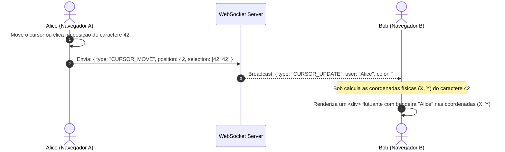

# 02. Cursores Remotos e Atribuição de Autoria em Tempo Real

Quando abrimos o **Google Docs, Figma ou Miro**, vemos instantaneamente o cursor de outras pessoas voando pela tela, com uma bandeirinha colorida contendo o nome (ex: *"Bob"*, *"Alice"*), e o texto recém-digitado brilha na cor da pessoa.

Como isso é implementado tecnicamente por baixo dos panos?

---

## 🚫 1. Por que um `<textarea>` nativo não mostra cursores?

Um elemento HTML `<textarea>` é uma primitiva nativa do sistema operacional (C++/Rust do motor do navegador):
- Ele suporta **estritamente um único cursor** (o ponteiro do sistema operacional do usuário local).
- Não é possível inserir tags HTML (`<div>` ou `<span>`) dentro de um `<textarea>` para desenhar cursores ou pintar palavras com cores diferentes.

Por isso, ferramentas profissionais (Google Docs, Notion, VS Code, Figma) constroem **editores virtuais customizados** (usando `contenteditable`, Canvas/WebGL ou camadas sobrepostas).

---

## 📍 2. Como Funciona a Matemática do Cursor Remoto



### O Desafio: Converter "Índice de Caractere" em "(X, Y) Pixels"
O servidor e a rede nunca transmitem pixels (como `x: 320px, y: 150px`), pois a tela de Alice pode ser um monitor 4K e a de Bob um celular de 6 polegadas.

Em vez disso:
1. O protocolo transmite apenas o **índice do caractere** (ex: `position: 42`).
2. O navegador de destino utiliza medição de texto (via `Range.getBoundingClientRect()` em DOM ou um elemento espelho de medição) para descobrir exatamente onde o caractere 42 está quebrando linha na sua tela local.
3. Renderiza uma barra vertical colorida com animação de piscar (*caret*) e um *tooltip* com o nome do usuário.

---

## 🎨 3. Como Funciona o "Quem Está Editando o Quê" (Atribuição)

Existem dois níveis de exibição de quem editou:

### A. Realce Efêmero (*Transient Edit Highlight*) - Estilo Google Docs
Quando Bob faz uma alteração, o trecho inserido ou editado recebe uma borda ou fundo translúcido com a cor de Bob (ex: fundo verde claro com opacidade de 20%). Após 2 a 3 segundos sem novas edições naquele trecho, o realce desaparece suavemente com uma transição CSS (*fade-out*).

### B. Atribuição Permanente de Autoria (*Character Attribution / Author Marks*)
Cada nó ou caractere na estrutura de dados do documento (CRDT / AST) guarda um metadado imutável com o ID do criador:
```json
{
  "text": "Tempo Real",
  "authorId": "user-bob",
  "authorName": "Bob",
  "color": "#10b981",
  "createdAt": 1730000000
}
```
Isso permite ao usuário ligar o modo *"Mostrar histórico de edições"* ou *"Blame"* e ver cada parágrafo colorido de acordo com quem o escreveu.

---

## ⚡ 4. Otimização de Performance: Não Poluir o Histórico
Movimentos de cursor e cliques do mouse acontecem centenas de vezes por minuto.
- **Deltas de Texto**: São persistidos no PostgreSQL (`document_operations`).
- **Movimentos de Cursor**: São **100% efêmeros**. Eles trafegam apenas pela memória RAM e WebSocket/Redis, e **nunca** são gravados no banco de dados. Se o usuário desconectar, a presença é descartada.

---

## 🛠️ 5. Como o Lab 04 Implementou na Prática

Para permitir edição em tempo real com realce de quem editou o quê sem recorrer a bibliotecas de 500kb (Monaco/CodeMirror), o Lab 04 utiliza o **Padrão Underlay Backdrop**:

```
+-------------------------------------------------------------+
| Container Principal (position: relative)                    |
|                                                             |
|  [Camada 1 - Backdrop no fundo (z-index: 1)]                |
|  <div> espelhado com fundo escuro e tags <mark> coloridas   |
|  Ex: <mark style="background: #10b98155">texto do Bob</mark>|
|                                                             |
|  [Camada 2 - Textarea transparente por cima (z-index: 2)]   |
|  <textarea style="background: transparent; color: #f1f5f9"> |
|  Recebe foco, cliques e teclado nativos do navegador        |
|                                                             |
|  [Camada 3 - Carets flutuantes (z-index: 20)]               |
|  Divs absolutos posicionados na coordenada (X, Y) exata     |
|  com bandeira de nome "[Bob]" pairando acima do cursor      |
+-------------------------------------------------------------+
```

### O Desafio do Deslocamento de Índices (`adjustHighlightsOnDelta`)
Se Alice digitou na posição 0 a 5, e depois Bob insere 10 caracteres no início do documento (posição 0):
- Sem ajuste de coordenadas, o realce da Alice continuaria marcando os caracteres 0 a 5 (que agora pertencem ao Bob!).
- O algoritmo `adjustHighlightsOnDelta` intercepta cada operação recebida pelo WebSocket e desloca os intervalos de autoria (`start` e `end`) existentes de forma proporcional ao delta aplicado, mantendo os destaques visualmente ancorados às palavras exatas que cada um digitou.

Além disso, o Lab oferece o alternador **Modo Blame / Autoria**, exibindo cada segmento com a etiqueta explícita `[Nome do Autor]` e bordas coloridas.

