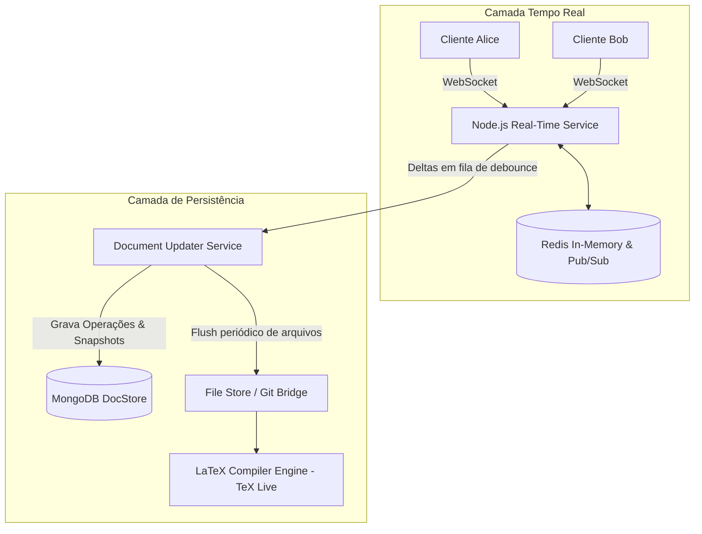

# 03. Estudo de Caso de Produção: Como Funciona o Overleaf (ShareLaTeX)

O **Overleaf** é a maior plataforma de edição colaborativa em tempo real de documentos científicos e acadêmicos em LaTeX do mundo. Seu código-fonte do motor colaborativo é aberto sob licença AGPL (disponível no repositório [overleaf/overleaf](https://github.com/overleaf/overleaf) no GitHub, anteriormente conhecido como *ShareLaTeX*).

A arquitetura do Overleaf é uma das implementações industriais mais consagradas do mundo real. Abaixo comparamos a abordagem do Overleaf com a que construímos no nosso estudo e nos laboratórios.

---

## 🎯 1. Resumo Comparativo: Overleaf vs Nosso Lab 04

| Dimensão | Overleaf (ShareLaTeX) | Nosso Lab 04 |
| :--- | :--- | :--- |
| **Algoritmo de Colaboração** | **OT (Operational Transformation)** via **ShareDB** (`ot-text`) | **Sequenciador Centralizado de Deltas** (base de OT) |
| **Componente de Editor (UI)** | **CodeMirror 6** (historicamente Ace Editor / CM5) | **Textarea Nativo + Padrão Underlay Backdrop** |
| **Cursores e Presença** | CodeMirror *Decorations* (`Decoration.widget`) | Divs absolutos com medição de caracteres em espelho |
| **Realce de Autoria ("Quem editou o quê")** | CodeMirror *Mark Decorations* (`Decoration.mark`) | Tags `<mark>` na camada de backdrop sincronizada |
| **Coordenação em Tempo Real** | WebSockets + **Redis Pub/Sub** | WebSockets (Fastify) + **Redis Pub/Sub** |
| **Armazenamento de Operações** | MongoDB (`docOps`) + Document Updater Service | PostgreSQL (`document_operations`) |
| **Persistência de Snapshots** | Buffering em Redis/RAM $\to$ Debounce $\to$ DocStore/Disco | Buffering em Redis/RAM $\to$ Debounce 3s $\to$ PostgreSQL |
| **Integração de Versões** | Histórico de Projetos + **Git Bridge** bidirecional | Tabela `document_snapshots` com versão incremental |

---

## 🧠 2. Como o Overleaf Renderiza Cursores e Realces

No nosso Lab 04, usamos um `<textarea>` nativo com uma camada de espelho no fundo (*Underlay Backdrop*) para demonstrar a mecânica física do navegador sem depender de pacotes externos pesados.

O Overleaf, por ser um editor de código com suporte a realce de sintaxe de LaTeX, números de linha, autocompletar e dobramento de código (*code folding*), utiliza o **CodeMirror**:

```
+-----------------------------------------------------------------+
| Overleaf UI (CodeMirror 6)                                      |
|                                                                 |
| 1. DOM Virtualizado: divide o documento em linhas (<div class="cm-line">)
| 2. Syntax Highlighting: parser Léxico Lezer para LaTeX          |
| 3. Decoration.widget: insere os carets remotos com bandeiras    |
|    ex: <span class="remote-caret" style="border-color: #38bdf8">|
|        <span class="user-flag">Alice</span>                     |
| 4. Decoration.mark: adiciona classes CSS nos nós de texto       |
|    ex: <span class="cm-author-bob"> \documentclass{article} </span> |
+-----------------------------------------------------------------+
```

### O conceito subjacente é rigorosamente o mesmo:
Tanto o CodeMirror do Overleaf quanto a nossa implementação do Lab 04 separam a **estrutura do documento** (índice absoluto de caracteres $0 \dots N$) da sua **apresentação visual na tela** (coordenadas $X, Y$ em pixels).

---

## 🔄 3. O Motor de Concorrência do Overleaf: ShareDB e OT

O Overleaf utiliza **ShareDB** (anteriormente chamado *ShareJS*), criado por Joseph Gentle (um dos engenheiros originais do **Google Wave**).

### Como o Overleaf Processa Edições Concorrentes
1. Quando Alice digita uma letra no documento no Overleaf, o cliente gera uma operação de texto no formato `ot-text`:
   ```json
   [120, "Hello"] // Pula 120 caracteres e insere "Hello"
   ```
2. A operação é enviada via WebSocket acompanhada da versão base do documento no cliente (ex: versão $V_{14}$).
3. O servidor central (`document-updater` / `web-sharelatex`):
   - Se o servidor já estiver na versão $V_{15}$ (porque Bob enviou uma operação 10ms antes), o servidor aplica a **matriz de transformação OT**:
     $$\text{op}' = \text{transform}(\text{op}_\text{Alice}, \text{op}_\text{Bob})$$
   - O servidor aplica a operação transformada ao documento canônico, incrementa a versão para $V_{16}$, grava a operação no histórico do MongoDB e transmite a operação final para todos os outros colaboradores via Redis Pub/Sub.

---

## 💾 4. A Estratégia de Persistência do Overleaf

Muitos desenvolvedores supõem que o Overleaf salva cada letra imediatamente no sistema de arquivos ou compila o PDF a cada tecla. Isso destruiria os discos e os servidores.

O Overleaf utiliza exatamente a **estratégia em duas camadas** que implementamos:



### 1. Camada Rápida (Memória / Redis)
- Operações de edição e cursores trafegam em milissegundos via WebSockets e Redis.
- O estado recente é mantido ativo na memória enquanto houver pessoas digitando.

### 2. Debounce e Consolidação
- Enquanto os usuários estão digitando ininterruptamente, o Overleaf adia (*debounce*) a geração de arquivos estáticos no disco.
- Quando o usuário para de digitar por alguns segundos (ou clica em "Recompile"), os deltas são consolidados em um snapshot de arquivo completo e o compilador `pdflatex` / `xelatex` é acionado.

### 3. A Git Bridge do Overleaf
O Overleaf possui um recurso onde você pode fazer `git clone` do seu projeto. Como eles fazem isso funcionar junto com a edição em tempo real?
- Os deltas de OT gravados no banco são agrupados em **commits sintéticos do Git**.
- Quando alguém faz `git push` de fora, o servidor do Overleaf converte o diff do Git em operações de OT e as injeta no WebSocket dos usuários que estão com o navegador aberto, atualizando o editor ao vivo sem conflitos!

---

## 📌 Conclusão

A arquitetura que você viu e utilizou no **Lab 04** segue a **mesma fundação técnica do Overleaf**:
1. **Comunicação bidirecional contínua** via WebSockets com identificação de presença.
2. **Envio atômico de deltas** em vez de sobrescrever o arquivo inteiro.
3. **Buffer em memória/Redis** para absorver a altíssima frequência de digitação com **debounce** para salvar snapshots no banco de dados relacional/documental.
4. **Mapeamento de índices lógicos para coordenadas visuais** para desenhar os cursores flutuantes e os realces de autoria.

A principal diferença prática é que, para uma ferramenta de código e LaTeX como o Overleaf, a interface do usuário adota uma biblioteca rica de editor virtual (como o **CodeMirror 6**), que oferece realce de sintaxe nativo e um sistema avançado de *decorations* DOM.
