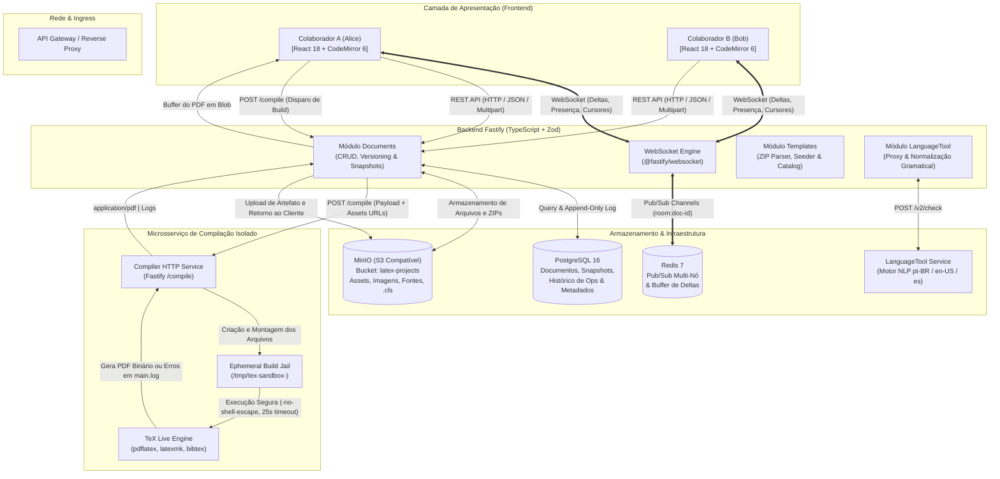
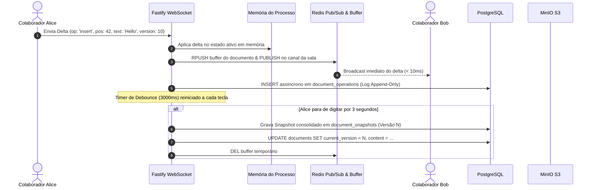
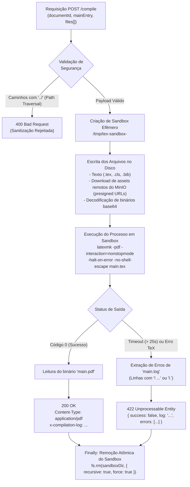
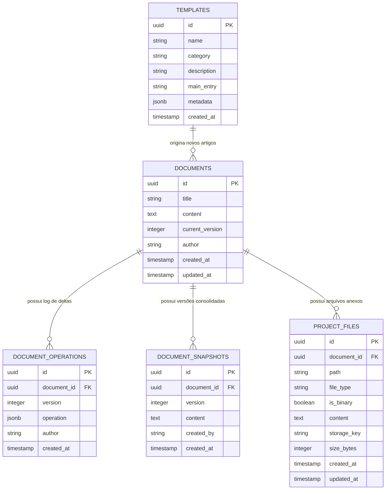

# 🏛️ Arquitetura Detalhada: Editor Colaborativo de Artigos Científicos (Overleaf Clone)

Este documento descreve detalhadamente a arquitetura de engenharia de software de ponta a ponta do **Lab 04 - Editor Colaborativo de Artigos Científicos em LaTeX** (inspirado na plataforma [Overleaf / ShareLaTeX](https://github.com/overleaf/overleaf)).

A solução foi projetada seguindo padrões modernos de sistemas distribuídos, reatividade em tempo real, isolamento seguro de execução e Clean Architecture modular.

---

## 🧭 1. Visão Geral da Arquitetura do Sistema

O sistema é composto por **três camadas lógicas principais** (Frontend SPA, Backend API/WebSocket e Compiler Sandbox Worker), orquestradas junto a **quatro serviços de infraestrutura dedicada** (PostgreSQL, Redis, MinIO S3 e LanguageTool):



---

## 🎨 2. Arquitetura do Frontend (React + TypeScript + Vite)

O cliente web é uma Single Page Application construída com **React 18**, **TypeScript estrito (sem `any`)**, **Vite** e **Material-UI (MUI v6/v9)** customizado, estruturada sob o paradigma **Feature-Sliced Design**.

### 2.1. Estrutura Modular de Pastas

```
frontend/src/
├── api/                          # Cliente HTTP (Axios) e chaves do React Query
│   ├── httpClient.ts             # Instância configurada com baseURL e interceptors
│   └── queryKeys.ts              # Fábrica tipada de queryKeys para invalidação precisa
├── components/common/            # Componentes genéricos de UI reutilizáveis
│   ├── GenericDataGrid.tsx       # Tabela de dados padrão corporativo com MUI DataGrid
│   ├── dataGridColumns.tsx       # Factory helpers tipados para colunas e formatações
│   ├── PageContainer.tsx         # Wrapper de página com padding e cabeçalho padrão
│   ├── ResizableSplitLayout.tsx  # Divisor de tela redimensionável com arrasto de mouse
│   ├── TableContainer.tsx        # Card container de tabelas com layout flex
│   └── TableFilters.tsx          # Barra de busca com debounce integrado
├── features/
│   ├── articles/                 # Domínio de Artigos & Dashboard
│   │   ├── components/           # ArticlesTable, CreateArticleModal, TemplateSelector, UploadTemplateDialog
│   │   ├── hooks/                # useArticlesQuery, useCreateArticleMutation, useCreateTemplateFromZipMutation
│   │   ├── pages/                # ArticlesDashboardPage
│   │   ├── services/             # articles.service.ts, templates.service.ts
│   │   └── types/                # article.types.ts, template.types.ts
│   └── editor/                   # Domínio da IDE de Edição Colaborativa
│       ├── components/           # IdeNavbar, ActivityRail, FileTreeSidebar, CodeMirrorEditor,
│       │                         # EditorTabBar, PdfPreview, ReviewSidebar, HistorySidebar, SettingsModal
│       ├── context/              # CollabEditorContext (estado central de arquivos, abas e seleção)
│       ├── hooks/                # useCollabWebSocket, useLatexCompiler, useProjectFilesQuery, useDocumentHistoryQuery
│       ├── pages/                # EditorPage
│       ├── services/             # editor.service.ts, languagetool.service.ts
│       └── types/                # collab.types.ts, files.types.ts
├── router/                       # Configuração de rotas declarativas (React Router)
├── theme/                        # Design tokens, paleta de cores (Dark/Light), tipografia e overrides
└── types/                        # Tipagens globais do sistema e configurações de usuário
```

### 2.2. Destaques da Implementação do Frontend

#### A. Editor CodeMirror 6 de Alta Fidelidade (`CodeMirrorEditor.tsx`)
- **Arquitetura Baseada em Extensões**: Utiliza o ecossistema modular do CodeMirror 6 (`@codemirror/view`, `@codemirror/state`, `@codemirror/language`, `@codemirror/lint`).
- **Suporte a LaTeX**: Realce de sintaxe nativo através do leitor lezer/legacy stex para comandos (`\section`, `\begin`, etc.), ambientes matemáticos e comentários.
- **Compartimentos Dinâmicos (`Compartment`)**: Permite alterar dinamicamente em tempo de execução configurações como tema de cores (Dark, Monokai, Nord, Dracula, Light) e quebra de linhas (*line wrapping*) sem recriar a instância do editor, preservando o histórico de undo/redo e a posição do cursor.
- **Camada de Cursores Remotos (Remote Carets)**:
  - Cada colaborador conectado tem uma cor HEX única e nome exibido.
  - A extensão mapeia a posição absoluta no texto para coordenadas DOM e injeta decorações do tipo `Decoration.widget` com etiqueta flutuante (*user flag*).
- **Integração de Linting Inline**:
  - As sugestões do LanguageTool são convertidas em `Diagnostic` do CodeMirror (`@codemirror/lint`), sublinhando os erros ortográficos ou sintáticos diretamente no código com *tooltips* explicativas.
- **Atalhos Produtivos**:
  - `Ctrl + Enter` (ou `Cmd + Enter`): dispara a compilação instantânea do LaTeX.
  - `Ctrl + S`: força a gravação imediata (*flush*) dos deltas pendentes.

#### B. Divisor de Tela Flexível com Mouse Drag (`ResizableSplitLayout.tsx`)
- Permite ajustar a proporção entre o painel de código (Editor) e o painel de visualização (PDF) de forma fluida.
- **Proteção contra *Iframe Pointer Drops***: Durante o arrasto do divisor, uma sobreposição invisível (`pointer-events: none` no iframe ou overlay ativo) é ativada para impedir que o ponteiro do mouse seja capturado pelo `<iframe>` do PDF, garantindo rastreamento a 60 FPS.
- Modos suportados: **Split (50/50 ou personalizado)**, **Editor Fullscreen** e **PDF Fullscreen**.

#### C. Árvore de Arquivos e Gestão Multi-Arquivo (`FileTreeSidebar.tsx` e `EditorTabBar.tsx`)
- Suporta projetos reais com múltiplos arquivos: `main.tex`, arquivos de estilo `.cls` ou `.sty`, bibliografias `.bib` e imagens `.png`/`.jpg`.
- Criação, upload, renomeação e exclusão de arquivos e diretórios.
- Sistema de abas persistente com indicador de arquivo ativo.

#### D. Visualizador de PDF com Console de Diagnóstico (`PdfPreview.tsx`)
- Renderização do PDF compilado via `Blob URL`.
- Ferramental de zoom in, zoom out, reset (100%), fit to width e rotação.
- Painel sanfonado inferior com o log completo da saída do `latexmk` / `pdflatex`, com filtragem e destaque visual de mensagens de aviso (*warnings*) e erros críticos (*fatal errors*).

#### E. Painel de Revisão Gramatical Inteligente (`ReviewSidebar.tsx`)
- Integração em tempo real com o LanguageTool.
- **Pré-processador de LaTeX**: Remove comandos e macros complexas antes de enviar ao corretor para evitar falsos positivos em tags sintáticas como `\cite{...}` ou `\ref{...}`.
- Lista agrupada de ocorrências com mensagem explicativa e botão de **Aplicação em 1 Clique**, que substitui o intervalo de caracteres exato no CodeMirror.

---

## ⚙️ 3. Arquitetura do Backend (Fastify + TypeScript + Zod)

O backend é construído com **Fastify v5**, utilizando injeção de dependências modular, validação rigorosa de esquemas através do **Zod Type-Provider** e suporte de alta performance a WebSockets.

### 3.1. Estrutura Modular

```
backend/src/
├── infra/
│   ├── minio.ts                  # Cliente MinIO S3 (provisionamento de bucket, upload e presigned URLs)
│   └── redis.ts                  # Cliente Redis (instâncias independentes de publisher e subscriber)
├── modules/
│   ├── documents/
│   │   ├── documents.controller.ts # Handlers REST para documentos, arquivos e compilações
│   │   ├── documents.repository.ts # Camada de acesso a dados SQL pura com node-pg
│   │   ├── documents.routes.ts     # Definição de rotas tipadas com Zod schema
│   │   ├── documents.schema.ts     # Esquemas de entrada, saída e validação de parâmetros
│   │   ├── documents.service.ts    # Regras de negócio, flush de debounce e integração MinIO
│   │   └── documents.websocket.ts  # Gerenciador de conexões, presença e deltas em tempo real
│   ├── languagetool/
│   │   ├── languagetool.controller.ts # Proxy para o LanguageTool com normalização
│   │   ├── languagetool.routes.ts     # Rota /api/languagetool/check
│   │   ├── languagetool.schema.ts     # Validação de idiomas e formato de texto
│   │   └── languagetool.service.ts    # Regras de requisição e tratamento de falhas
│   └── templates/
│       ├── templates.controller.ts    # Listagem de templates e upload de pacotes ZIP
│       ├── templates.routes.ts        # Rotas /templates e /templates/upload-zip
│       ├── templates.schema.ts        # Validação de metadados e arquivos de templates
│       ├── templates.seeder.ts        # Seeder automático ao iniciar a aplicação (IEEE, ACM, SBC)
│       └── templates.service.ts       # Gestão de templates no Postgres e armazenamento no MinIO
├── utils/
│   └── latex-zip-parser.ts        # Parser heurístico de arquivos .zip de projetos LaTeX
└── server.ts                      # Bootstrap, plugins (CORS, Multipart, WS), seeds e graceful shutdown
```

### 3.2. Fluxo de Concorrência e Persistência em Duas Fases

O sistema implementa uma estratégia de persistência de **alta performance com duas velocidades** para suportar centenas de alterações por segundo sem sobrecarregar o disco:



### 3.3. Extração e Detecção Automática de ZIPs (`latex-zip-parser.ts`)

Para permitir a importação de modelos prontos de qualquer universidade ou conferência, o módulo `latex-zip-parser`:
1. Descompacta o arquivo `.zip` em memória utilizando buffers controlados (prevenindo *Zip Bombs*).
2. Varre a árvore de arquivos ignorando metadados de sistema (`__MACOSX`, `.DS_Store`).
3. Classifica cada arquivo por tipo: `tex`, `style` (`.cls`, `.sty`), `bib` (`.bib`), `image` (`.png`, `.jpg`, `.pdf`) ou `doc`.
4. **Heurística de Detecção do Documento Raiz**:
   - Procura prioritariamente por `main.tex`.
   - Caso não exista, busca o arquivo `.tex` que contenha a declaração `\documentclass{...}`.
   - Extrai automaticamente via Regex o título do artigo (`\title{...}`) e o resumo/descrição inicial para catalogação.
5. Faz o upload dos arquivos binários (imagens, fontes) diretamente para o bucket do **MinIO** e persiste os arquivos de texto nas tabelas correspondentes.

---

## ⚡ 4. Arquitetura do Microsserviço Compilador (Compiler Sandbox)

O compilador LaTeX roda em um microsserviço isolado construído sobre uma imagem Linux com a distribuição **TeX Live oficial**:



### Medidas de Segurança do Sandbox:
1. **Contenção de Execução de Comandos Externos**: A flag obrigatória `-no-shell-escape` impede que comandos TeX maliciosos executem binários arbitrários no sistema host (ex: `\write18{rm -rf /}`).
2. **Prevenção de Path Traversal**: Todos os caminhos de arquivos recebidos são normalizados e têm prefixos relativos perigosos (`../`, `..\`) eliminados antes da criação no sistema de arquivos.
3. **Limitação de Tempo e Recursos**: O processo filho é abortado via sinal `SIGKILL` caso a compilação exceda **25 segundos** (protegendo contra *loops infinitos* causados por macros recursivas do TeX).
4. **Isolamento de Diretório**: Cada compilação gera um diretório único (`os.tmpdir() + /tex-sandbox-<uuid>`), garantindo que compilações simultâneas de usuários diferentes não tenham conflito de concorrência ou vazamento de arquivos.
5. **Limpeza Garantida**: O diretório efêmero é sempre excluído no bloco `finally`, prevenindo o esgotamento de *inodes* ou espaço em disco.

---

## 🗄️ 5. Modelo de Dados Relacional (PostgreSQL)

O schema do banco de dados foi modelado para garantir integridade referencial, histórico imutável e velocidade de leitura:



---

## ☸️ 6. Orquestração com Kubernetes e GitOps

A aplicação está completamente empacotada para rodar em clusters locais (**Kind**) ou nuvens corporativas através de manifestos Kustomize em `k8s/`:

- **GitOps com Argo CD**: O repositório contém a definição declarativa da aplicação (`k8s/argocd/application.yaml`), sincronizando automaticamente qualquer alteração nos manifestos da branch `main` com o cluster Kubernetes.
- **Argo Workflows**: Template declarativo (`k8s/workflows/latex-compile-workflow.yaml`) para descarregar compilações em lote ou pesadas diretamente em pods descartáveis de alta prioridade.
- **Microserviços Declarados**:
  - `backend`: Deployment escalável horizontalmente com variáveis de ambiente configuráveis e probes de liveness/readiness.
  - `frontend`: Servido via Nginx otimizado com cache de assets e compressão gzip.
  - `compiler`: Pod com quotas dedicadas de CPU e memória para proteger o cluster contra picos de processamento.
  - `postgres`, `redis`, `minio` e `languagetool`: Serviços desacoplados com volumes persistentes (`PersistentVolumeClaim`).

---

## 🧪 7. Qualidade de Código & Testes Automatizados

A suíte de testes cobre regras de negócio críticas e comportamento da interface:

- **Frontend (Vitest + Testing Library)**:
  - `ArticlesTable.test.tsx`: Renderização, integração com DataGrid, filtros e ações.
  - `ResizableSplitLayout.test.tsx`: Proporções de tela, gatilhos de redimensionamento e limites mínimos.
  - `CodeMirrorEditor.test.ts`: Mecanismos de decorações, cursores remotos e extensões de lint.
  - `ReviewSidebar.test.tsx`: Renderização do painel gramatical e disparo de correções.
  - `SettingsModal.test.tsx`: Alteração de temas, fontes e persistência de preferências.
  - `languagetool.service.test.ts`: Pré-processamento e limpeza de tags LaTeX para o corretor.
  - `color.test.ts`: Geração e contraste de cores hexadecimais de colaboradores.
- **Backend (Node.js Native Test Runner + TSX)**:
  - `latex-zip-parser.test.ts`: Extração de pacotes ZIP complexos, identificação automática do `main.tex`, classificação de arquivos e rejeição de pacotes corrompidos.
  - `templates.service.test.ts`: Ciclo de vida de templates, validação de catálogo e seeders.

---

## 🚀 8. Resumo das Decisões de Arquitetura (ADRs)

| Decisão | Escolha Técnica | Motivo & Benefício |
| :--- | :--- | :--- |
| **Editor de Código** | CodeMirror 6 | Virtualização eficiente do DOM, extensibilidade através de `StateField` e suporte nativo a decorações para cursores remotos e correções inline. |
| **Persistência em Tempo Real** | Buffer em RAM/Redis + Debounce de 3s no PostgreSQL | Elimina gargalos de I/O em disco a cada tecla digitada sem comprometer a durabilidade dos dados. |
| **Object Storage** | MinIO (S3 API) | Compatibilidade padrão da indústria com AWS S3, permitindo guardar imagens de artigos científicos, `.cls` e `.bib` com suporte a presigned URLs. |
| **Isolamento do Compilador** | Contêiner TeX Live dedicado com `-no-shell-escape` | Garante que compilações de artigos não executem comandos maliciosos no servidor backend e impede vazamento de memória. |
| **Gramática & Revisão** | LanguageTool Container | Independência de APIs pagas externas, garantia de privacidade dos artigos científicos e baixa latência. |
| **Layout Dividido** | ResizableSplitLayout próprio com listener global | Flexibilidade para o usuário ajustar o espaço de código e PDF com proteção contra congelamento de mouse em iframes. |
