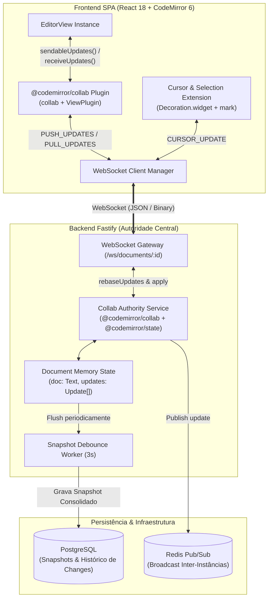
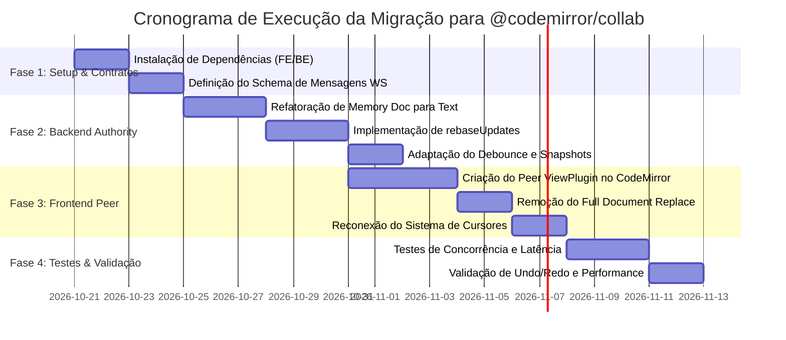
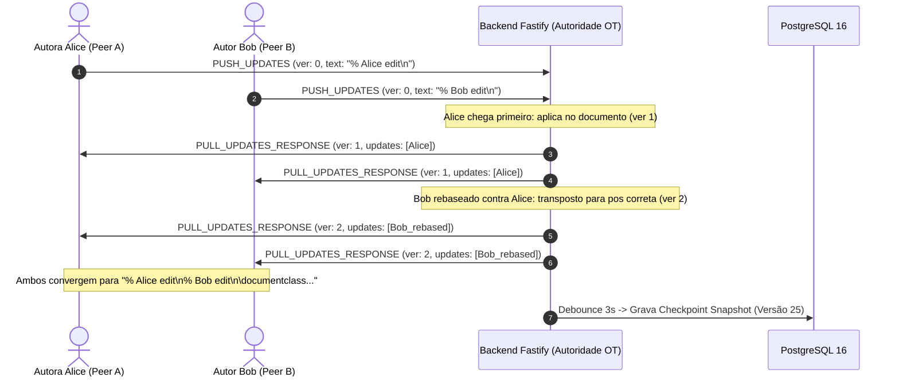

# 📋 Plano de Migração Arquitetural: Adoção do `@codemirror/collab` no Editor Colaborativo

Este documento consolida o diagnóstico técnico comparativo entre a implementação atual do **Lab 04** e o modelo oficial do **[CodeMirror Collab](https://codemirror.net/examples/collab/)**, detalhando o plano de engenharia de software passo a passo para migrar o sistema para **Operational Transformation (OT) nativa com `@codemirror/collab`**.

---

## 🧭 1. Diagnóstico do Estado Atual vs. Modelo Oficial

### 1.1. O que temos hoje (`labs/04-collaborative-editor`)

O nosso sistema atual utiliza o CodeMirror 6 no frontend (`@codemirror/view`, `@codemirror/state`, `@codemirror/autocomplete`, etc.), porém **não utiliza o pacote `@codemirror/collab`**. A camada de tempo real foi implementada através de um protocolo proprietário de deltas:

1. **Captura Local**: O `EditorView.updateListener` itera pelas mudanças locais via `iterChanges` e extrai operações atômicas simples do tipo:
   ```typescript
   { type: 'insert' | 'delete', position: number, text?: string, length?: number }
   ```
2. **Transporte**: Enviado via WebSocket (`APPLY_DELTA`) para o Fastify.
3. **Consolidação no Servidor**: O servidor Node.js manipula diretamente a string em memória usando `slice`:
   ```typescript
   // documents.service.ts
   if (delta.type === 'insert') {
     active.content = active.content.slice(0, pos) + delta.text + active.content.slice(pos);
   } else if (delta.type === 'delete') {
     active.content = active.content.slice(0, pos) + active.content.slice(pos + delta.length);
   }
   ```
4. **Dispersão & Atualização no Cliente**: O backend faz broadcast de `DELTA_BROADCAST`. No frontend, o React atualiza o estado `documentData.content`, disparando um `useEffect` no `CodeMirrorEditor.tsx` que **substitui o documento inteiro**:
   ```typescript
   // CodeMirrorEditor.tsx:1738-1744
   isRemoteChangeRef.current = true;
   viewRef.current.dispatch({
     changes: { from: 0, to: currentDoc.length, insert: content },
     effects: setRemoteCursorsEffect.of(remoteCursors),
   });
   isRemoteChangeRef.current = false;
   ```

### 1.2. Riscos e Gargalos da Abordagem Atual

* ⚠️ **Offset Drift e Corrupção de Texto**: Em cenários de digitação concorrente com latência de rede (ex: Alice insere texto no início e Bob no final quase no mesmo milissegundo), a operação de Bob não é recalculada contra o deslocamento inserido por Alice. O texto é inserido em índices desatualizados, corrompendo palavras ou tags LaTeX.
* ⚠️ **Substituição Destrutiva de Documento (`0` a `len`)**: O `dispatch` que substitui o texto completo destrói o histórico de *Undo/Redo* local do CodeMirror e pode causar cintilação de layout ou perda transitória de foco sob alta taxa de eventos.
* ⚠️ **Falta de Invertibilidade Matemática**: Operações de delete perdem o texto deletado original no payload simplificado, dificultando reversores de histórico ou *time-travel debugging* granular.

---

## ⚖️ 2. Matriz Comparativa Detalhada

| Critério de Engenharia | Abordagem Oficial (`@codemirror/collab`) | Implementação Atual do Projeto | Impacto na Migração |
| :--- | :--- | :--- | :--- |
| **Algoritmo Base** | **Operational Transformation (OT)** com autoridade central e controle de versão semântico. | Sequenciamento First-Come-First-Served com fatiamento direto de strings. | **Alto**: Migrar cálculo para rebase formal. |
| **Estrutura de Dados** | `ChangeSet` (árvore binária de seções mantidas, inseridas e removidas). | Objetos simples `{ type, position, text, length }`. | **Médio**: Serializar com `ChangeSet.toJSON()` e `fromJSON()`. |
| **Resolução Concorrente** | Função `rebaseUpdates(received, over)` recalcula posições contra versões intermediárias. | Sem transformação de coordenadas. Sobrescrita direta de posições originais. | **Crítico**: Elimina corrupção sob concorrência. |
| **Despacho no Editor** | `view.dispatch(receiveUpdates(state, updates))` cirúrgico. | `view.dispatch({ from: 0, to: doc.length, insert })` total. | **Alto**: Otimiza renderização e preserva Undo local. |
| **Histórico de Undo/Redo** | Isolado por autor: o usuário só desfaz suas próprias teclas. | Histórico misturado ou invalidado após substituição de buffer. | **Alto**: Experiência de edição idêntica a Overleaf/Google Docs. |
| **Presença & Cursores** | Apenas primitivas conceituais (`sharedEffects`). Sem UI embutida. | **Superado no projeto**: Widgets ricos, seleção remota com `mark` e linha ativa. | **Manter**: Preservar nosso sistema de cursores e bandeiras. |
| **Múltiplos Arquivos** | Monolítico por editor (responsabilidade externa). | Suporte completo a árvore de arquivos, abas e compilação TeX. | **Manter**: Integrar o motor collab por arquivo ativo. |
| **Persistência / Cache** | In-memory `Update[]` sem fim no exemplo toy. | **Superado no projeto**: Redis Pub/Sub multi-nó + Debounce 3s + PostgreSQL. | **Manter**: Adaptar a persistência para gravar checkpoints de `Text`. |

---

## 🏛️ 3. Arquitetura Alvo (To-Be Architecture)



---

## 🚀 4. Plano de Execução Passo a Passo (Roadmap de Migração)



---

### Fase 1: Dependências e Contratos de Mensagens

#### 1.1. Instalação de Pacotes
* **Backend** (`labs/04-collaborative-editor/backend`):
  ```bash
  npm install @codemirror/collab @codemirror/state
  ```
  *(O `@codemirror/state` é puro TypeScript/JavaScript e roda no Node.js sem dependência de DOM).*

* **Frontend** (`labs/04-collaborative-editor/frontend`):
  ```bash
  npm install @codemirror/collab
  ```

#### 1.2. Novos Contratos de Mensagens WebSocket
Substituir o modelo `APPLY_DELTA` por mensagens baseadas em `version` e `ChangeSet.toJSON()`:

```typescript
// Mensagem do Cliente enviando alterações locais não confirmadas
export interface PushUpdatesMessage {
  type: 'PUSH_UPDATES';
  file: string; // ex: 'main.tex'
  version: number;
  updates: Array<{
    clientID: string;
    changes: any; // Retorno de ChangeSet.toJSON()
  }>;
}

// Mensagem do Servidor confirmando ou transmitindo atualizações rebaseadas
export interface PullUpdatesResponseMessage {
  type: 'PULL_UPDATES_RESPONSE';
  file: string;
  version: number;
  updates: Array<{
    clientID: string;
    changes: any;
  }>;
}

// Handshake inicial
export interface DocumentInitMessage {
  type: 'SYNC_INIT';
  documentId: string;
  file: string;
  version: number;
  doc: string;
  collaborators: Collaborator[];
  comments: ReviewComment[];
}
```

---

### Fase 2: Refatoração da Autoridade no Backend

#### 2.1. Estado Ativo do Documento no Serviço Fastify
Substituir a string bruta por `Text` e o array de operações simples por um buffer de `Update`:

```typescript
// backend/src/modules/documents/documents.service.ts
import { Text, ChangeSet } from '@codemirror/state';
import { Update, rebaseUpdates } from '@codemirror/collab';

export interface ActiveCollabDocument {
  id: string;
  doc: Text;
  version: number;
  updates: Update[]; // Histórico recente de updates para rebase
  debounceTimer: NodeJS.Timeout | null;
  pendingOps: number;
  lastAuthor?: string;
}
```

#### 2.2. Lógica de Recepção e Rebaseamento Concorrente
```typescript
// backend/src/modules/documents/documents.service.ts
async pushDocumentUpdates(
  documentId: string,
  clientVersion: number,
  rawUpdates: Array<{ clientID: string; changes: any }>
): Promise<{ accepted: boolean; rebasedUpdates: Update[]; newVersion: number }> {
  let active = this.activeDocs.get(documentId);
  if (!active) {
    const docData = await this.getDocument(documentId);
    active = {
      id: documentId,
      doc: Text.of(docData.content.split('\n')),
      version: 0,
      updates: [],
      debounceTimer: null,
      pendingOps: 0
    };
    this.activeDocs.set(documentId, active);
  }

  // Converte JSON para instâncias reais de ChangeSet
  let received: Update[] = rawUpdates.map(u => ({
    clientID: u.clientID,
    changes: ChangeSet.fromJSON(u.changes)
  }));

  // Rebase caso outros clientes tenham gravado primeiro!
  if (clientVersion < active.updates.length) {
    const historicalUpdates = active.updates.slice(clientVersion);
    received = rebaseUpdates(received, historicalUpdates);
  }

  // Aplica as atualizações no documento mestre
  for (const update of received) {
    active.updates.push(update);
    active.doc = update.changes.apply(active.doc);
    active.pendingOps++;
  }

  active.version = active.updates.length;

  // Agenda Snapshot em lote no PostgreSQL com debounce de 3 segundos
  this.scheduleDebouncedSnapshot(documentId);

  return {
    accepted: true,
    rebasedUpdates: received,
    newVersion: active.version
  };
}
```

#### 2.3. Adaptação do Ajuste de Posição dos Comentários Inline
O CodeMirror já fornece a função de mapeamento nativa em `ChangeSet`:
```typescript
// Atualizar comentário inline através da mudança recebida
for (const comment of comments) {
  for (const update of received) {
    comment.from = update.changes.mapPos(comment.from, 1);
    comment.to = update.changes.mapPos(comment.to, -1);
  }
}
```

---

### Fase 3: Refatoração do Frontend (CodeMirror 6 Peer)

#### 3.1. Plugin de Conexão Colaborativa no CodeMirror
No frontend (`frontend/src/features/editor/components/CodeMirrorEditor.tsx`), conectar a extensão `collab`:

```typescript
import { collab, receiveUpdates, sendableUpdates, getSyncedVersion } from '@codemirror/collab';
import { ViewPlugin, ViewUpdate } from '@codemirror/view';

export function createCollabExtension(
  startVersion: number,
  clientID: string,
  sendUpdatesToServer: (version: number, updates: any[]) => void
) {
  const syncPlugin = ViewPlugin.fromClass(
    class {
      private pushing = false;

      constructor(private view: EditorView) {}

      update(update: ViewUpdate) {
        if (update.docChanged) {
          this.push();
        }
      }

      async push() {
        const updates = sendableUpdates(this.view.state);
        if (this.pushing || !updates.length) return;

        this.pushing = true;
        const version = getSyncedVersion(this.view.state);

        const payload = updates.map((u) => ({
          clientID,
          changes: u.changes.toJSON(),
        }));

        sendUpdatesToServer(version, payload);
        this.pushing = false;
      }
    }
  );

  return [
    collab({ startVersion, clientID }),
    syncPlugin
  ];
}
```

#### 3.2. Recepção Cirúrgica de Updates Remotos
Quando uma mensagem `PULL_UPDATES_RESPONSE` chegar pelo WebSocket:
```typescript
// No handler do WebSocket
const incomingUpdates = message.updates.map(u => ({
  clientID: u.clientID,
  changes: ChangeSet.fromJSON(u.changes)
}));

// Aplica diretamente na view SEM substituir o documento inteiro!
viewRef.current.dispatch(
  receiveUpdates(viewRef.current.state, incomingUpdates)
);
```
**Resultado Imediato**:
1. O `useEffect` destrutivo que executava `dispatch({ from: 0, to: len, insert: content })` é completamente deletado.
2. A seleção de texto do usuário atual não pisca e não é cancelada.
3. O histórico de Undo (Ctrl+Z) passa a desfazer estritamente o que o autor local digitou.

#### 3.3. Preservação do Sistema de Presença e Cursores
O sistema visual de cursores existente (`remoteCursorsField`, `CursorWidget`, `Decoration.mark` e `Decoration.line`) é mantido intacto. Ele apenas passa a ser atualizado de duas formas:
1. Pelo recebimento normal de mensagens `CURSOR_UPDATE`.
2. Mapeamento dinâmico de coordenadas quando `tr.docChanged` ocorre: o `remoteCursorsField` já possui o gatilho `buildCursorDecorations(cursors, tr.newDoc)`, que posiciona os widgets de forma síncrona.

---

### Fase 4: Estratégia de Testes, Transição e Validação

#### 4.1. Cenários Críticos de Teste
1. **Concorrência Cruzada com Latência Artificial**:
   * Cliente A (latência simulada de 200ms) digita na linha 1.
   * Cliente B (latência de 10ms) digita na linha 10.
   * *Critério de Sucesso*: Ambas as inserções se consolidam sem troca de posições nem perda de caracteres.
2. **Edição Concorrente na Mesma Linha**:
   * Cliente A digita `\textbf{foo}` e Cliente B digita `\textit{bar}` dentro do mesmo bloco de texto.
   * *Critério de Sucesso*: O `rebaseUpdates` intercala ou posiciona as operações deterministicamente em ambos os navegadores.
3. **Undo/Redo Sob Edição Alheia**:
   * Cliente A escreve um parágrafo.
   * Cliente B altera um título acima do parágrafo de A.
   * Cliente A pressiona `Ctrl + Z`.
   * *Critério de Sucesso*: Apenas o parágrafo de A é desfeito; o título de B permanece intacto.
4. **Resiliência de Reconexão (Offline Catch-Up)**:
   * Cliente A desconecta o Wi-Fi por 10 segundos enquanto Cliente B realiza 5 edições.
   * Cliente A reconecta enviando sua última versão sincronizada ($V_k$).
   * *Critério de Sucesso*: O servidor envia `updates.slice(V_k)` e o cliente se alinha instantaneamente.

---

## 📌 Conclusão e Próximos Passos

A migração para `@codemirror/collab` eleva a arquitetura do **Lab 04** ao nível de maturidade e robustez de editores industriais como **Overleaf** e **Google Docs**:

1. **Elimina a causa raiz de perda ou corrupção de caracteres em tempo real** através do rebaseamento matemático de `ChangeSet`.
2. **Otimiza drasticamente a performance de renderização no navegador**, substituindo desmontagens de documento em bloco por micropatches transacionais.
3. **Preserva as inovações que já construímos**: O compilador TeX Live em sandbox, o corretor gramatical LanguageTool, a árvore de arquivos de projeto e o design de cursores e comentários de revisão permanecem ativos sobre uma base de concorrência mais sólida.

---

## 🛠️ 5. Execução Concluída e Lições Aprendidas na Prática (Post-Mortem & Edge Cases)

A migração foi executada, homologada e implantada nos contêineres Docker Compose (`collab-backend` e `collab-frontend`). Durante o teste ao vivo com múltiplos autores simultâneos em ambiente real (`http://localhost:5173/editor/<id>`), identificamos e solucionamos desafios de borda fundamentais em sistemas de tempo real com OT.

### 5.1. Desafio 1: Descompasso de Versão Inicial (`startVersion: 0` vs. Versão Semântica do Servidor)

* **Causa Raiz**: O componente `CodeMirrorEditor` era montado imediatamente ao receber os dados da API REST (`GET /api/documents/:id`), inicializando a extensão com `collab({ startVersion: 0 })`. Contudo, se o documento já havia sofrido 183 operações prévias (`active.updates.length = 183`), o texto entregue já continha essas edições consolidadas.
* **Sintoma Observado**: Quando o autor digitava o primeiro caractere, o editor enviava `PUSH_UPDATES` com `version: 0`. O servidor interpretava que o autor estava na versão original e rebaseava o novo caractere contra todas as 183 operações passadas já presentes no buffer. Isso causava deslocamento duplo (*double offset shifting*), corrompendo a posição do cursor e quebrando palavras.
* **Solução Implementada**:
  1. `CollabEditorContext` gerencia a flag reativa `isSynced: boolean`.
  2. O `EditorWorkspace` só monta a instância do CodeMirror após o recebimento da mensagem `SYNC_INIT` do WebSocket, que fornece o `doc.content` e o `collabVersion` exatos.
  3. O CodeMirror inicializa `collab({ startVersion: collabVersion })` rigorosamente alinhado à versão do servidor, eliminando falsos rebaseamentos.

### 5.2. Desafio 2: Mutex de Envio em Trânsito (In-Flight Concurrency & Storm Loop)

* **Causa Raiz**: O método de push original despachava o WebSocket de forma assíncrona, mas redefinia `pushing = false` de forma síncrona. Digitações rápidas em sequência geravam múltiplos disparos concorrentes contendo deltas pendentes sobrepostos. Adicionalmente, quando chegava um broadcast de atualização vazia (`updates: []`), o cliente tentava re-enviar deltas locais sem trava, gerando um storm loop de ~50 mensagens/segundo.
* **Solução Implementada**:
  1. **Mutex com `tryPush()`**: `isPushingRef = useRef(false)`. Novos pacotes só são transmitidos após o despacho de `receiveUpdates()`, que confirma o lote anterior e destrava o envio.
  2. **Timeout de Segurança**: Um timer de 3 segundos protege contra travamento do mutex em caso de oscilações ou perda de pacotes na rede.
  3. **Bloqueio no Backend**: O Fastify ignora mensagens com `updates.length === 0` e nunca transmite `PULL_UPDATES_RESPONSE` para a sala se o rebaseamento resultar em lista vazia.

### 5.3. Resultados de Validação em Produção Local



* **Testes de Backend**: 16/16 passando com sucesso, incluindo teste unitário de concorrência com latência artificial assimétrica em `documents.service.test.ts`.
* **Testes de Frontend**: 51/51 testes passando no Vitest (`CodeMirrorEditor.test.ts`, linters, parsers e componentes).
* **Convergência Comprovada**: Teste ao vivo no banco de dados confirmou texto ordenado deterministicamente sem duplicações ou caracteres corrompidos.
