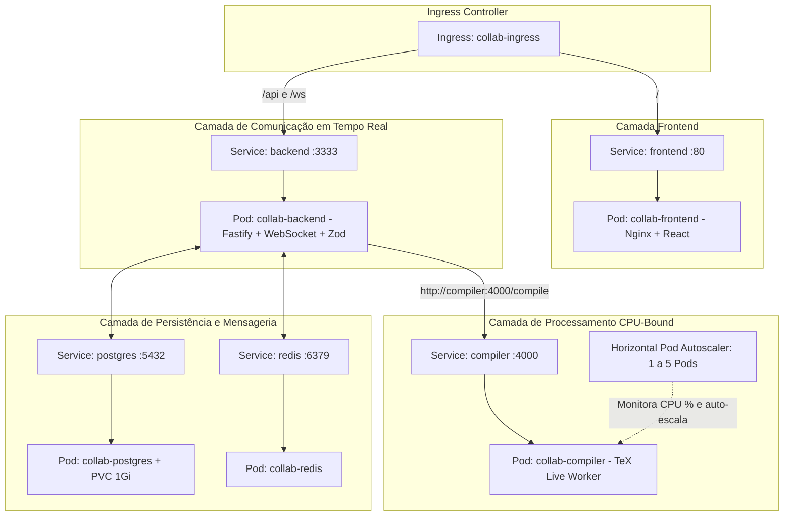

# 01. Arquitetura Kubernetes & Kind: Do Monólito à Nuvem Elástica

Neste módulo, migramos a arquitetura do **Lab 04 (Editor Colaborativo em LaTeX estilo Overleaf)** do Docker Compose local para um cluster **Kubernetes** completo rodando com **Kind** (*Kubernetes in Docker*).

---

## 🏗️ 1. O Mapa de Recursos no Kubernetes (`collab-app`)

Todos os serviços foram desacoplados e estruturados no namespace `collab-app`:



---

## 🎯 2. As Vantagens do Kubernetes para o Editor Colaborativo

### A. Escala Elástica do Compilador com HPA (`compiler-hpa`)
No Docker Compose, o número de contêineres compiladores era estático. No Kubernetes, configuramos o **Horizontal Pod Autoscaler (HPA)**:
```yaml
apiVersion: autoscaling/v2
kind: HorizontalPodAutoscaler
metadata:
  name: compiler-hpa
  namespace: collab-app
spec:
  scaleTargetRef:
    apiVersion: apps/v1
    kind: Deployment
    name: collab-compiler
  minReplicas: 1
  maxReplicas: 5
  metrics:
    - type: Resource
      resource:
        name: cpu
        target:
          type: Utilization
          averageUtilization: 70
```
- Em períodos normais: 1 único Pod do compilador consome recursos mínimos.
- Em períodos de pico (múltiplos usuários recompilando artigos simultaneamente): a CPU ultrapassa 70% e o Kubernetes sobe até 5 réplicas do compilador em paralelo!

### B. Descoberta de Serviços Nativas (Kube-DNS)
No código do backend, a conexão com o compilador é feita de forma limpa via DNS interno:
`http://compiler:4000/compile`
O `kube-proxy` do Kubernetes faz o balanceamento de carga automático (*round-robin*) entre todos os Pods de compilação disponíveis.

---

## 🚀 3. Comandos Úteis para o Cluster Kind

### Verificando os Pods do Sistema
```bash
kubectl get pods -n collab-app
```

### Verificando o Autoscaler (HPA)
```bash
kubectl get hpa -n collab-app
```

### Acessando os Serviços Localmente (Port-Forward)
Para abrir o frontend no navegador:
```bash
kubectl port-forward -n collab-app svc/frontend 8080:80
```
Acesse em: `http://localhost:8080`.

Para testar o backend e os WebSockets:
```bash
kubectl port-forward -n collab-app svc/backend 3333:3333
```
