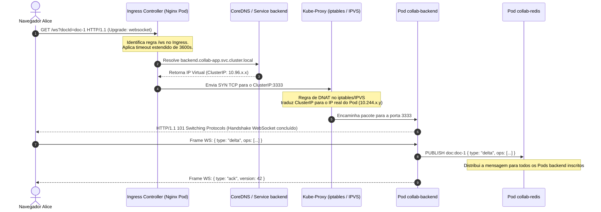
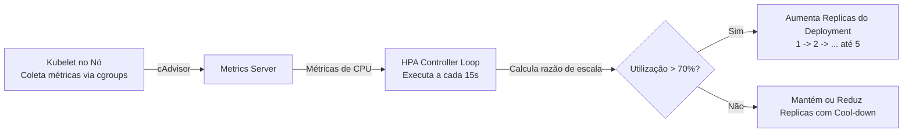

# 01. Arquitetura Kubernetes & Kind: Do Monólito à Nuvem Elástica

> **Objetivo:** Compreender profundamente a arquitetura de orquestração do Editor Colaborativo em LaTeX estilo Overleaf, dissecando o **porquê** de cada decisão de design e o **como** cada componente opera sob o capô do Kubernetes.

---

## 🏛️ 1. Visão Sistêmica e Topologia no Kubernetes

No ambiente de produção, uma aplicação colaborativa em tempo real com compilação pesada (como LaTeX, Typst ou compiladores de código) apresenta requisitos de computação diametralmente opostos:

1. **Camada de Comunicação em Tempo Real:** Altamente orientada a E/S assíncrona (*I/O-Bound*), requer baixa latência (< 50ms), conexões TCP persistentes de longa duração (WebSockets) e compartilhamento rápido de estado de presença e deltas de texto.
2. **Camada de Compilação:** Altamente orientada a processamento (*CPU-Bound*), executa processos binários intensivos (`pdflatex`, `xelatex`, `biber`), consome picos de 100% de núcleo de CPU e pode sofrer travamentos, loops ou falhas em documentos mal formatados.
3. **Camada de Dados & Mensageria:** Estado transacional com ACID (PostgreSQL para documentos e revisões) combinado com cache/broker volátil ultrarrápido in-memory (Redis para presença e Pub/Sub distribuído).

### Topologia de Recursos no Namespace `collab-app`

```mermaid
flowchart TD
    subgraph Internet_Host [Camada Host / Ingress Externo]
        USER_A[Navegador Alice: :8080]
        USER_B[Navegador Bob: :8080]
        ING[Ingress Nginx: collab-ingress\nRules: / -> frontend, /ws e /api -> backend]
    end

    subgraph K8s_CollabApp [Namespace: collab-app]
        subgraph FrontTier [Camada Frontend - Stateless Web]
            FE_SVC[Service ClusterIP: frontend :80]
            FE_POD[Pod: collab-frontend\nNginx + SPA React 18 + CodeMirror 6]
        end

        subgraph RealtimeTier [Camada Tempo Real - I/O-Bound]
            BE_SVC[Service ClusterIP: backend :3333]
            BE_POD[Pod: collab-backend\nNode.js Fastify + @fastify/websocket + Zod]
        end

        subgraph CompilerTier [Camada Compilação - CPU-Bound Autoscaled]
            COMP_SVC[Service ClusterIP: compiler :4000\nLoad-Balancer Round-Robin Kube-Proxy]
            COMP_POD1[Pod: collab-compiler-1\nTeX Live Worker]
            COMP_POD2[Pod: collab-compiler-2\nTeX Live Worker]
            HPA[Horizontal Pod Autoscaler\nTarget: 70% CPU | Min: 1 | Max: 5]
        end

        subgraph StorageTier [Camada de Estado - Stateful Services]
            PG_SVC[Service ClusterIP: postgres :5432]
            PG_POD[(Pod: collab-postgres\nPostgreSQL 16 + PVC 1Gi)]
            RD_SVC[Service ClusterIP: redis :6379]
            RD_POD[(Pod: collab-redis\nRedis 7 Alpine In-Memory)]
        end
    end

    USER_A ==>|HTTP / WebSocket Upgrade| ING
    USER_B ==>|HTTP / WebSocket Upgrade| ING

    ING -->|Path: /| FE_SVC --> FE_POD
    ING -->|Path: /api & /ws| BE_SVC --> BE_POD

    BE_POD <==>|Pub/Sub Deltas & Presença| RD_SVC --> RD_POD
    BE_POD <==>|Snapshots & Histórico SQL| PG_SVC --> PG_POD
    BE_POD -->|POST /compile HTTP| COMP_SVC
    COMP_SVC --> COMP_POD1
    COMP_SVC --> COMP_POD2

    HPA -.->|Mede CPU via Metrics API| COMP_POD1
    HPA -.->|Escala réplicas 1..5| COMP_SVC
```

---

## 🧠 2. O "PORQUÊ": Fundamentos e Decisões de Arquitetura (ADRs)

Por que desenhamos a infraestrutura dessa maneira? Abaixo estão os **Architecture Decision Records (ADRs)** conceituais que orientam o projeto:

### ADR 01: Desacoplamento Físico do Compilador TeX Live (Worker Isolado)
* **O Problema:** No ecossistema Node.js, a execução de tarefas CPU-bound intensivas bloqueia o *Event Loop*. Se o backend executasse `child_process.exec('pdflatex ...')` diretamente no mesmo processo que gerencia WebSockets, qualquer usuário que clicasse em "Recompilar" congelaria o broadcast de digitação de todos os outros usuários conectados na mesma instância por 200ms a 5 segundos (*Head-of-Line Blocking de CPU*). Além disso, a imagem Docker do TeX Live (`texlive-full` ou `texlive-latex-base`) possui centenas de megabytes ou gigabytes de pacotes e binários em C/C++, enquanto o backend Node.js é enxuto.
* **A Solução:** Extrair o compilador para um microsserviço dedicado (`collab-compiler`) executando como um pod isolado no Kubernetes.
* **Benefício:** O backend permanece 100% focado em I/O assíncrono e baixa latência. Se um documento LaTeX travar o compilador ou der *Segmentation Fault*, o pod de compilação morre ou atinge timeout isoladamente, sem afetar as sessões WebSockets ativas nem o banco de dados.

### ADR 02: Ingress Nginx com Anotações Específicas de WebSocket
* **O Problema:** Proxies reversos e Ingress Controllers padrão encerram conexões TCP ociosas após 60 segundos (`proxy_read_timeout 60s`). Em editores colaborativos, se um usuário passar mais de um minuto lendo o texto sem digitar nada, o proxy intermediário fecharia o canal WebSocket com erro `1006 Abnormal Closure`.
* **A Solução:** Inserir anotações customizadas no Ingress:
  ```yaml
  nginx.ingress.kubernetes.io/proxy-read-timeout: "3600"
  nginx.ingress.kubernetes.io/proxy-send-timeout: "3600"
  nginx.ingress.kubernetes.io/websocket-services: "backend"
  ```
* **Benefício:** Permite sessões de até 1 hora de leitura contínua, enquanto o mecanismo de *Heartbeat* da aplicação (Ping/Pong a cada 30s) mantém a tabela de conexões do kernel e dos roteadores viva (*keep-alive*).

### ADR 03: Autoscaling Focado em CPU no Compilador (HPA) vs. Conexões no Backend
* **O Problema:** Por que não colocar HPA baseado em CPU no backend?
  O backend de WebSockets raramente atinge 80% de CPU com facilidade; seu gargalo de escala costuma ser descritores de arquivos abertos (*file descriptors* / limite de conexões simultâneas) ou memória por conexão. Se configurássemos um HPA de CPU no backend, ele poderia ter 10.000 conexões abertas com apenas 25% de CPU e nunca escalaria. Já o compilador é puramente computacional: cada compilação `pdflatex` busca consumir 1 núcleo inteiro de CPU.
* **A Solução:** Definir HPA estritamente no `collab-compiler` com métrica de 70% de utilização média de CPU, variando de 1 a 5 pods. O backend é mantido com dimensionamento estável e escalonamento planejado por memória e capacidade de rede.

### ADR 04: StatefulSet e PVC para PostgreSQL vs. Deployments Stateless
* **O Problema:** Contêineres no Kubernetes possuem sistema de arquivos efêmero (*ephemeral storage*). Se um Pod de banco reiniciar ou for movido para outro nó do cluster pelo Scheduler, todos os dados salvos em disco desapareceriam se usássemos apenas o disco local do contêiner.
* **A Solução:** Atrelar o Pod do PostgreSQL a um **PersistentVolumeClaim (PVC)** de 1Gi (`ReadWriteOnce`), garantindo que o volume persista mesmo diante de destruição, eviction ou reinicialização do Pod.

---

## ⚙️ 3. O "COMO": Mecânica Interna e Funcionamento Sob o Capô

Como o Kubernetes executa e garante a integridade de todo esse fluxo? Vamos analisar os mecanismos internos:

### 3.1 O Caminho de um Pacote WebSocket até o Pod (Rede K8s)



1. **Resolução de Nomes (CoreDNS):** O Ingress localiza o serviço `backend` através do DNS interno do cluster (`backend.collab-app.svc.cluster.local`).
2. **ClusterIP e Kube-Proxy:** O serviço `backend` não é um servidor real, mas um IP virtual gerido pelo `kube-proxy`. O `kube-proxy` programa regras de *iptables* ou *IPVS* no kernel Linux do nó para fazer balanceamento de carga e tradução de endereços (DNAT) diretamente para a interface de rede do Pod.
3. **Upgrade de Protocolo:** O Nginx Ingress inspeciona os cabeçalhos `Upgrade: websocket` e `Connection: Upgrade`, abrindo um túnel TCP transparente bidirecional entre o cliente externo e o socket do Fastify.

---

### 3.2 Isolamento de Recursos: Requests, Limits e o Escalonador Linux (CFS)

No manifesto `k8s/base/compiler.yaml`, definimos:

```yaml
resources:
  requests:
    cpu: 250m
    memory: 256Mi
  limits:
    cpu: 1000m
    memory: 512Mi
```

Como o kernel Linux e o Kubernetes interpretam esses valores?

* **`requests` (Garantia de Agendamento):** O Kubernetes Scheduler soma os *requests* de todos os pods agendados em um nó. Ele só aceita colocar um novo Pod de compilação em um nó se houver pelo menos 250 milicores (1/4 de 1 CPU) e 256 MB de RAM livres. Isso evita o problema de *Overcommitment* descontrolado.
* **`limits.cpu` (CFS Quota):** O Linux utiliza o *Completely Fair Scheduler* (CFS). No caso de `1000m` (1 núcleo), o contêiner recebe uma cota de 100ms de CPU a cada período de 100ms. Se o compilador tentar usar mais de 1 núcleo (por exemplo, gerando múltiplas threads de renderização), o kernel aplica *CPU Throttling* (estrangulamento), sem matar o processo.
* **`limits.memory` (OOM Killer):** Ao contrário da CPU, a memória não pode ser "estrangulada". Se um arquivo LaTeX corrompido ou malicioso alocar mais de 512 MiB de RAM na compilação, o kernel dispara o **Out-Of-Memory Killer (OOMKilled)**. O contêiner recebe o sinal `SIGKILL (exit code 137)`, morre instantaneamente e o Kubernetes reinicia o Pod limpo, protegendo a estabilidade de todo o nó.

---

### 3.3 A Mecânica do Horizontal Pod Autoscaler (HPA)

O HPA configurado em `k8s/base/compiler.yaml` monitora o `collab-compiler`:



A fórmula matemática do HPA é:
$$\text{Réplicas Desejadas} = \left\lceil \text{Réplicas Atuais} \times \frac{\text{Utilização Atual de CPU}}{\text{Target (70\%)}} \right\rceil$$

Se 1 Pod estiver rodando a 140% de CPU (sob carga contínua de compilações concorrentes), o HPA calcula:
$$\left\lceil 1 \times \frac{140}{70} \right\rceil = 2 \text{ réplicas}$$
O Kubernetes aciona a API do Deployment, que cria imediatamente o segundo Pod. O Service `compiler:4000` passa a distribuir as próximas requisições HTTP de compilação em *round-robin* entre os dois Pods!

---

## 🔬 4. Inspeção Forense e Comandos de Diagnóstico

Para verificar a saúde e a dinâmica do cluster Kind em tempo de execução:

### 1. Inspecionar Métricas de Consumo Real (CPU/RAM)
```bash
# Ver consumo de nós
kubectl top nodes

# Ver consumo de cada Pod no namespace
kubectl top pods -n collab-app
```

### 2. Verificar o Status e Eventos do HPA
```bash
kubectl describe hpa compiler-hpa -n collab-app
```
*Procure pela seção `Conditions` (AbleToScale, ScalingActive, ScalingLimited).*

### 3. Simular Carga de Compilação para Disparar Autoscaling
Você pode disparar compilações concorrentes via script bash em loop e observar o HPA subir réplicas:
```bash
for i in {1..20}; do
  curl -s -X POST http://localhost:3334/api/compile \
    -H "Content-Type: application/json" \
    -d '{"documentId":"doc-1","author":"StressTester"}' > /dev/null &
done
```
Monitore a reação do HPA em tempo real:
```bash
kubectl get hpa -n collab-app -w
```

### 4. Simular Queda e Recuperação Automática de Pod (Self-Healing)
Delete o Pod do backend ou do compilador e veja a recuperação em menos de 2 segundos:
```bash
kubectl delete pod -n collab-app -l app=compiler
kubectl get pods -n collab-app -w
```
O *ReplicaSet Controller* detecta imediatamente que a contagem de réplicas caiu abaixo do desejado e provisiona um novo Pod sem intervenção humana.

---

## 📌 Resumo dos Aprendizados Chave

| Conceito | Por que usamos? | Como funciona na prática? |
| :--- | :--- | :--- |
| **Kind (K8s in Docker)** | Cluster de testes idêntico ao ambiente de produção em nuvem (EKS, GKE). | O nó do Kubernetes é um contêiner Docker rodando containerd, kubelet e kube-proxy. |
| **Kustomize (`k8s/base`)** | Gerenciamento declarativo e limpo de manifestos sem a complexidade de templates pesados. | Concatena e aplica manifestos padronizados com rastreabilidade total via Git. |
| **Worker Desacoplado** | Evita congelamento do Event Loop do Node.js por tarefas pesadas em C/C++. | Backend despacha via HTTP interno para `compiler:4000`, balanceado pelo kube-proxy. |
| **Ingress Timeout 3600s** | Evita desconexões indesejadas de WebSockets ociosos por timeouts padrões de 60s. | O Ingress Controller estende a janela de leitura antes de encerrar o socket TCP. |
| **HPA** | Escala elástica horizontal em picos de demanda acadêmica/editorial. | O controlador consulta o Metrics Server e ajusta o `replicas` do Deployment. |
| **PersistentVolumeClaim** | Garante que o banco relacional não perca dados em caso de reinicialização. | Vincula o diretório `/var/lib/postgresql/data` a um volume gerenciado pelo host. |
