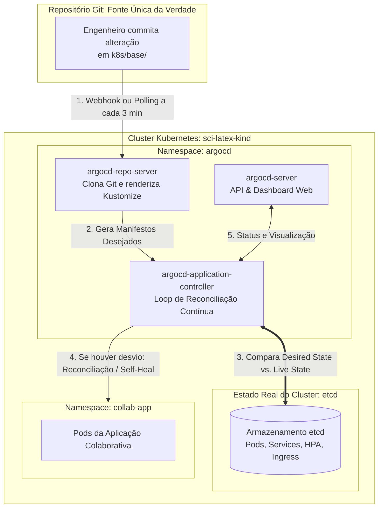

# 02. GitOps com Argo CD & Pipelines Científicos com Argo Workflows

> **Objetivo:** Dominar a entrega contínua declarativa (**GitOps**) com o **Argo CD** e a orquestração de compilação assíncrona efêmera com o **Argo Workflows**, dissecando o **porquê** de cada estratégia e o **como** cada componente reconcilia e executa tarefas sob o capô do Kubernetes.

---

## 🐙 1. GitOps com Argo CD: A Inversão do Paradigma de Deploy

### 1.1 O "PORQUÊ": Por que GitOps e não CI/CD Tradicional Push?

No modelo tradicional de implantação contínua (*Push-based CD*, como scripts rodando em GitHub Actions, GitLab CI ou Jenkins):
* Um runner externo ao cluster precisa de credenciais de superusuário (`kubeconfig` com privilégios de `cluster-admin`).
* Se o runner for invadido ou o segredo vazar, todo o cluster Kubernetes fica exposto.
* **Problema do Desvio de Configuração (*Configuration Drift*):** Se um operador alterar manualmente um recurso no cluster usando `kubectl edit`, `kubectl scale` ou aplicar um patch de emergência, o repositório Git nunca ficará sabendo. A infraestrutura real entra em desvio em relação ao código (*drift*), gerando cenários onde o próximo deploy pode sobrescrever correções críticas ou quebrar em cascata.

O **GitOps (*Pull-based CD*)** inverte essa relação fundamentalmente:



### Princípios Chave Implementados:
1. **Estado Desejado Declarativo:** Todo o ambiente do editor colaborativo (Postgres, Redis, Backend, Compilador, Ingress) está formalizado em arquivos YAML sob controle de versão.
2. **Puxado de Dentro para Fora (*Pull-based*):** O controlador do Argo CD roda dentro do cluster. Ele não requer nenhuma porta aberta para a internet nem exposição de credenciais externas.
3. **Reconciliação e Auto-Cura (*Continuous Self-Healing*):** Se alguém tentar alterar o número de réplicas ou apagar um serviço via linha de comando no cluster, o Argo CD detecta o desvio em segundos e força o estado do cluster de volta ao que está no Git.

---

### 1.2 O "COMO": Anatomia do Manifesto `Application` (`k8s/argocd/application.yaml`)

O Argo CD estende a API do Kubernetes através de um **Custom Resource Definition (CRD)** chamado `Application`:

```yaml
apiVersion: argoproj.io/v1alpha1
kind: Application
metadata:
  name: collaborative-latex-editor
  namespace: argocd
  finalizers:
    # Garante que, ao deletar a Application, o Argo CD faça a limpeza de todos os recursos filhos
    - resources-finalizer.argocd.argoproj.io
spec:
  project: default
  source:
    repoURL: 'https://github.com/usuario/estudo-comunicao-em-tempo-real.git'
    targetRevision: HEAD
    path: k8s/base
  destination:
    server: 'https://kubernetes.default.svc'
    namespace: collab-app
  syncPolicy:
    automated:
      prune: true
      selfHeal: true
    syncOptions:
      - CreateNamespace=true
```

#### Dissecando cada campo crítico:
* **`spec.source.path: k8s/base`:** O Argo CD inspeciona este diretório e detecta automaticamente o arquivo `kustomization.yaml`. Ele invoca nativamente a engine do Kustomize para montar o grafo completo de recursos sem precisar de plugins adicionais.
* **`destination.server: https://kubernetes.default.svc`:** Aponta para o próprio cluster onde o Argo CD está rodando (comunicação via rede de serviço interna com certificado TLS do cluster).
* **`syncPolicy.automated.prune: true`:** Se um desenvolvedor remover o arquivo `ingress.yaml` do Git, o Argo CD detecta que o recurso não deve mais existir e **remove** o Ingress correspondente do cluster automaticamente. Sem o `prune`, recursos mortos ficariam vagando como "recursos zumbis" no cluster.
* **`syncPolicy.automated.selfHeal: true`:** Se um operador rodar `kubectl delete svc compiler -n collab-app`, o controlador detecta o descompasso (*OutOfSync*) e recria o Service do compilador imediatamente.

---

## ⚡ 2. Argo Workflows: Pipelines de Compilação Científica Efêmera

### 2.1 O "PORQUÊ": Por que Compilar LaTeX em Pipelines Efêmeros?

No Lab 04, temos o microsserviço `collab-compiler` que atende compilações interativas rápidas via HTTP em ~200ms. No entanto, em sistemas editoriais e de publicação acadêmica (como Overleaf, IEEE, Springer, ArXiv), existem desafios únicos que uma API simples não consegue resolver sozinha:

#### 1. O Problema da Compilação Multi-pass no LaTeX
Diferente de um código em C ou JavaScript que compila em um único comando linear, documentos acadêmicos complexos exigem **múltiplas passagens sequenciais**:

```
[Documento .tex]
       │
       ▼
[Passo 1: pdflatex (Passagem 1)]
       │ - Gera arquivo .aux com referências não resolvidas (ex: citações "[?]")
       ▼
[Passo 2: bibtex / biber]
       │ - Lê o .aux e a base de referências bibliográficas (.bib)
       │ - Gera o arquivo formatado de citações (.bbl)
       ▼
[Passo 3: pdflatex (Passagem 2)]
       │ - Lê o .bbl e substitui "[?]" pelos autores e números reais
       ▼
[Passo 4: pdflatex (Passagem 3 / Opcional)]
       │ - Atualiza índices remissivos, contadores de páginas e listas de tabelas
       ▼
[PDF Final Consolidado e Publicável]
```

Se tentássemos rodar 3 a 4 passagens pesadas sequencialmente dentro do mesmo contêiner HTTP síncrono, a conexão poderia sofrer timeout, a memória do processo poderia esgotar e a rastreabilidade de erros seria confusa para o usuário.

#### 2. Isolamento de Segurança e Sandbox Efêmero
LaTeX é uma linguagem de macros Turing-complete e possui o comando `\write18` (que permite execução de comandos shell se não for bloqueado com `-no-shell-escape`). Usuários maliciosos poderiam submeter códigos que entram em loops infinitos de expansão de macros ou tentam consumir todo o disco temporário.

Ao orquestrar a compilação via **Argo Workflows**:
* Cada compilação executa em um **Pod isolado efêmero**.
* O Pod tem cotas rígidas de CPU e memória (*cgroups*). Se o usuário criar uma bomba de memória no LaTeX, apenas aquele Pod específico morre com OOMKilled, sem impactar nenhum outro usuário.
* Ao término da compilação, o Pod é destruído, liberando 100% dos recursos do cluster.

---

### 2.2 O "COMO": Análise do `WorkflowTemplate` (`k8s/workflows/latex-compile-workflow.yaml`)

```yaml
apiVersion: argoproj.io/v1alpha1
kind: WorkflowTemplate
metadata:
  name: latex-compilation-pipeline
  namespace: collab-app
spec:
  entrypoint: compile-latex-article
  arguments:
    parameters:
      - name: document-id
        value: "doc-1"
      - name: tex-source
        value: "\\documentclass{article}\\begin{document}Hello Scientific World\\end{document}"

  templates:
    - name: compile-latex-article
      steps:
        # Etapa 1: Primeira passagem para mapear chaves e referências
        - - name: pdflatex-initial-pass
            template: run-pdflatex
            arguments:
              parameters:
                - name: pass-number
                  value: "1"

        # Etapa 2: Passagem final para consolidar o layout
        - - name: pdflatex-final-pass
            template: run-pdflatex
            arguments:
              parameters:
                - name: pass-number
                  value: "2"

    - name: run-pdflatex
      inputs:
        parameters:
          - name: pass-number
      container:
        image: 04-collaborative-editor-compiler:latest
        imagePullPolicy: IfNotPresent
        command: [sh, -c]
        args:
          - |
            echo "=== Executando passagem {{inputs.parameters.pass-number}} no Pod efêmero ==="
            mkdir -p /tmp/workdir
            cd /tmp/workdir
            echo '{{workflow.parameters.tex-source}}' > main.tex
            pdflatex -interaction=nonstopmode -no-shell-escape main.tex
            ls -la main.pdf
        resources:
          requests:
            cpu: 500m
            memory: 256Mi
          limits:
            cpu: 1000m
            memory: 512Mi
```

#### Mecânica de Execução dos Steps:
1. **Entrypoint:** Define que o ponto de entrada é o template de passos `compile-latex-article`.
2. **Execução Sequencial vs. Paralela:** No formato de lista de listas (`steps: [ [passo1], [passo2] ]`), o Argo Workflows garante que a Etapa 2 (`pdflatex-final-pass`) só inicia após a conclusão bem-sucedida da Etapa 1 (`pdflatex-initial-pass`).
3. **Isolamento Parametrizado:** O texto-fonte é injetado dinamicamente via variáveis de template `{{workflow.parameters.tex-source}}`, permitindo que o pipeline seja disparado programaticamente pelo backend via API do Argo Workflows.

---

## 🛠️ 3. Guia Prático de Operação e Testes GitOps

### 3.1 Acessando e Interagindo com o Argo CD

#### Passo 1: Obter a senha administrativa gerada na instalação
```bash
kubectl -n argocd get secret argocd-initial-admin-secret -o jsonpath="{.data.password}" | base64 -d; echo
```

#### Passo 2: Estabelecer túnel seguro para o painel web
```bash
kubectl port-forward svc/argocd-server -n argocd 8443:443
```
Abra no navegador em **`https://localhost:8443`** (aceite o certificado autoassinado) e entre com usuário `admin`.

#### Passo 3: Inspecionar o Status da Aplicação via CLI
```bash
# Ver estado de sincronização e saúde de todos os recursos da aplicação
kubectl get application -n argocd

# Descrição detalhada dos recursos reconciliados
kubectl describe application collaborative-latex-editor -n argocd
```

---

### 3.2 Testando o "Self-Healing" do Argo CD na Prática

Quer ver a auto-cura em ação?
1. Apague intencionalmente um Service crucial:
   ```bash
   kubectl delete svc backend -n collab-app
   ```
2. No painel do Argo CD, observe o status passar instantaneamente para `OutOfSync`.
3. O controlador detecta a violação e **recria o Service automaticamente** em menos de 5 segundos!
4. Verifique no terminal:
   ```bash
   kubectl get svc backend -n collab-app
   ```
   *O serviço já estará ativo novamente!*

---

### 3.3 Disparando o Pipeline do Argo Workflows Manualmente

Para submeter uma compilação de artigo científico através do pipeline efêmero:

```bash
# Se o Argo CLI estiver instalado:
argo submit --from wftmpl/latex-compilation-pipeline \
  -n collab-app \
  --parameter tex-source="\documentclass{article}\begin{document}\title{Estudo GitOps}\maketitle Reconciliado com sucesso!\end{document}" \
  --watch
```

Você verá o Argo provisionar os Pods efêmeros passo a passo no cluster:
```
STEP                               TEMPLATE            PODNAME
 ✔ latex-compilation-pipeline-1    compile-article
 ├──✔ pdflatex-initial-pass        run-pdflatex        latex-compilation-pipeline-1-pass1
 └──✔ pdflatex-final-pass          run-pdflatex        latex-compilation-pipeline-1-pass2
```

---

## 📊 Matriz Comparativa: Compilação Síncrona vs. Workflow Efêmero

| Critério | Compilação Interativa HTTP (`collab-compiler`) | Pipeline com Argo Workflows |
| :--- | :--- | :--- |
| **Caso de Uso Principal** | Feedback visual instantâneo durante a digitação do usuário (~200ms). | Publicação final de teses e livros com múltiplos `.bib` e índices (~10s a 2min). |
| **Ciclo de Vida do Pod** | Pods persistentes gerenciados por Deployment + HPA. | Pods efêmeros criados sob demanda e destruídos imediatamente. |
| **Isolamento de Segurança** | Compartilhado entre requisições sequenciais do mesmo Pod. | Isolamento absoluto de processo, memória e rede por Pod. |
| **Consumo de Recursos** | Mantém consumo base contínuo (requisição/limite). | Zero consumo de CPU/RAM em períodos de inatividade. |
| **Tolerância a Falhas** | Trata erros via timeout de requisição HTTP. | Possui retries nativos, steps condicionais e DAG de fallback. |
