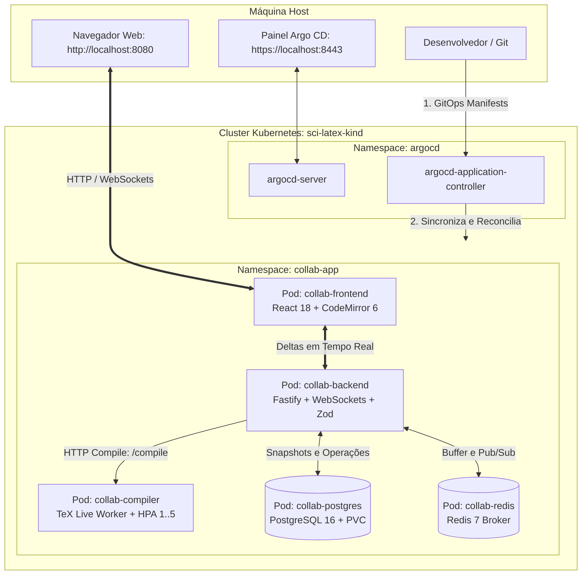

# 🚀 Guia de Operação: Subindo a Arquitetura no Kubernetes (Kind) & GitOps com Argo CD

Este guia contém o passo a passo completo para provisionar e operar a arquitetura do **Editor Colaborativo em LaTeX estilo Overleaf** no **Kubernetes (Kind)** com **Argo CD**.

---

## 🏛️ Visão Geral da Arquitetura



---

## 📋 1. Pré-Requisitos

Certifique-se de ter instalado na sua máquina:
- **Docker** (`docker version`)
- **Kind** (`kind --version`)
- **Kubectl** (`kubectl version --client`)

---

## 🛠️ 2. Passo a Passo: Subindo o Ambiente do Zero

### Passo 1: Criar o Cluster Kind (se ainda não existir)
Se o cluster `sci-latex-kind` ainda não estiver ativo:
```bash
kind create cluster --name sci-latex-kind
```

Verifique se o nó está pronto:
```bash
kubectl get nodes
```

---

### Passo 2: Construir as Imagens Docker Localmente
Na raiz da pasta do laboratório:
```bash
cd labs/04-collaborative-editor

# Constrói as 3 imagens customizadas
docker compose build backend compiler frontend
```

---

### Passo 3: Carregar as Imagens no Cluster Kind
O Kind roda contêineres locais e não precisa de registro remoto (Docker Hub). Carregue as imagens diretamente para o nó do cluster:
```bash
kind load docker-image \
  04-collaborative-editor-backend:latest \
  04-collaborative-editor-compiler:latest \
  04-collaborative-editor-frontend:latest \
  --name sci-latex-kind
```

---

### Passo 4: Instalar o Argo CD no Cluster
Instale os recursos do Argo CD no namespace `argocd`:
```bash
kubectl create namespace argocd || true
kubectl apply -n argocd --server-side --force-conflicts -f https://raw.githubusercontent.com/argoproj/argo-cd/stable/manifests/install.yaml
```

Aguarde até os pods do Argo CD ficarem prontos:
```bash
kubectl wait --for=condition=ready pod -l app.kubernetes.io/name=argocd-server -n argocd --timeout=120s
```

---

### Passo 5: Implantar a Aplicação no Kubernetes
Você pode aplicar os manifestos diretamente via Kustomize:
```bash
kubectl apply -k k8s/base
```

Ou registrar a aplicação no **Argo CD** para gerenciamento GitOps:
```bash
kubectl apply -f k8s/argocd/application.yaml
```

Verifique se todos os pods subiram com sucesso:
```bash
kubectl get pods -n collab-app
```
*Saída esperada: todos os 5 pods com status `1/1 Running`.*

---

## 🌐 3. Acessando a Aplicação e o Argo CD

Criamos um script que inicia todos os túneis de conexão (*port-forwards*) em segundo plano:

```bash
cd labs/04-collaborative-editor
./k8s-port-forward.sh
```

### URLs de Acesso Disponíveis:

| Serviço | URL | Descrição / Credenciais |
| :--- | :--- | :--- |
| **Editor Colaborativo (LaTeX + PDF)** | **[http://localhost:8080](http://localhost:8080)** | Interface completa estilo Overleaf |
| **Backend API (REST + WebSockets)** | **[http://localhost:3334](http://localhost:3334)** | Endpoint da API Fastify no Kubernetes |
| **Painel Web do Argo CD** | **[https://localhost:8443](https://localhost:8443)** | **Usuário:** `admin`<br>**Senha:** veja como obter abaixo |

---

### 🔑 Como Obter a Senha do Argo CD

Para extrair a senha inicial gerada para o usuário `admin`:
```bash
kubectl -n argocd get secret argocd-initial-admin-secret -o jsonpath="{.data.password}" | base64 -d; echo
```

---

## 🧪 4. Como Testar a Colaboração e a Compilação

1. Abra duas abas no navegador em: **[http://localhost:8080](http://localhost:8080)**
2. Na **Aba 1**, defina seu nome como **Alice**.
3. Na **Aba 2**, defina seu nome como **Bob**.
4. Digite uma nova equação matemática no CodeMirror na Aba 1:
   ```latex
   \begin{equation}
     E = mc^2 \quad \text{e} \quad \nabla \cdot \mathbf{B} = 0
   \end{equation}
   ```
5. Veja na Aba 2:
   - O cursor com a bandeira **"Alice"** piscando em tempo real.
   - O texto com o realce de autoria (*author highlight*).
6. Clique no botão azul **"Recompilar PDF"**:
   - O Pod `collab-compiler` processará o documento via `pdflatex` em **~200ms**.
   - O visualizador no lado direito exibirá a versão diagramada do PDF com as novas equações!

---

## 📊 5. Comandos de Diagnóstico e Monitoramento

### Ver Logs dos Serviços em Tempo Real
```bash
# Logs do Backend (Fastify + WebSockets)
kubectl logs -n collab-app deploy/collab-backend -f

# Logs do Compilador TeX Live
kubectl logs -n collab-app deploy/collab-compiler -f

# Logs do Banco de Dados PostgreSQL
kubectl logs -n collab-app deploy/collab-postgres -f
```

### Monitorar o Escalonamento Automático (HPA)
```bash
kubectl get hpa -n collab-app
```

### Reiniciar um Serviço
```bash
kubectl rollout restart deployment/collab-compiler -n collab-app
```

---

## 🛑 6. Como Parar ou Limpar o Ambiente

Para encerrar os port-forwards, basta dar `Ctrl+C` no terminal do script `./k8s-port-forward.sh`.

Para remover todos os recursos do Kubernetes mantendo o cluster:
```bash
kubectl delete -k k8s/base
```

Para deletar o cluster Kind por completo:
```bash
kind delete cluster --name sci-latex-kind
```
