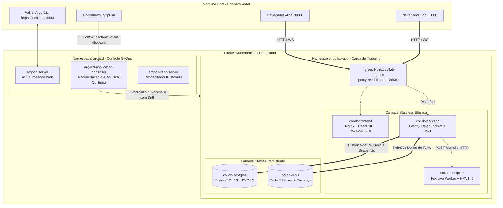

# 🚀 Guia de Arquitetura & Operação: Kubernetes (Kind) & GitOps com Argo CD

Este guia consolida a arquitetura completa, o embasamento teórico (**o porquê**) e o manual prático passo a passo (**o como**) para provisionar, operar e depurar o **Editor Colaborativo em LaTeX estilo Overleaf** no **Kubernetes (Kind)** com **Argo CD** e **Argo Workflows**.

---

## 🏛️ 1. O PORQUÊ: Fundamentos da Arquitetura Distribuída

Por que migramos de um Docker Compose simples para uma topologia orquestrada no Kubernetes?



### Decisões Arquiteturais Chave:
1. **Desacoplamento CPU-Bound vs. I/O-Bound:**
   * O backend Fastify gerencia milhares de conexões WebSockets abertas (I/O intensivo). O Node.js possui um *Event Loop* single-threaded; se rodasse a compilação do TeX Live (`pdflatex`) diretamente no mesmo processo, cada compilação congelaria os cursores de todos os usuários por até 5 segundos.
   * O `collab-compiler` roda em Pods isolados com limites rígidos de CPU (*cgroups CFS*).
2. **Escala Elástica Inteligente com HPA (Horizontal Pod Autoscaler):**
   * O compilador varia automaticamente de 1 a 5 réplicas quando a média de CPU ultrapassa 70%, absorvendo picos de compilação sem onerar o cluster em horários ociosos.
3. **Resiliência a Conexões Longas no Ingress:**
   * Anotações customizadas estendem o timeout de 60s padrão para 3600s (`proxy-read-timeout`), eliminando desconexões espúrias de usuários ociosos.
4. **GitOps como Fonte Única da Verdade:**
   * Qualquer desvio acidental no cluster (*configuration drift*) é corrigido automaticamente pelo Argo CD (*self-heal*), e qualquer remoção de recurso no Git é limpa automaticamente no cluster (*prune*).

---

## 📋 2. Pré-Requisitos

Antes de iniciar, certifique-se de ter instalado:
* **Docker** (`docker version` >= 20.10)
* **Kind** (`kind --version` >= 0.20)
* **Kubectl** (`kubectl version --client` >= 1.28)

---

## 🛠️ 3. O COMO: Passo a Passo do Provisionamento do Zero

### Passo 1: Criar o Cluster Kind
Se o cluster `sci-latex-kind` ainda não estiver ativo:
```bash
kind create cluster --name sci-latex-kind
```
Verifique a conectividade:
```bash
kubectl get nodes
```

---

### Passo 2: Construir as Imagens Docker Localmente
Na pasta do laboratório:
```bash
cd labs/04-collaborative-editor
docker compose build backend compiler frontend
```

---

### Passo 3: Carregar as Imagens para o Nó do Kind
Como o Kind roda contêineres locais sem precisar enviar para o Docker Hub, injete as imagens diretamente no nó:
```bash
kind load docker-image \
  04-collaborative-editor-backend:latest \
  04-collaborative-editor-compiler:latest \
  04-collaborative-editor-frontend:latest \
  --name sci-latex-kind
```

---

### Passo 4: Instalar o Argo CD no Cluster
Crie o namespace `argocd` e aplique os manifestos oficiais:
```bash
kubectl create namespace argocd || true
kubectl apply -n argocd --server-side --force-conflicts -f https://raw.githubusercontent.com/argoproj/argo-cd/stable/manifests/install.yaml
```

Aguarde o controlador do Argo CD inicializar:
```bash
kubectl wait --for=condition=ready pod -l app.kubernetes.io/name=argocd-server -n argocd --timeout=120s
```

---

### Passo 5: Implantar os Recursos da Aplicação

#### Opção A: Via Kustomize Direto (Modo Rápido / Imperativo)
```bash
kubectl apply -k k8s/base
```

#### Opção B: Via Argo CD GitOps (Modo Declarativo de Produção)
```bash
kubectl apply -f k8s/argocd/application.yaml
```

Verifique se todos os Pods atingiram status `Running`:
```bash
kubectl get pods -n collab-app
```
*Saída esperada:*
```
NAME                               READY   STATUS    RESTARTS   AGE
collab-backend-xxxx-yyyy           1/1     Running   0          45s
collab-compiler-xxxx-yyyy          1/1     Running   0          45s
collab-frontend-xxxx-yyyy          1/1     Running   0          45s
collab-postgres-xxxx-yyyy          1/1     Running   0          45s
collab-redis-xxxx-yyyy             1/1     Running   0          45s
```

---

## 🌐 4. Acessando a Aplicação e os Dashboards

Execute o script de automação de túneis em segundo plano:
```bash
cd labs/04-collaborative-editor
./k8s-port-forward.sh
```

### Tabela de Portas e Endereços Locais:

| Serviço | URL de Acesso | O que faz / Credenciais |
| :--- | :--- | :--- |
| **Editor Colaborativo Web** | **[http://localhost:8080](http://localhost:8080)** | Frontend React + CodeMirror 6 + Visualizador PDF |
| **Backend API & WebSockets** | **[http://localhost:3334](http://localhost:3334)** | Fastify API (`/api/documents/:id`, `/ws`) |
| **Painel Web do Argo CD** | **[https://localhost:8443](https://localhost:8443)** | **Usuário:** `admin`<br>**Senha:** ver comando abaixo |

#### 🔑 Como extrair a senha do Argo CD:
```bash
kubectl -n argocd get secret argocd-initial-admin-secret -o jsonpath="{.data.password}" | base64 -d; echo
```

---

## 🧪 5. Validação Prática: Colaboração, Compilação e GitOps

### Teste 1: Colaboração em Tempo Real Multi-Aba
1. Abra duas abas no navegador em `http://localhost:8080`.
2. Em uma aba, digite seu nome como **Alice**; na outra, como **Bob**.
3. Na aba da Alice, adicione uma nova seção no documento:
   ```latex
   \section{Escalonamento no Kubernetes}
   O Horizontal Pod Autoscaler regula réplicas baseado em carga de CPU.
   ```
4. Verifique instantaneamente na aba do Bob:
   * O cursor de Alice se move e pisca em tempo real.
   * O texto digitado aparece com realce de autoria.
   * As mensagens transitam via WebSocket no Pod `collab-backend`, sincronizam no `collab-redis` e persistem no `collab-postgres`.

### Teste 2: Compilação de PDF TeX Live
1. Clique no botão azul **"Recompilar PDF"**.
2. O Pod `collab-compiler` processa o arquivo via `pdflatex` em cerca de 200 milissegundos.
3. O visualizador PDF exibe o documento diagramado com a nova seção e fórmulas matemáticas.

### Teste 3: Auto-Cura (Self-Healing) do Argo CD
1. Delete intencionalmente o serviço do backend pelo terminal:
   ```bash
   kubectl delete svc backend -n collab-app
   ```
2. Abra a interface do Argo CD em `https://localhost:8443`.
3. Veja o status mudar brevemente para `OutOfSync`, e o Argo CD recriar o serviço imediatamente para manter a integridade declarada no Git!

---

## 🩺 6. Guia Forense e Troubleshooting

| Sintoma | Causa Mais Provável | Comando de Diagnóstico & Correção |
| :--- | :--- | :--- |
| **Pod em `CrashLoopBackOff`** | O PostgreSQL ainda não aceitou conexões ou falha no `init.sql`. | Inspecione os logs com `kubectl logs -n collab-app deploy/collab-postgres`. Se for o backend: `kubectl logs -n collab-app deploy/collab-backend`. |
| **Pod em `ImagePullBackOff`** | A imagem Docker não foi carregada no nó do Kind. | Reexecute: `kind load docker-image 04-collaborative-editor-backend:latest --name sci-latex-kind`. |
| **Compilação falha ou lenta** | O contêiner atingiu o limite de CPU ou memória (OOMKilled). | Rode `kubectl describe pod -n collab-app -l app=compiler` e procure por `Last State: Terminated (Reason: OOMKilled)`. |
| **WebSocket fecha após 1 minuto** | Falta da anotação `proxy-read-timeout` no Ingress. | Verifique se `k8s/base/ingress.yaml` contém a anotação `nginx.ingress.kubernetes.io/proxy-read-timeout: "3600"`. |
| **Argo CD exibe `ComparisonError`** | Sintaxe inválida de YAML ou versão incompatível de Kustomize. | Rode `kubectl kustomize k8s/base` localmente para validar se os manifestos renderizam sem erros. |

---

## 🛑 7. Desligamento e Limpeza

* Para parar os túneis de rede locais: dê `Ctrl+C` no terminal onde o `./k8s-port-forward.sh` está rodando.
* Para remover a aplicação mantendo o cluster ativo:
  ```bash
  kubectl delete -k k8s/base
  ```
* Para destruir o cluster Kind completamente e liberar toda a memória do host:
  ```bash
  kind delete cluster --name sci-latex-kind
  ```

---

## 📚 Documentos Complementares no Repositório

Para um aprofundamento teórico e conceitual avançado, consulte:
* [01. Arquitetura Kubernetes & Kind: Do Monólito à Nuvem Elástica](file:///mnt/c0b6217c-c2f3-4c1f-8ba2-c8d177f718a9/development/professional/estudo-comunicao-em-tempo-real/docs/04-kubernetes-e-gitops/01-arquitetura-k8s-e-kind.md)
* [02. GitOps com Argo CD & Pipelines Científicos com Argo Workflows](file:///mnt/c0b6217c-c2f3-4c1f-8ba2-c8d177f718a9/development/professional/estudo-comunicao-em-tempo-real/docs/04-kubernetes-e-gitops/02-argocd-gitops-e-workflows.md)
* [Template de Compilação com Argo Workflows](file:///mnt/c0b6217c-c2f3-4c1f-8ba2-c8d177f718a9/development/professional/estudo-comunicao-em-tempo-real/k8s/workflows/latex-compile-workflow.yaml)
