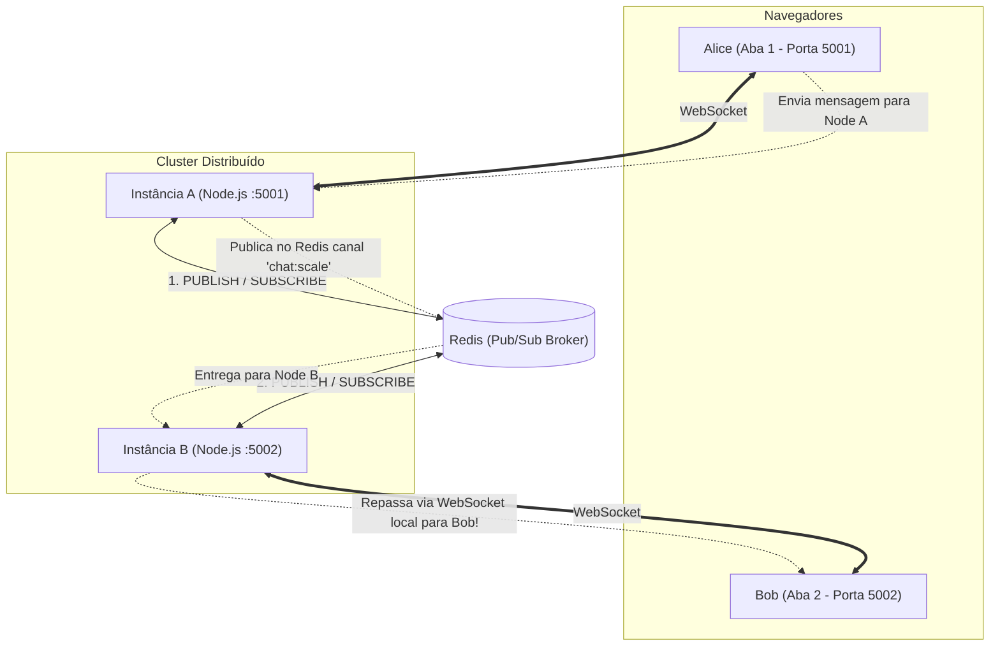

# 🧪 Lab 03: Escala Horizontal Multi-Nó com Redis Pub/Sub

Este laboratório demonstra na prática a solução para o **Desafio Stateful**: como escalar servidores de WebSocket horizontalmente entre múltiplos processos ou contêineres utilizando o **Redis Pub/Sub** como backplane de eventos.

---

## 🎯 Cenário de Teste da Arquitetura



Mesmo que Alice e Bob estejam conectados em **processos completamente diferentes em portas diferentes**, as mensagens trafegam instantaneamente através do Redis!

---

## 🚀 Como Executar

### Opção A: Usando Docker Compose (Recomendado)
Sobe o Redis e duas instâncias da aplicação automaticamente:
```bash
cd labs/03-scale-redis-pubsub
docker compose up --build
```
- Instância A estará em: [http://localhost:5001](http://localhost:5001)
- Instância B estará em: [http://localhost:5002](http://localhost:5002)

---

### Opção B: Executando Localmente no Terminal

1. Suba apenas o Redis via Docker:
   ```bash
   docker run -d --name redis-lab -p 6379:6379 redis:alpine
   ```
2. Instale as dependências:
   ```bash
   cd labs/03-scale-redis-pubsub
   npm install
   ```
3. Abra **Terminal 1** e inicie o Nó A:
   ```bash
   PORT=5001 NODE_NAME="Nó A" npm start
   ```
4. Abra **Terminal 2** e inicie o Nó B:
   ```bash
   PORT=5002 NODE_NAME="Nó B" npm start
   ```

---

## 🔬 O Experimento Prático

1. Abra [http://localhost:5001](http://localhost:5001) (Nó A) e entre com o nome **Alice**.
2. Abra [http://localhost:5002](http://localhost:5002) (Nó B) e entre com o nome **Bob**.
3. Ambos entram na sala `#geral`.
4. Observe no cabeçalho de cada aba que uma está conectada explicitamente ao **Nó A** e a outra ao **Nó B**.
5. Digite uma mensagem como Alice no Nó A:
   - Alice publica no Nó A.
   - O terminal do Nó A exibe: `[Nó A -> Redis] Publicando mensagem de Alice`.
   - O terminal do Nó B exibe: `[Redis -> Nó B] Mensagem recebida! Repassando para clientes locais...`.
   - Bob recebe a mensagem imediatamente no Nó B!
