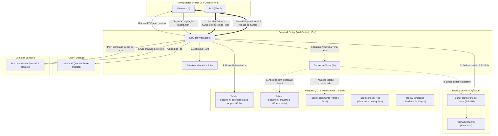

# 🧪 Lab 04: Editor Colaborativo em LaTeX estilo Overleaf (CodeMirror 6 + TeX Live + Fastify + PostgreSQL + Redis + MinIO + LanguageTool)

Este laboratório demonstra uma implementação completa de nível industrial de uma **Plataforma de Edição Colaborativa de Artigos Científicos em LaTeX** (inspirada na arquitetura real do **Overleaf / ShareLaTeX**), integrando:

- **Frontend**: **React 18** + **TypeScript** + **CodeMirror 6** (realce de sintaxe LaTeX, cursores remotos em tempo real com identificador e cor, decorações de lint com sugestões inline) + **Visualizador de PDF Real com zoom e rotação** + **Painel de Revisão com LanguageTool** + **MUI DataGrid corporativo**.
- **Micro-serviço Compilador**: Contêiner dedicado com **TeX Live oficial (`pdflatex`, `latexmk`, `bibtex`)**, executando compilações atômicas em sandbox efêmero com segurança rígida (`-no-shell-escape`, timeout de 25s, sanitização contra Path Traversal).
- **Backend API & WebSocket**: **Fastify v5** + **TypeScript** + **Zod Type-Provider** + `@fastify/websocket` + `@fastify/multipart`.
- **Armazenamento de Objetos (S3)**: **MinIO** para arquivos de projeto (imagens, classes `.cls`, bibliografias `.bib` e artefatos de build).
- **Corretor Gramatical & Ortográfico**: **LanguageTool** em contêiner dedicado para suporte multilíngue em tempo real (Português, Inglês, Espanhol).
- **Banco de Dados**: **PostgreSQL 16** (documentos, templates, arquivos de projeto, log append-only de operações e snapshots versionados).
- **Mensageria & Buffer**: **Redis 7** (buffer temporário de deltas em memória e Pub/Sub distribuído para múltiplos nós).
- **Orquestração**: **Docker Compose** com 7 micro-serviços com limites de recursos e healthchecks automáticos.

---

## 🎯 Arquitetura & Fluxo de Persistência



---

## 📦 Funcionalidades Implementadas

### 1. Dashboard de Artigos
- Tabela moderna com **MUI DataGrid** (`GenericDataGrid`) com paginação, ordenação e contagem de arquivos.
- **Barra de Busca com Debounce de 500ms** sincronizada diretamente com os parâmetros da URL (`?search=...`).
- Modal para criação de novo artigo em branco ou a partir de templates consagrados (**IEEE**, **ACM**, **SBC**).
- Upload e extração de templates customizados a partir de pacotes `.zip` com detecção automática do `main.tex`.

### 2. Workspace de Edição (IDE estilo Overleaf)
- **Divisor de Tela Redimensionável (`ResizableSplitLayout`)**: ajuste da proporção entre editor e preview via mouse drag, com proteção contra captura de eventos em iframes.
- **Árvore de Arquivos (`FileTreeSidebar`)**: navegação hierárquica, criação de novos arquivos/pastas, upload de imagens/assets e exclusão.
- **Abas de Arquivos (`EditorTabBar`)**: permite abrir múltiplos arquivos do projeto e alternar com agilidade.
- **Editor CodeMirror 6**:
  - Destaque de sintaxe LaTeX oficial.
  - Cursores e seleções remotas de outros colaboradores em tempo real.
  - Sublinhado de erros gramaticais/ortográficos do LanguageTool integrado diretamente no texto.
  - Compartimentos dinâmicos para troca instantânea de tema (Dark, Light, Monokai, Nord, Dracula) e quebra de linhas.
- **Painel de Revisão Gramatical (`ReviewSidebar`)**: lista de advertências e erros gramaticais com correção em 1 clique.
- **Histórico de Versões (`HistorySidebar`)**: checkpoints automáticos gerados pelo debounce e restauração de versões.
- **Preview de PDF (`PdfPreview`)**: visualizador integrado com zoom, ajuste de largura, rotação e console de logs do compilador TeX Live.

---

## 🚀 Como Executar

### Opção A: Usando Docker Compose (Recomendado)
Inicia todos os 7 serviços em ambiente de contêineres:
```bash
cd labs/04-collaborative-editor
docker compose up -d --build
```
- **Frontend SPA**: [http://localhost:5173](http://localhost:5173)
- **Backend Fastify**: [http://localhost:3333](http://localhost:3333)
- **Compilador TeX Live**: [http://localhost:4000](http://localhost:4000)
- **MinIO Console**: [http://localhost:9001](http://localhost:9001) (usuário: `minioadmin` / senha: `minioadmin`)
- **LanguageTool API**: [http://localhost:8010](http://localhost:8010)

Para parar os contêineres:
```bash
docker compose down
```

---

### Opção B: Executando Localmente no Terminal

#### 1. Iniciar Infraestrutura Auxiliar (Postgres, Redis, MinIO e LanguageTool)
```bash
cd labs/04-collaborative-editor
docker compose up -d postgres redis minio languagetool compiler
```

#### 2. Iniciar o Backend Fastify
```bash
cd labs/04-collaborative-editor/backend
npm install
npm run dev
```

#### 3. Iniciar o Frontend React (Vite)
```bash
cd labs/04-collaborative-editor/frontend
npm install
npm run dev
```

---

## 🧪 Testes Automatizados

Tanto o frontend quanto o backend possuem cobertura de testes automatizados:

```bash
# Executar suíte de testes do Frontend (Vitest)
npm --prefix labs/04-collaborative-editor/frontend test

# Executar testes unitários do Backend (Node Native Test Runner + TSX)
npm --prefix labs/04-collaborative-editor/backend test
```

---

## 🔬 Experimento Prático de Colaboração

1. Abra duas abas do navegador lado a lado em [http://localhost:5173](http://localhost:5173).
2. Acesse o mesmo artigo nas duas abas.
3. Altere o apelido no topo da primeira aba para **"Alice"** e da segunda para **"Bob"**.
4. Observe que a barra de colaboradores no topo indica a presença simultânea de Alice e Bob.
5. Digite na primeira aba:
   - O cursor de Alice e o texto digitado aparecem instantaneamente na aba de Bob.
   - O status do documento reflete a alteração em tempo real na memória.
   - Se pausar por 3 segundos, o backend executa o **debounce flush** e cria um novo checkpoint no histórico de versões!
6. Pressione `Ctrl + Enter` para compilar o documento LaTeX e visualizar o PDF gerado pelo TeX Live.

---

## 📚 Documentação Complementar & Deep Dives

- [Arquitetura Completa do Editor Colaborativo (Frontend, Backend, Compiler e Infra)](file:///mnt/c0b6217c-c2f3-4c1f-8ba2-c8d177f718a9/development/professional/estudo-comunicao-em-tempo-real/docs/03-casos-reais-e-padroes/04-arquitetura-overleaf-clone.md)
- [Estudo de Caso: Arquitetura do Overleaf Original (ShareLaTeX)](file:///mnt/c0b6217c-c2f3-4c1f-8ba2-c8d177f718a9/development/professional/estudo-comunicao-em-tempo-real/docs/03-casos-reais-e-padroes/03-estudo-de-caso-overleaf.md)
- [Guia Operacional Kubernetes & GitOps (k8s/README.md)](file:///mnt/c0b6217c-c2f3-4c1f-8ba2-c8d177f718a9/development/professional/estudo-comunicao-em-tempo-real/k8s/README.md)
- [01. Arquitetura Kubernetes & Kind](file:///mnt/c0b6217c-c2f3-4c1f-8ba2-c8d177f718a9/development/professional/estudo-comunicao-em-tempo-real/docs/04-kubernetes-e-gitops/01-arquitetura-k8s-e-kind.md)
- [02. GitOps com Argo CD & Pipelines Científicos](file:///mnt/c0b6217c-c2f3-4c1f-8ba2-c8d177f718a9/development/professional/estudo-comunicao-em-tempo-real/docs/04-kubernetes-e-gitops/02-argocd-gitops-e-workflows.md)
