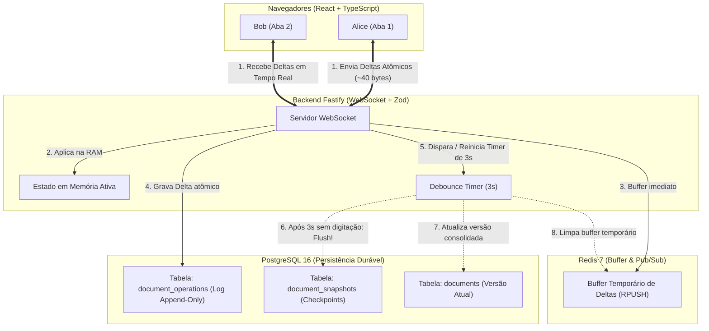

# 🧪 Lab 04: Editor Colaborativo em LaTeX estilo Overleaf (CodeMirror 6 + TeX Live + Fastify + PostgreSQL + Redis)

Este laboratório demonstra uma implementação completa de nível industrial de **Edição Colaborativa de Artigos Científicos em LaTeX** (inspirada na arquitetura real do **Overleaf**), integrando:

- **Frontend**: **React** + **TypeScript** + **CodeMirror 6** (com modo `stex`/LaTeX, numeração de linha, cursores remotos com bandeiras de nome e realce de autoria) + **Visualizador de PDF Real**
- **Micro-serviço Compilador**: Contêiner dedicado com **TeX Live oficial (`pdflatex`)**, executando compilações atômicas em sandbox efêmero com segurança (`-no-shell-escape`, timeout de 25s) e limites rígidos de CPU/RAM
- **Backend API & WebSocket**: **Fastify** + **TypeScript** + **Zod Type-Provider** + `@fastify/websocket`
- **Banco de Dados**: **PostgreSQL 16** (com tabelas de documentos, log append-only de operações e snapshots versionados)
- **Mensageria & Buffer**: **Redis 7** (buffer temporário em memória e pub/sub distribuído)
- **Orquestração**: **Docker Compose** com 5 micro-serviços com limites de recursos e healthchecks automáticos

---

## 🎯 Arquitetura & Fluxo de Persistência



---

## 🚀 Como Executar

### Opção A: Usando Docker Compose (Recomendado)
Sobe tanto o backend Fastify quanto o frontend React automaticamente:
```bash
cd labs/04-collaborative-editor
docker compose up -d --build
```
- **Frontend**: [http://localhost:5173](http://localhost:5173)
- **Backend**: [http://localhost:3333](http://localhost:3333)

Para parar os contêineres:
```bash
docker compose down
```

---

### Opção B: Executando Localmente no Terminal

#### 1. Iniciar o Backend Fastify
```bash
cd labs/04-collaborative-editor/backend
npm run dev
```

#### 2. Iniciar o Frontend React (Vite)
```bash
cd labs/04-collaborative-editor/frontend
npm run dev
```

---

## 🔬 Experimento Prático Recomendado

1. Abra duas abas lado a lado no navegador em [http://localhost:5173](http://localhost:5173).
2. Na Aba 1, altere o apelido no topo para **"Alice"**.
3. Na Aba 2, altere o apelido no topo para **"Bob"**.
4. Observe os avatares no topo indicando que ambos estão online no mesmo documento.
5. Digite um texto na Aba 1:
   - Observe a barra de status mudar para: `🟡 Em memória RAM (debounce de 3s ativo para snapshot)`.
   - Observe na barra lateral direita os **Deltas atômicos** surgindo no stream instantaneamente (`+ INSERT na pos X: "..."`).
   - A Aba 2 de Bob recebe e aplica o texto em tempo real sem recarregar a tela!
6. Pare de digitar por 3 segundos:
   - O servidor Fastify dispara o timer de debounce.
   - Um novo **Snapshot** surge na lista de banco de dados (`Versão X - Salvo por Alice`).
   - A barra de status atualiza para: `🟢 Sincronizado no banco`.

---

## ☸️ Execução em Produção no Kubernetes com Argo CD (GitOps)

Este laboratório foi totalmente portado para o **Kubernetes (Kind)** com **Argo CD** e **Argo Workflows**:
- **Guia de Operação e Comandos:** [k8s/README.md](file:///mnt/c0b6217c-c2f3-4c1f-8ba2-c8d177f718a9/development/professional/estudo-comunicao-em-tempo-real/k8s/README.md)
- **Deep Dive de Arquitetura K8s & Kind:** [01. Arquitetura Kubernetes & Kind](file:///mnt/c0b6217c-c2f3-4c1f-8ba2-c8d177f718a9/development/professional/estudo-comunicao-em-tempo-real/docs/04-kubernetes-e-gitops/01-arquitetura-k8s-e-kind.md)
- **Deep Dive de GitOps & Argo Workflows:** [02. GitOps com Argo CD & Pipelines Científicos](file:///mnt/c0b6217c-c2f3-4c1f-8ba2-c8d177f718a9/development/professional/estudo-comunicao-em-tempo-real/docs/04-kubernetes-e-gitops/02-argocd-gitops-e-workflows.md)
- **Automação de Túneis de Conexão:** [k8s-port-forward.sh](file:///mnt/c0b6217c-c2f3-4c1f-8ba2-c8d177f718a9/development/professional/estudo-comunicao-em-tempo-real/labs/04-collaborative-editor/k8s-port-forward.sh)

